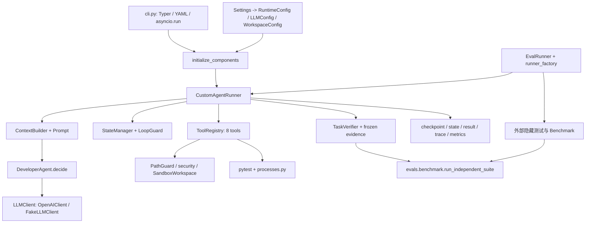

# DevPilot 当前架构与运行机制审计

审计日期：2026-10-23（Asia/Shanghai）。基线提交：`2341ca172109f544cb35bb5adf9abdc39df46cbc`。审计对象是当前工作区有效 Python 源码；开始时只有既有未跟踪审计文档，未发现已跟踪代码修改。本轮未采用旧报告推断功能状态，未读取实际 `.env` 内容，未调用收费模型。所有后续模块路径以仓库根目录为起点。

## 结论与证据口径

这是具备确定性工具、测试保护、独立验收、预算和保守恢复能力的单 Agent 系统，不是只有提示词和 while 循环的原型。主要问题是编排器集中承担太多职责、状态语义不完全一致，以及业务证据和运行器的接口还没有收敛。引入框架必须保留现有约束，不能以“获得 checkpoint”为由删除已存在的恢复安全检查。

本文的“已实现”表示检查了有效调用路径；“测试覆盖”表示存在相应测试；本轮实际测试结果单列于 `06-validation.md`，不将 FakeLLM 成功解释为真实编程能力或模型成功率。

## 当前依赖图

`devpilot/pyproject.toml` 要求 Python >=3.12，使用 Pydantic 2、OpenAI SDK、asyncio、Typer、pytest；没有安装在项目依赖声明中的 Agent 框架。CLI 仍直接组装具体 CustomAgentRunner。配置优先级为显式值、环境、dotenv、默认值；工作目录决定相对路径解析。

## 完整生命周期

|阶段|实际入口、输入输出与状态|失败及终止路径|
|---|---|---|
|任务输入|`devpilot/devpilot/cli.py:load_issue` 将 YAML 必填字段映射为 DevelopmentTask，并记录 issue_file；`run` 调用 `asyncio.run(runner.run(task))`|缺文件、无效 YAML 在运行器外失败；CLI 非 completed 返回退出码 1|
|初始化|`initialize_components` 注册 list/search/read、patch/create、test.run、git.diff/status 八工具；配置同一个 test_python；创建 verifier、trace、metrics|Fake 模式使用 bundled calculator fixture，不是 ShopFlow 能力评测|
|工作区|`runtime/custom/runner.py:run/_run` 生成 run ID 并取得 RunLock；`workspace/sandbox.py:create` 复制允许文件，创建新 Git 基线；`verification/evidence.py:capture_snapshot` 冻结原代码、原测试和配置|链接路径拒绝、容量不足、复制或 Git 失败；准备耗时单记 preparation_ms，运行 deadline 在准备之后启动|
|理解与探索|初始 phase=understanding；ContextBuilder 合并系统提示、工具 schema、任务、计划、观察、阶段提示；DeveloperAgent 返回 AgentDecision|一轮至多三次模型尝试；每次先计数并写 llm_inflight；单请求超时受总剩余时间约束；SDK max_retries=0|
|决策|`domain/decision.py:exactly_one_branch` 强制 action、finish、plan_update 三选一；runner 将别名归一为标准工具名|空决策、多分支、解析错误纳入请求失败与重试，不是免费重试|
|规划|plan_update 替换完整 ImplementationPlan；纯计划也生成 observation 并累计步数|规划不强制先于代码修改；阶段是启发式标签，不是严格流程门禁|
|修改|ToolRegistry 验参及 dispatch；工具返回 ToolResult；StateManager 记录观察和 modified_files；读缓存按 patch/create 结果失效|未知工具、非法参数、权限及普通执行异常转换为失败结果；取消异常不能等同一般失败|
|测试|`tools/test/run_tests.py:RunTests.execute` 仅启动 pytest，限制 target/extra_args；写独立日志和 JUnit XML；用 parse_junit 判定|超时、输出超限或缺失报告是失败/错误；`failure_parser.py` 从日志形成结构化失败反馈|
|修复|test.run 失败累加 retry_count，repair_required=True；成功清标志；LoopGuard 检查测试失败、补丁失败、重复调用和无动作计划循环|测试失败和 finish 被拒绝共用 retry_count；到达配置阈值终止；预算用尽也终止|
|独立验收|finish 只请求完成；TaskVerifier 重建候选副本，比对冻结测试/配置、实际增删改、非空 diff、文件数；独立执行原测试与新增测试|验收失败形成 verification_failed observation 并尝试转 implementing；成功才进入 completed；构造器允许 verifier=None 的兼容分支直接完成|
|结束|保存 checkpoint、state、result、llm-requests，另有 trace.jsonl、测试日志、final.diff；写失败尝试临时恢复文件|GuardrailViolation、异常、步数耗尽均终止；trace 写入失败通常只记录日志；artifact_errors 表示产物不完整|

## 决策与状态的真实语义

`OpenAIClient.chat` 使用 `json_object` 和提示中的 schema，工具描述也在提示中；没有把工具作为 SDK 原生 function-calling 参数执行。输出经 Pydantic 验证后，唯一执行入口是 ToolRegistry。不能把其现状描述为框架原生工具调用。

`_maybe_advance_phase` 根据工具前缀和累计步数推断阶段：understanding 使用 repo 工具后到 exploring；exploring 有计划或 >=10 步到 planning，使用 code 工具可到 implementing；planning 用 code 工具或 >=15 步到 implementing；implementing 调用 test.run 到 verifying。失败测试未必退出 verifying。理解阶段直接修改代码也未被阶段机禁止。

`StateManager.add_observation` 每条观察累计一步，因此工具、计划、运行时反馈、验收失败都可能消耗步数；finish 成功本身不一定增加一步。它不是模型请求数，也不是未来 LangGraph superstep 数，迁移时必须分别计数。

ContextBuilder 保留最新计划、最近观察和旧观察摘要，当前测试失败会在后来一次成功测试后失效；这项旧上下文问题已修复。压缩只减少完整观察数量，并不保证输出小于 max_context_chars。验收反馈存在另一处未修复的名称/字段契约不一致，见问题报告。

## 工具、工作区与可信证据

`security.py:permitted_files/forbidden` 在读取前排除敏感文件和目录，拒绝 symlink/junction；`PathGuard.validate_path` 验证解析后的工作区包含关系。`SearchCode.execute` 的 rg 和 Python fallback 都先使用允许文件清单，因此不能再声称搜索直接泄露 `.env`。其 rg 路径逐文件启动进程并完整 communicate，仍有资源和取消问题。

`ApplyPatch.execute` 先提取路径，再用 Git numstat 获取权威目标，做 validate_write 和 git apply --check；异常回写原内容。支持宽松补丁重试，但不等于进程崩溃下的事务。CreateFile 同样使用路径及冻结测试保护。Git 工作区是独立副本，普通 Agent 工具没有提交到原项目的行为。

`capture_snapshot/check_integrity/materialize_candidate` 覆盖原测试、conftest 和配置；从真实文件清单推导新增、删除、修改，不能只靠 Agent 声称的 modified_files。`TaskVerifier.verify` 在候选副本上调用独立测试 harness，禁止跳过测试作为通过；只对少量“新增测试”关键词给出显式要求。任意自然语言 acceptance_criteria 并没有自动转为独立行为断言。

`processes.py` 提供流式限量输出、清理进程树、取消等待；Windows 使用 Job Object，在候选代码启动前分配进程作业。其作用是进程治理，不是文件系统、网络或 CPU/内存的安全隔离。`Settings.network_access=False` 没有被用于实施网络封锁。

## 恢复、评估与观测

`runtime/custom/recovery.py:Checkpoint` 已有 schema_version、stage、state、请求次数、当轮尝试、原 deadline、guard/metrics、workspace/trusted hashes 和 runtime identity。`CustomAgentRunner.resume` 只接受普通运行的 ready/llm_inflight，拒绝 terminal、tool_inflight、verifier_inflight 和 evaluation；校验配置、源码/模型指纹与文件变化。停机时间消耗原预算；不确定的模型请求记为 usage unknown。没有通用人工审批、跨版本 checkpoint 迁移或任意副作用恢复能力。

`EvalRunner` 已通过 runner_factory 和 AgentRunner Protocol 移除顶层具体运行器导入；但仍改写 runner.sandbox/purpose，读取 verifier.last_results/deadline/metrics 和磁盘 state.json，故是“导入解耦，行为接口尚未完整解耦”。`test_framework_independence.py` 中旧说明提到 xfail，但当前测试代码是正常断言，不应相信过时注释。

Benchmark 有 DEV-001 至 DEV-008 的版本化输入、缺陷及参考补丁、隐藏测试和资源哈希。prepare_task 不把参考补丁/隐藏测试放进 Agent 工作区。Fake smoke 测试真实执行修改、失败、修复和新增测试，但 EvalResult 把它排除出 capability task_success；缺失隐藏测试为 NOT_EVALUATED，不算通过。隐藏测试在普通循环结束后执行，不回馈给 Agent；当前读取最终工作区，尚未绑定为验收时同一不可变候选 hash。

MetricsCollector 逐模型尝试记录 tokens、latency、错误状态；未知 usage 使总 tokens 为 None，另保留 known_tokens。没有金额预算或按价格计算的真实费用；EvalResult.token_cost 字段不能当已实现的金额统计。Trace 是事件摘要，不是足够重放外部动作的事务日志。

## 实现状态清单

|能力|判定|代码/测试证据|
|---|---|---|
|CLI/八工具/模型决策/自修复|已接入|cli.py；tests/test_cli_e2e.py、runtime/test_repair_loop.py|
|请求预算、timeout、别名标准化|已接入|runner.py；runtime/test_request_budget.py|
|冻结测试、独立候选验收|已接入，有业务覆盖边界|verification/*；tests/verification/*|
|敏感文件过滤、补丁回滚|已接入，非 OS sandbox|security.py；test_file_security.py、tools/test_patch_atomicity.py|
|持久化、普通运行安全点恢复|已接入，恢复范围受限|recovery.py；runtime/test_recovery.py、test_persistence.py|
|评估/隐藏测试/Fake 分离|已接入，仍有接口耦合|evals/*；test_eval_truthfulness.py、test_hidden_test_isolation.py|
|通用 HITL、多 Agent、调度|未接入|无相应生命周期/调度接口；不能从 asyncio 推断并行 Agent 支持|
|网络禁用、硬 token/金额限额|没有执行闭环|network_access 仅配置字段；RuntimeConfig 无累计 token 上限|

ShopFlow 是任务样例与基准输入，本方案不重写其业务。源码符号行号索引与运行证据见 `06-validation.md`。
