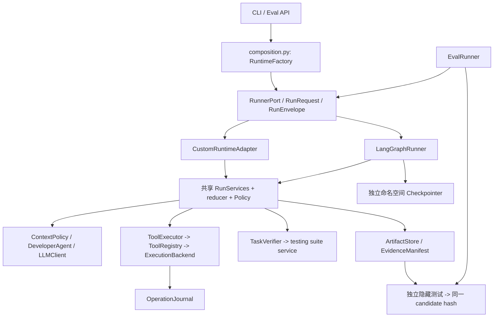
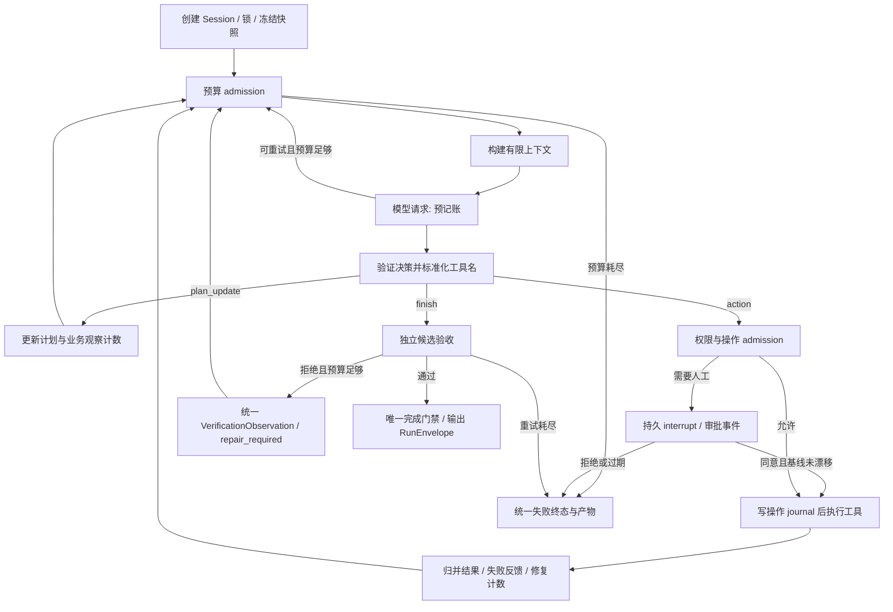

# DevPilot 目标架构设计（评审稿，未实施）

目标采用部分 LangGraph 编排，保留领域与执行能力。当前架构图见 01；本文所有新增路径、接口与字段均为设计，不代表已接入。

## 目标依赖与流程





业务 phase 与图节点分离：phase 描述理解、探索、规划、实现、验收；node 描述实际调度位置，status 描述 running/waiting/needs_reconciliation/completed/failed。初期生产仍只有单 Agent 和单写者；多 Agent 只能在未来用独立工作区提交 patch，经中心确定性策略合并。

## 模块迁移表

下表路径共同前缀为 `devpilot/devpilot/`。原样保留表示框架接入不要求改变内部实现；独立工程修复仍按问题编号实施。

|现有模块|处理|目标职责/具体去向|
|---|---|---|
|domain/task.py、plan.py、decision.py|原样保留|输入与三分支决策公共 DTO，框架不得注入类型|
|llm/base.py、fake.py、openai.py、agents/developer.py|接口适配|仍使用现有提示、JSON 输出和 SDK；由 DecisionService 包装每次调用记账，避免 graph retry 叠加|
|tools/registry.py、base.py、context.py|保留协议、适配执行入口|ToolExecutor 统一 operation_id、预算、标准别名；registry 仍是唯一工具入口|
|tools/repo/*、code/*、git/*、test/*|优先复用；独立内部修复|F02 用统一进程服务；不把代码工具换为泛化 shell；测试保护保持|
|workspace/sandbox.py、security.py、tools/path_guard.py|接口适配 + 工程修复|WorkspaceService 提供路径与 manifest；ExecutionBackend 承接隔离；工具策略不由 graph 重写|
|verification/evidence.py|保留核心、适配证据存储|内容寻址 CandidateRef、冻结 manifest、真实变更枚举|
|verification/verifier.py|内部重构|改返回不可变 VerificationReport，不修改输入 state，不依赖 registry 找解释器；强制生产 gate|
|evals/benchmark.py|拆分|parse_junit、SuiteResult、run_independent_suite 移至新增 testing/suites.py；数据集/参考补丁/hidden selector 留 evals|
|evals/runner.py|接口适配|只消费 RunnerPort、RunEnvelope、ArtifactStore；不窥探 runner 属性|
|runtime/custom/state_manager.py|内部重构|领域 reducer 共享；移除与框架重复的调度状态，保留业务不变量|
|runtime/custom/loop_guard.py|保留规则，拆出序列化状态|新增 runtime/policies.py 与 BudgetState/GuardState；不交给模型决定|
|runtime/custom/context.py|内部重构|新增 context/policy.py，限制 tokens、规范 observation，不用图消息历史直接替换|
|runtime/custom/runner.py|渐进瘦身|Custom 适配器只调共享服务；新增 runtime/langgraph/runner.py、graph.py、nodes.py|
|runtime/custom/recovery.py|旧运行保留；新版本新命名空间|框架接管调度 checkpoint；RecoveryPolicy 仍检查 identity、hash、预算、操作 journal|
|tracing/*、storage.py|保留并适配|新增版本化 EventSink/ArtifactStore；统一 quota 与失败诊断预留|
|cli.py、settings.py、runtime/base.py|接口重构|新增 composition.py 工厂，CLI 增 runtime selector；协议不暴露 framework 类型|
|ShopFlow 与 benchmark baseline|不纳入业务重写|保持输入及断言，只有经证实的适配需求另行评审|

最终可删除/合并：旧 runner 中已替代的循环调度和重复终态保存分支；旧 verifier 的未被 verify 调用的 `_check_visible_tests/_check_diff_non_empty`（先核查测试调用后删除）；失效双别名分支和常量。旧 recovery 格式在保留期内仍可读，不在迁移第一阶段删除。不得一次性复制整份 runner 到 graph 节点形成双份业务实现。

## 接口与状态草案

```python
class RunnerPort(Protocol):
    async def run(self, request: RunRequest) -> RunEnvelope: ...
    async def resume(self, request: ResumeRequest) -> RunEnvelope: ...

# 以下为字段设计，实施时用 Pydantic 定义及校验。
RunRequest = {task, runtime_kind, purpose, workspace_spec, budget_policy}
RunEnvelope = {schema_version, result, metrics, evidence_ref, artifacts, status}
EvidenceRef = {baseline_hash, candidate_hash, manifest_uri, verification_uri}
WorkflowState = {
    schema_version, graph_version, run_id, purpose,
    domain_state, node, status, last_decision, last_error,
    budget_state, guard_state, pending_operation_id,
    baseline_hash, candidate_hash, evidence_ref, event_sequence,
}
BudgetState = {
    llm_requests, attempts_in_turn, observation_steps,
    test_failures, verifier_rejections, known_tokens, unknown_usage_requests,
    deadline_at, remaining_seconds, preparation_ms,
}
OperationRecord = {
    operation_id, tool, arguments_hash, before_hash, after_hash,
    status, result_ref, attempt, run_id,
}
```

所有 graph state 必须可序列化，不保存客户端、锁、subprocess、完整 secret 或模型对象；运行时依赖通过 RunServices 注入。初期只用单节点写 state，避免多个 reducer 重复追加 observation。Observation 加稳定 event_id；同一已完成事件再投递应去重。旧 total_steps 保持历史语义，新增 model_requests/node_steps，不能直接把 recursion_limit 当 max_steps。

RunEnvelope 的 result 继续兼容 AgentRunResult，新增字段使用 schema_version 管理；EvalResult v2 的 smoke/capability 和 PASS/FAIL/NOT_EVALUATED/ERROR 语义不改变。输入 YAML、八工具 schema、final.diff、state/result/trace 输出保留适配投影。未知 tokens 保持 null，不能转换为零。

## Checkpoint 与外部副作用一致性

采用 `thread_id=run_id`，新图 checkpoint 与 legacy JSON 不互相覆盖。单机首选经兼容性测试的持久 SQLite 后端；多进程部署再评估 PostgreSQL。内存 saver 仅测试使用。schema/graph/runtime 指纹必须记录；不兼容升级拒绝恢复，不隐式迁移。

每次外部操作先写 prepared/inflight journal，再执行，记录 result 和 after_hash，最后提交图状态。checkpoint 与文件修改不存在跨系统原子事务，必须承认中间窗口：

|恢复发现|策略|
|---|---|
|只读操作未完成|重核输入快照后可重执行，但仍纳入时间/输出预算|
|patch/create 已写入且 after_hash 等于记录|使用持久结果完成状态归并，不再次写文件|
|patch/create 在 inflight 且无法证明结果|进入 needs_reconciliation，保持当前文件；人工检查或从原基线新 run，不猜测成功|
|测试执行中中断|确保原进程树回收；在固定 candidate hash 上允许有预算的重跑，新 test_attempt ID；测试不能假设无副作用|
|LLM 中断|记录请求已消费，usage unknown；满足原预算才可新请求|
|人工审批恢复|验证批准的是同一操作 hash、候选版本和权限；漂移重新请求审批，不能复用旧批准|

早期图版本至少保留现有“不重放不确定工具”的保守语义。只有操作日志故障注入证明安全后才扩大恢复范围。人工等待是否暂停执行时间单独配置，默认沿用当前原 deadline；另有审批最长等待时间，不可无限延长成本预算。

## 异常、资源和完成规则

错误分类为 ModelTransportError（允许有限重试）、DecisionValidationError（受模型请求预算约束）、ToolFailure（回馈观察）、PolicyViolation（停止）、EvidenceFailure（拒绝完成）、StorageFailure（停止派发并保存有限诊断）、Cancelled（清理后中断）、BudgetExceeded（终态）。节点重试默认关闭，由共享 DecisionService 唯一控制模型 retry。

所有写文件/测试都先做 admission；工具取消必须等子进程退出再回滚。完成只有 verifier report 成功且 candidate hash 一致才可提交。隐藏测试只在评估侧使用同一个不可变 candidate，不加入模型上下文。运行日志作为观察副本，journal/checkpoint/manifest 才承担恢复证据；不能将 Trace 当事务提交日志。
