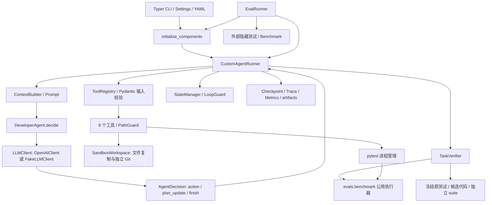
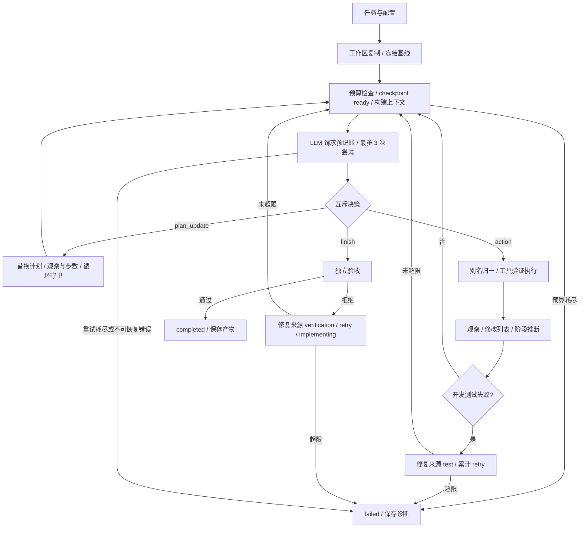

# DevPilot 当前真实架构与运行机制审计

审计日期：2026-10-24（Asia/Shanghai）。代码基线：`41b027b4860354f69205ed7895de044b7f2bd39e`，以本次工作区有效 Python 源码为准。未用 README、旧设计或历史审计推断功能完成情况。未修改业务代码，未调用收费模型。测试结果及证据边界见 [验证记录](G:/program/CodingDev/docs/architecture-review-2026-10-24/06-validation.md)。

## 1. 结论与代码边界

DevPilot 已有可运行的单 Agent 开发闭环；并非只有接口或演示骨架。它具备真实文件修改、pytest 反馈、修复、冻结测试独立验收、结构化运行产物和普通任务保守恢复。其主要短板是编排集中、状态语义含混、部分资源配置未接入、执行环境仍为可信本机，以及评估边界没有完全封装。

`devpilot/` 是 Agent 产品；`shopflow-order-service/` 是业务样例；`devpilot/devpilot/evals/benchmark/baseline/` 是固定评估基线。后两者不属于本轮重构主体。ShopFlow 架构规则硬编码在通用 Prompt 中，是需要移出 Agent 核心的配置耦合，不代表需要重写 ShopFlow。

项目要求 Python ≥3.12；直接依赖 OpenAI SDK、Pydantic v2、pydantic-settings、Typer、Rich、PyYAML、pytest、pytest-asyncio、Ruff。当前没有引入四个候选 Agent 框架。`uv.lock` 提供锁定依赖，不能只看 `pyproject.toml` 的宽版本声明判断实际环境。

## 2. 当前架构图

这是单个进程内的异步编排，工具内部混用异步子进程、线程和同步文件系统操作。`async def` 并不意味着整个生命周期可取消，也不代表 OS 安全隔离。

## 3. 证据索引与模块职责

下表链接指向本次基线中的具体入口。后续文档用 E 编号引用同一组证据，避免把设计建议误写为现状。

| 编号 | 源码与入口 | 真实职责与关键依赖 |
|---|---|---|
| E01 | [cli.py:52](G:/program/CodingDev/devpilot/devpilot/cli.py:52)、`:143`、`:314`、`:354` | YAML → DevelopmentTask；组件装配；`asyncio.run(runner.run(task))`；resume；inspect/diff/eval/benchmark-check/workspace-report |
| E02 | [settings.py:16](G:/program/CodingDev/devpilot/devpilot/settings.py:16)、[runtime/base.py:13](G:/program/CodingDev/devpilot/devpilot/runtime/base.py:13) | Settings 显式参数 > 环境 > dotenv > 默认值；投影为 RuntimeConfig、LLMConfig、WorkspaceConfig；AgentRunner 协议仍暴露内部组件 |
| E03 | [runner.py:145](G:/program/CodingDev/devpilot/devpilot/runtime/custom/runner.py:145)、`:200` | 分配 run_id、锁、准备工作区、主循环、请求重试、工具、验收、终止及产物；文件共 921 行，`_run` 承担多数行为 |
| E04 | [developer.py:22](G:/program/CodingDev/devpilot/devpilot/agents/developer.py:22)、[decision.py:26](G:/program/CodingDev/devpilot/devpilot/domain/decision.py:26) | 一次 decide 对应一次 chat；记录请求；三分支严格互斥。DeveloperAgent 自身不执行工具、不决定最终成功 |
| E05 | [context.py:69](G:/program/CodingDev/devpilot/devpilot/runtime/custom/context.py:69)、[prompts.py:91](G:/program/CodingDev/devpilot/devpilot/llm/prompts.py:91) | 系统规则、工具 Schema、任务、状态、阶段提示；确定性截断压缩；保留任务/最新计划与修复证据 |
| E06 | [openai.py:41](G:/program/CodingDev/devpilot/devpilot/llm/openai.py:41)、[fake.py:10](G:/program/CodingDev/devpilot/devpilot/llm/fake.py:10) | OpenAI-compatible JSON 输出；SDK 重试关闭；响应解析；FakeLLM 按序返回预设决策 |
| E07 | [registry.py:22](G:/program/CodingDev/devpilot/devpilot/tools/registry.py:22)、[context.py:10](G:/program/CodingDev/devpilot/devpilot/tools/context.py:10) | 名称/别名冲突检查、参数验证、统一 ToolResult；ToolContext 提供 workspace、trusted、deadline 等 |
| E08 | [security.py:22](G:/program/CodingDev/devpilot/devpilot/security.py:22)、[path_guard.py:29](G:/program/CodingDev/devpilot/devpilot/tools/path_guard.py:29)、[search_code.py:55](G:/program/CodingDev/devpilot/devpilot/tools/repo/search_code.py:55) | 敏感路径过滤、拒绝链接/越界、先枚举允许文件再搜索；子进程环境白名单 |
| E09 | [sandbox.py:40](G:/program/CodingDev/devpilot/devpilot/workspace/sandbox.py:40)、[apply_patch.py:43](G:/program/CodingDev/devpilot/devpilot/tools/code/apply_patch.py:43)、[create_file.py:42](G:/program/CodingDev/devpilot/devpilot/tools/code/create_file.py:42) | 复制基线、初始化 Git、容量检查；补丁校验及回滚；排他创建新文件；冻结测试写保护 |
| E10 | [run_tests.py:76](G:/program/CodingDev/devpilot/devpilot/tools/test/run_tests.py:76)、[processes.py:97](G:/program/CodingDev/devpilot/devpilot/processes.py:97) | pytest 参数白名单、JUnit、日志上限、超时、取消清理；Windows Job / POSIX 进程组 |
| E11 | [state_manager.py:12](G:/program/CodingDev/devpilot/devpilot/runtime/custom/state_manager.py:12)、[loop_guard.py:46](G:/program/CodingDev/devpilot/devpilot/runtime/custom/loop_guard.py:46) | 阶段合法性、观察/步数/修复来源、共享重试计数、重复工具及无动作循环限制 |
| E12 | [verifier.py:56](G:/program/CodingDev/devpilot/devpilot/verification/verifier.py:56)、[evidence.py:62](G:/program/CodingDev/devpilot/devpilot/verification/evidence.py:62) | 运行前冻结原测试/配置，按文件系统差异构造候选，外部 harness 验证，覆盖状态如实标记 |
| E13 | [evals/runner.py:96](G:/program/CodingDev/devpilot/devpilot/evals/runner.py:96)、[benchmark.py:209](G:/program/CodingDev/devpilot/devpilot/evals/benchmark.py:209) | capability 与 smoke 区分、隐藏测试、版本化数据集、参考补丁正负例自检、JUnit 判据 |
| E14 | [recovery.py:21](G:/program/CodingDev/devpilot/devpilot/runtime/custom/recovery.py:21)、[runner.py:160](G:/program/CodingDev/devpilot/devpilot/runtime/custom/runner.py:160)、`:894` | schema v1 检查点、运行身份/文件哈希、预算恢复、拒绝不确定工具重放 |
| E15 | [storage.py:34](G:/program/CodingDev/devpilot/devpilot/storage.py:34)、[writer.py:19](G:/program/CodingDev/devpilot/devpilot/tracing/writer.py:19)、[metrics.py:26](G:/program/CodingDev/devpilot/devpilot/tracing/metrics.py:26) | 运行锁、单文件 fsync/replace、JSONL trace、请求和未知 Token 统计、失败降级产物 |

## 4. 完整生命周期：逻辑阶段不等于必经节点

| 阶段 | 输入、调用和输出 | 状态/异常/终止 |
|---|---|---|
| 任务输入 | `load_issue` 验证 id/title/description/acceptance_criteria，将来源放进 metadata | YAML 不是 mapping、缺字段或 Pydantic 验证失败会阻止运行；它不是完整需求语义解析 |
| 装配 | `initialize_components` 选 Fake/OpenAI，注册八工具，组装工作区、Agent、状态管理、验收与追踪 | 构造器要求 verifier；入口集中在 CLI，库与评估复用 CLI 装配 |
| 创建运行 | `run` 分配 `run_<8 hex>`、检查冲突、创建产物目录、取得 RunLock | 锁/目录失败在 `_run` 主异常包装之外；不能保证所有初始化错误都有 AgentRunResult |
| 准备 | `runtime_identity` → `sandbox.create` → `capture_snapshot` → bind verifier | 同步复制、Git、全文件哈希；之后才设置 max_run_seconds deadline；`preparation_ms` 只记录时间 |
| 需求理解 | State 初值 understanding；ContextBuilder 发送任务和规则 | 没有独立需求分析器或必须产生结构化需求的门槛 |
| 探索 | 模型 action → canonical_name → ToolRegistry → repo 工具 → Observation | repo 行为推动 understanding→exploring；工具失败通常作为反馈继续，而非立即终止 |
| 制定计划 | `plan_update` 替换整个 ImplementationPlan，生成观察 | 没有 revision 单调检查/步骤完成证据；不是所有任务都必须先规划；步数阈值也会推动阶段 |
| 修改 | code.apply_patch / code.create_file；成功后失效读缓存 | 原测试/配置不可改；执行后再检查变更文件上限。动作权限并未按 phase 限制 |
| 开发测试 | test.run → 指定 Python 的 pytest → JUnit/日志 → failure_parser | 错误/超时不是 PASS；累计 retry_count；失败标记 test 修复来源，达到阈值失败 |
| 失败修复 | 失败信息进入上下文；模型重新选择检查、补丁、测试 | 修复循环是真实闭环；没有专门 RepairAgent。通过开发测试仅清除 test 来源，不抹掉 verification 失败 |
| 完成请求 | finish 设置 completion_requested → TaskVerifier.verify | finish 本身不增加普通观察步数，不直接 completed；验收拒绝增加 retry/Observation，设 implementing 并继续 |
| 独立验收 | 文件完整性 + 非空 diff + 实际修改范围 + 冻结原测试 + 新增测试；关键词要求新增测试时检查存在性 | 任一 check 失败拒绝。一般自然语言条件可为 uncovered，仍可能 completed，不能将 completed 解读为全部需求已证明 |
| 终止与保存 | completed、max_steps、请求/时间预算、循环守卫、修复预算或异常 → build_result/save_artifacts | 保存终态 checkpoint/state/result/请求明细；失败写盘可生成临时 recovery 文件；Trace 部分错误只日志记录 |

## 5. 决策、上下文与状态的具体语义

`AgentDecision` 的 action、finish、plan_update 恰好一个非空。Runner 中若干“action 同时携带 plan_update”的注释/组合分支并不代表允许该协议；正常输入已被 Pydantic 拒绝。`DeveloperAgent` 把注册表转为 OpenAI 形状 Schema，但 `OpenAIClient` 实际把工具描述放入 Prompt，使用 `json_object` 返回文字 JSON，再调用 `_parse_decision`。这不是供应商原生 function calling，也不是严格 JSON Schema 输出保证。

每轮重建消息，不直接回放完整 chat history。上下文包含全部任务、最新计划、近期观察、旧观察摘要和修复证据；预算以字符数计，包含 `_SCHEMA_HINT` 预留，必要内容仍过大则在请求前失败。它不是 Token tokenizer，也不是语义摘要模型。`ReadFile` 最多返回 500 行，但 ContextBuilder 通常仅呈现 2000 字符；Prompt 又要求不重读文件，可能妨碍局部精读。这是上下文策略问题。

`phase` 同时承担 UI 标签、Prompt 策略与部分控制条件。`_maybe_advance_phase` 用工具前缀和 10/15 步阈值推进，而非显式工作流完成事实。直接 code→test 可仍停在 understanding（离线探针已确认）。`reject_verification` 直接设置 implementing，绕过 `_ALLOWED_TRANSITIONS`。这说明阶段表并非完整状态机的唯一权威。

`total_steps` 是 `add_observation` 的次数，包含工具、计划和部分运行反馈；不是模型调用次数。一次计划更新加 guardrail_feedback 可计两步。开发测试失败与独立验收拒绝共用 retry_count；达到 `>= max_test_retries` 即失败。默认 3 表示第三次累计失败终止，不是“首次失败后另有三次修复”。

## 6. 工具、工作区和测试保护

八工具为 repo.list_files/search_code/read_file、code.apply_patch/create_file、test.run、git.diff/status。注册表在注册阶段拒绝点号/下划线别名冲突；Runner 在守卫和记账前归一化名称。未知工具、参数错误、一般工具异常均变成失败 ToolResult；取消不是可假定吞掉的一般异常。

搜索在读取内容前使用 `permitted_files`，同时覆盖 rg 与 Python fallback，历史“目录搜索绕过敏感文件过滤”不再是同样的现状。PathGuard 拒绝越界、敏感文件与链接；缓存前置读取问题另见问题报告。

SandboxWorkspace 是过滤后复制加新 Git 仓库，不是容器或权限沙箱。原仓库不被工具直接修改；运行中的 Python 测试仍享有宿主用户权限。`network_access=False` 没有实现网络隔离，AgentRunResult 正确报告 `trusted_local` 和 `network_isolation=False`。

补丁先由 Git 解析真实目标，再逐一权限/冻结保护校验和保存旧内容，`--check` 通过才应用；捕获 BaseException 时恢复目标内容。该措施值得复用，但 Git 子进程取消清理没有统一接入 `run_process_async`，不能宣称已实现持久事务或崩溃原子性。CreateFile 使用 `open('x')`，成功后 git add；写成功但 add 失败仍可能留下文件。

测试进程已有流式输出限额、超时/取消清理、Windows Job 和 POSIX 进程组。`test.run` 仅允许有限 pytest 参数，但测试代码本身可运行任意 Python。独立 harness 在候选目录外运行，明确 pytest 配置、禁止自动插件加载、设置候选代码路径；这保护测试收集和普通污染，不防御同用户恶意代码。

## 7. 独立验收与评估的真实完成程度

TaskVerifier 使用运行前冻结清单检查原测试/配置是否变动，从文件系统计算新建/删除/修改，重新生成候选树，分别执行原测试和新增测试。与 Agent 自述及开发测试通过分离，不能用简单框架输出校验替代。

`coverage_for` 只把“add tests/新增测试/新增回归测试”映射到新增测试要求；其它条件如金额、接口返回、性能等标记 uncovered。隐藏测试仅在评估端进一步验证，并不等于普通任务都拥有隐藏验收。

EvalRunner 有 runner_factory 和 AgentRunner 协议，导入独立性测试确实禁止直接加载 custom runtime。但执行时仍替换 `runner.sandbox`、设置 `purpose`、读取 `verifier.last_results`、`deadline`、`metrics`，还从 CLI 获取默认工厂与 issue loader。结论是“有替换缝隙，尚非完全黑盒评估”。

八个 Benchmark 任务有固定 baseline 哈希、start/reference patch 和隐藏测试。`validate_benchmark` 验证缺陷版本触发断言失败、参考修复通过隐藏及可见测试；performance 是单独可选门槛。Fake smoke 使用小型 calculator，`task_success=None`，不计能力成功率。本次没有使用真实模型，所以没有“当前模型完成八任务的成功率”证据。

## 8. 持久化、恢复和可观测性

检查点在 ready、llm_inflight、tool_inflight、verifier_inflight、terminal 阶段保存。内容包括完整业务状态、请求次数、当轮尝试数、绝对 deadline/剩余时间、守卫、metrics、工作区与 trusted 文件哈希、runtime identity。恢复保持原预算，停机时间也消耗 deadline；中断模型请求按未知 usage 保守补记。

只允许普通任务的 ready/llm_inflight 恢复，必须保持源码/运行配置/provider/工作区/trusted 兼容；终态、评估任务、工具或验收执行中检查点均拒绝。恢复不是完全缺失，而是刻意保守；缺少持久人工暂停、审批结果、工具副作用对账与迁移兼容机制。

产物包括 workspace-metadata.json、trusted、checkpoint.json、state.json、trace.jsonl、llm-requests.json、result.json、final.diff、测试日志/XML、verification-* 和 eval_result.json。`AgentRunResult.final_diff` 字段本身未由 `_build_result` 填充，主要证据在产物文件。Trace 是事件摘要，不是逐字完整模型/工具录像，也不是唯一恢复依据。

Token 记录覆盖成功、解析错误以及部分 API 失败；未知 usage 保持 None，已知部分单独累加。没有全运行 Token/货币硬预算，只有请求次数、单响应输出上限等近似控制。`token_cost`/`regression_rate` 在 EvalResult 有字段但主执行路径未计算；`avg_test_retries` 实际可含验收拒绝，与 MetricsCollector.test_retries 口径不同。

## 9. 能力分级

| 完成度 | 功能 | 证据边界 |
|---|---|---|
| 已实现并有离线覆盖 | CLI Fake 完整修改修复验收闭环；预算；别名；冻结证据；普通恢复；进程清理；评估真假状态 | 具体结果见验证记录；测试通过不是任意任务正确性的证明 |
| 部分实现 | 生命周期状态机、恢复、评估解耦、资源治理、需求覆盖、上下文控制 | 有真实路径，也存在上文列出的限制 |
| 定义但未接入 | tool_timeout_seconds、max_tool_output_bytes、preparation_timeout_seconds、evaluation_timeout_seconds、diagnostic_reserve_bytes | 全包搜索仅见配置声明/验证，没有执行端消费 |
| 尚未实现 | 持久人工介入、分布式调度、同仓库安全并发写、多 Agent 编排、OS/网络强隔离、全部自然语言条件自动证明 | 不应因框架有同名功能就宣称迁移后自然具备 |

