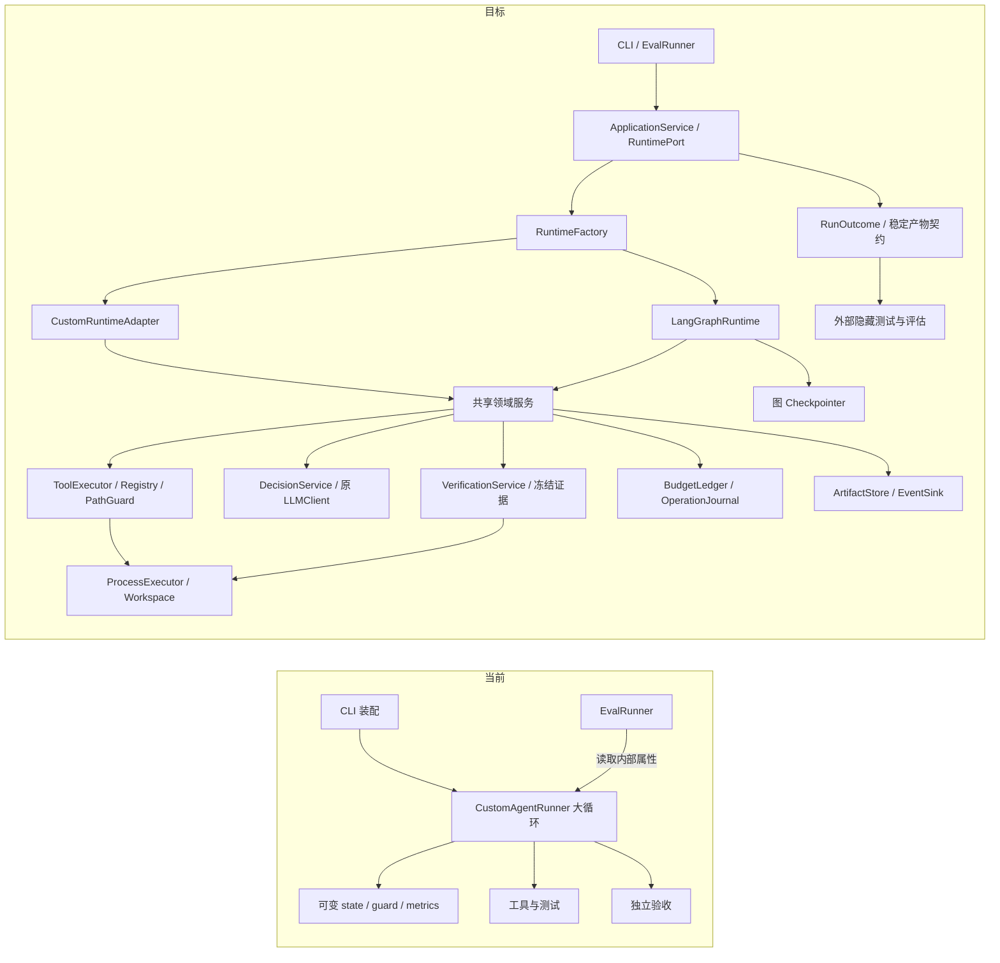
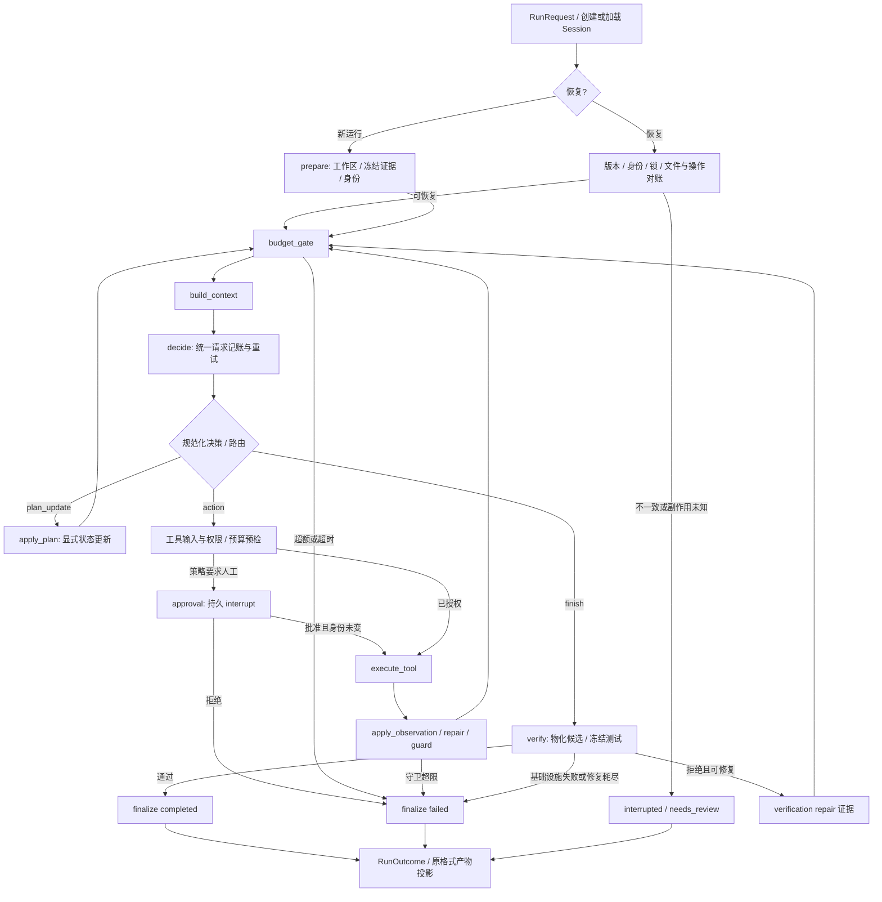

# DevPilot 目标架构设计（待评审，未实施）

推荐路线：LangGraph 局部编排；依据见 [选型报告](G:/program/CodingDev/docs/architecture-review-2026-10-24/03-framework-selection.md)。下述模块、接口及状态均为目标设计，不代表工作区已有实现。先保留单 Agent、单工作区单写者，不引入角色团队或分布式部署。

## 1. 设计原则与边界

框架负责“下一步执行哪个节点、图进度如何保存、在哪里暂停”；DevPilot 决定“什么允许执行、预算是否足够、如何运行进程、哪些证据可信、任务是否通过验收”。所有写文件/运行测试必须走既有受控服务，图节点不能直接绕开 Registry 或冻结证据检查。

优先复用工具语义、Domain 模型、FakeLLM、冻结证据、测试进程管理、Benchmark 数据集。兼容性改造和业务规则改进分开提交：例如 strict acceptance、计数口径、Prompt 调整不得和第一次图替换同时默认启用，否则无法定位效果变化。

## 2. 当前与目标对比

当前架构完整图见 [审计报告](G:/program/CodingDev/docs/architecture-review-2026-10-24/01-current-architecture.md)。其关键特征是 CLI 装配所有对象，Runner 内部控制流程，EvalRunner 读取/修改运行对象。



目标没有把整个 CustomAgentRunner 包成一个 LangGraph 节点。旧 Runner 先被瘦身为调用公共服务的循环；新 Runner 只组合这些相同服务。双 Runtime 不复制 patch/test/verify 业务实现。

## 3. 目标业务流程



探索、计划、实现、测试不是强制线性管道；Agent 仍可根据任务选择工具，控制边界由策略和验收决定。图节点名称描述执行职责，display_phase 不决定权限。是否要求先计划属于独立产品策略，不在编排迁移时悄然改变。

## 4. 模块映射与保留范围

下表路径以 `G:/program/CodingDev/devpilot/` 为根；“原样保留”指首轮迁移不改变语义，必要的独立缺陷修复不受限制。

| 当前模块 | 处理 | 目标位置/责任 |
|---|---|---|
| `devpilot/domain/task.py, decision.py, plan.py` | 原样保留首轮 | 任务/决策兼容 DTO；后续 AcceptanceSpec 独立增加 |
| `devpilot/llm/base.py, fake.py, openai.py, tool_schema.py` | 原样保留首轮 | DecisionService 后端；SDK 重试仍关闭；不引入新模型消息协议 |
| `devpilot/tools/base.py, context.py, registry.py` | 接口适配 | ToolExecutor 包装；Registry 仍是唯一工具名/参数协议来源 |
| `devpilot/tools/repo/*, tools/git/*` | 内部局部修复 | 读缓存下沉、受控 ProcessExecutor、输出额度；工具名和结果保持 |
| `devpilot/tools/code/*` | 保留算法，局部修复 | 保留路径保护/冻结校验/补丁回滚；补充取消清理、操作对账与预检 |
| `devpilot/workspace/sandbox.py, config.py` | 接口适配及内部资源治理 | WorkspaceService/WorkspaceHandle；可信本机后端继续可用 |
| `devpilot/tools/test/run_tests.py, failure_parser.py` | 保留核心，适配执行器 | 公用 testing 层；结构化失败反馈不丢失 |
| `devpilot/verification/evidence.py` | 原样保留核心 | VerificationService 的可信快照/完整性能力；新增哈希引用封装 |
| `devpilot/verification/verifier.py` | 接口适配 | 显式 VerificationRequest→VerificationReport；不再通过 registry 偷读解释器、不向外暴露 last_results |
| `devpilot/evals/benchmark.py` | 拆包，保留数据语义 | `testing/junit.py`、`testing/suite.py` 负责通用测试；Benchmark 保留 manifest/prepare/patch/validate |
| `devpilot/evals/runner.py, metrics.py` | 内部重构 | 只依赖 RuntimePort、RunOutcome、ArtifactReader；hidden suite 留在图外 |
| `devpilot/runtime/custom/context.py` | 移到共享服务并适配 | `runtime/services/context.py`；显式传入 ContextPolicy/RepositoryProfile，不直接抓 llm._SCHEMA_HINT |
| `devpilot/runtime/custom/state_manager.py` | 合并职责 | `runtime/services/state.py` 纯业务 reducer；框架接管控制路由；旧兼容计数保留 |
| `devpilot/runtime/custom/loop_guard.py` | 保留规则，移共享层 | `runtime/services/guards.py`；业务 guard 与框架递归限制分开 |
| `devpilot/runtime/custom/recovery.py` | 拆分与保留读取兼容 | 身份/文件对账进入 `runtime/services/recovery.py`；v1 文件只交旧 Runtime 恢复；图持久状态由框架负责 |
| `devpilot/runtime/custom/runner.py` | 渐进瘦身，最后可退役 | CustomRuntimeAdapter + 公共服务；新 `runtime/langgraph/runner.py, graph.py, nodes.py` 接管编排 |
| `devpilot/runtime/base.py` | 拆接口/配置 | `runtime/ports.py` 定义 RuntimePort；稳定配置保留兼容 re-export |
| `devpilot/domain/state.py, result.py` | 加版本化外层，保留 v1 投影 | 新 RunState/RunOutcome；legacy result/state 继续用于 inspect/历史数据 |
| `devpilot/storage.py, tracing/*` | 接口适配 | ArtifactStore/EventSink/RunRepository；JSONL 和统计语义保留，增加 operation_id/checkpoint_id |
| `devpilot/cli.py, settings.py` | 提取装配 | `application/bootstrap.py` 与 `application/service.py`；CLI 负责参数/展示，Settings 唯一配置源 |
| `devpilot/llm/prompts.py` | 后续独立改造 | 通用 Prompt 与 ShopFlow RepositoryProfile 分离 |
| `devpilot/evals/issues, hidden_tests, benchmark/*` | 原样保留 | 固定版本对比数据；不把参考补丁或 hidden 放进 Agent 工作区 |
| `shopflow-order-service/*` | 不改 | 仅作为测试执行目标；任何必要兼容变化须另列任务和证据 |

可删除/合并项：只有确认没有有效调用并迁移相关测试后，删除 Verifier/EvalRunner 的旧 `_check_visible_tests`、旧 diff 检查路径、重复常量/无效注释；新旧路由双写逻辑不得长期存在。CustomRunner 退役需 P5 门槛，不能在 P3 就删除。现有测试文件不因 Runtime 替换而整批删除，应转成公共契约套件。

## 5. 主要接口

以下为设计级类型草案，不是可直接运行的实现。新增端口通过适配器兼容原有 `run(task)`；不直接强制外部调用方同时改签名。

```python
class RuntimePort(Protocol):
    async def execute(self, request: RunRequest) -> RunOutcome: ...
    async def resume(self, run_id: str, command: ResumeCommand | None) -> RunOutcome: ...

class DecisionPort(Protocol):
    async def decide(self, messages: list[LLMMessage], session: RunSession) -> DecisionResult: ...

class ToolExecutor(Protocol):
    async def execute(self, operation: ToolOperation, session: RunSession) -> ToolReceipt: ...

class VerificationPort(Protocol):
    async def verify(self, request: VerificationRequest) -> VerificationReport: ...

class ProcessExecutor(Protocol):
    async def run(self, spec: ProcessSpec, policy: ExecutionPolicy) -> ProcessResult: ...

class ArtifactReader(Protocol):
    def read_verified(self, ref: ArtifactRef) -> bytes: ...
```

| 类型 | 必须包含的信息 | 边界约束 |
|---|---|---|
| RunRequest | DevelopmentTask、runtime_id、purpose、repository/benchmark 起点引用、PolicySnapshot、execution_id | 仅可信应用层提供基线/策略；不把隐藏测试/凭据嵌入模型上下文 |
| RunSession | run_id、WorkspaceHandle、依赖服务、锁/lease、时钟 | 进程对象不进 checkpoint；一次执行一个 Session，禁止同实例共享可变计数 |
| DecisionResult | AgentDecision、request attempt 记录、usage known/unknown | 兼容当前 JSON 决策；每个 transport attempt 都预记账 |
| ToolOperation/ToolReceipt | operation_id、规范工具名/参数摘要、输入指纹、执行状态、输出 ref、前后文件指纹 | 敏感参数不写公开 trace；原始必要参数保存在受保护本地产物，不能靠脱敏文本恢复补丁 |
| VerificationRequest | task/AcceptanceSpec、candidate ref、frozen ref、test execution policy | 不要求理解图状态、模型或框架对象 |
| VerificationReport | checks、coverage、candidate digest、visible/added 证据、时间与失败类别 | success 只能从确定性规则得到；隐藏测试结果不反馈给开发模型 |
| RunOutcome | schema_version、status、可选 terminal AgentRunResult、artifact refs、metrics、budget、runtime/version、可选 interrupt | evaluator 不读取 runner.sandbox/verifier/metrics；工作区读取权通过明确句柄授予 |

CLI 原 `run --fake` 行为保留；新的 `--runtime custom|langgraph` 默认 custom，工厂建立对应适配器。现有库级 `run(task)` 在兼容门面返回旧 AgentRunResult；需要中断的新调用方使用 execute/RunOutcome。`inspect`/`diff` 可继续读取原投影，避免所有使用者依赖 graph checkpoint 的格式。

## 6. 状态模型与所有权

```python
class RunState(BaseModel):
    schema_version: int = 2
    run_id: str
    runtime_id: str
    task: DevelopmentTask
    lifecycle: Literal['running', 'waiting_approval', 'needs_review', 'completed', 'failed']
    display_phase: str
    next_action: AgentDecision | None
    plan: ImplementationPlan | None
    observation_refs: list[ArtifactRef]
    repair_sources: set[Literal['test', 'verification']]
    latest_test_ref: ArtifactRef | None
    verification_ref: ArtifactRef | None
    modified_files: list[str]
    counters: Counters
    budget_snapshot: BudgetSnapshot
    workspace_manifest_ref: ArtifactRef
    trusted_manifest_ref: ArtifactRef
    pending_operation_id: str | None
    interrupt: ApprovalRequest | None
    termination: Termination | None
```

`Counters` 至少区分 decision_turns、domain_steps、test_failures、verification_failures、patch_failures；保留 legacy_total_steps/legacy_retry_count 投影供首轮一致性对照。图 super-step/recursion_limit 是另一组控制指标，不能替代 max_steps/max_llm_requests。

完整观察与日志保存为有界、带 digest 的 ArtifactRef；ContextBuilder 按当前策略解析所需内容。兼容 `state.json` 可物化旧 Observation 列表，但它是报告投影，不是新 Runtime 的恢复权威。

所有权明确：

- 图 checkpoint 是图业务状态与调度进度的权威。
- BudgetLedger 是不可回退的请求/预算消费记录权威；graph snapshot 可落后，恢复时必须向 ledger 对账，不能降低累计消费。
- OperationJournal 是外部副作用状态权威。图不能把未确认操作当作未执行而再次调用。
- ArtifactStore 是内容证据权威；每份报告引用具体 digest，路径本身不能作为不可变证明。
- 依赖、客户端、锁、凭据、进程句柄只在 RunSession。禁止将整个 Runner 或 registry 序列化到图状态。

首轮图保持串行状态写，节点返回经 Pydantic 校验的 delta，避免原位修改共享对象。将来并行只读节点需为观察使用按 event_id 去重的 reducer；预算/工作区写不使用简单相加 reducer，以免重放重复计数。

## 7. Checkpoint、外部副作用与恢复协议

图存储不能和 Git/文件系统建立自动跨资源事务。目标不承诺 exactly-once，而是可判定操作完成或明确停下。

1. 每个运行固定 thread_id=run_id，取得 RunLock/单写者 lease；校验 runtime_id、schema、策略、代码与依赖身份、冻结证据。
2. 决策落入 checkpoint 后，以稳定的 `(run_id, decision_seq, operation_kind)` 生成 operation_id。写操作前记录参数 hash、预期文件前像、可信引用；事务内预记预算并落盘 prepared。
3. 执行工具；所有外部进程必须在受控执行器中完成或确认清理。成功后记录 receipt、文件后像、日志与 changed_files，原子提交 journal completed。
4. 节点将 receipt 引用写入图 checkpoint。若 receipt 已提交但 checkpoint 未写，重跑节点只读取 receipt，不重复写文件、不重复预记预算。
5. 如果崩溃发生在 prepared 与 receipt 之间：只读工具可在身份/预算允许时重新读取；写文件工具由前后像和操作日志对账。能证明精确后像则补 receipt，能证明完全未执行才允许重试；部分修改/无法证明则 needs_review。严禁直接再次 apply patch。
6. 验收读取固定 candidate digest；若已有完整签名/哈希一致的报告可复用。否则只在测试环境明确允许重跑且预算足够时新建独立 harness；无法确认上次测试副作用或进程残留时先人工处理。
7. 模型请求在发送前记账，响应 receipt 未完成时视为 usage_unknown。允许重新请求也消耗新 attempt；保存可复用的已完成决策。无法保证供应商没有对中断请求收费。
8. finalize 按 run_id/终态序号幂等提交；旧 result/state/trace 投影失败应可重新生成，但不能改变验收结论。

人工审批节点置于执行节点之前，只读待审批内容。ApprovalRequest 绑定 operation_id、参数 hash、workspace digest、policy version；批准后任何输入漂移使批准失效。只有用户配置/调用方策略要求审批时启用，不对所有低风险工具无故增加确认。

预算默认保持当前停机消耗截止时间语义。若以后人工等待应暂停 active-time，必须新增独立 max_elapsed 与 active_budget，不能直接重置 deadline。恢复旧 v1 checkpoint 只路由回原 custom 实现及其身份检查；不把旧执行中任务转换为 LangGraph 图中间节点。

本地持久化 PoC 使用 SQLite 后端并验证线程/异步适配，单位测试可用内存后端。graph 与 journal 若不同事务域，按上述补偿协议处理；不把二者称作原子提交。规模化需要 PostgreSQL/对象存储时另行设计，不作为本轮默认基础设施。

## 8. 错误与重试策略

| 错误类别 | 处理 | 预算与状态 |
|---|---|---|
| 模型可重试传输/解析错误 | DecisionService 控制有限尝试；初期保留当前最多三次语义 | 每次发送前扣 request；框架对 decide 禁止额外自动重试 |
| 上下文过大、配置错误、权限拒绝 | 上下文/配置终止；工具权限拒绝变反馈并受循环守卫 | 发送前失败不计已发送模型请求；保留原因 |
| 工具业务失败、pytest 断言失败 | 写 Observation，进入既有修复循环 | 分别记 tool/test failure；不自动重放写工具 |
| 验收业务拒绝 | 保存独立报告，verification repair 分支 | 不能被一次开发测试成功清除 |
| 超时/取消 | 统一执行器清理后提交停止状态 | 未知工具结果 needs_review；可确定无副作用则按策略终止 |
| artifact quota/磁盘故障 | 拒绝继续 dispatch；有界诊断/临时回退；告知产物不完整 | 不伪造 checkpoint 成功；必要时恢复对账 |
| 框架 interrupt | 作为等待状态上抛给 application | 不能被广义 `except Exception` 转成失败或自动重试 |
| 框架递归上限/未知错误 | 明确 termination_code，保存可得诊断 | 不将框架节点数当业务步数 |

## 9. 依赖方向与兼容承诺

依赖方向：CLI/Eval → Application/Ports → Runtime adapters → Shared services → Domain/Tool/Testing/Storage。Framework import 只允许在 `runtime/langgraph/` 与装配根；Domain、工具、Verifier、Benchmark 禁止导入 LangGraph。testing 不依赖 evals，模型客户端不依赖具体 Runtime，RepositoryProfile 不依赖 ShopFlow 运行对象。

兼容承诺：任务 YAML 原字段和八工具名称/Schema保持；Fake smoke 仍为七个工具观察、八次请求、一次测试失败修复；冻结测试/隐藏测试保护不降低；旧 run_id/CLI inspect/diff 和历史报告继续可读；未知 Token 不能变零。中断结果使用 RunOutcome schema v2，只有终态生成 v1 AgentRunResult；CLI 对等待返回新约定退出码并清晰显示恢复指令，普通完成/失败退出码仍为 0/1。

最终可以让 LangGraph 成为默认编排，仍保留框架外确定性能力。这属于局部职责迁移，即使旧循环退役，也不等于工具/验收/评估整体重写。

