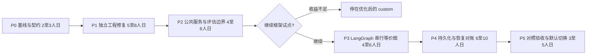

# DevPilot 分阶段迁移与验证计划（待方案确认后执行）

本轮只交付设计。以下阶段均未实施，路径均相对于 `G:/program/CodingDev/devpilot/`；目标接口见 [目标架构](G:/program/CodingDev/docs/architecture-review-2026-10-24/04-target-architecture.md)，P01–P12 问题编号见 [问题报告](G:/program/CodingDev/docs/architecture-review-2026-10-24/02-problems-and-necessity.md)。

## 1. 总体安排

全路线估算 24–38 人日，不含 OS 强隔离、新审批 UI、收费模型评测与发布排期。关键路径是 P0→P1→P2→P3→P4→P5，P1 是框架无关修复，失败回退不能删除已确认有效的安全改进。每阶段单独评审/测试，可停在其产出，不要求一口气完成全程。

## 2. P0：冻结事实、契约与可复现环境

**目标**：确定新旧 Runtime 的共同基准，避免“迁移时顺手改变正确性标准”。

**涉及路径**：`tests/test_runtime_contract_baseline.py`、`tests/runtime/*`、`tests/test_eval_truthfulness.py`、`tests/test_benchmark.py`、`devpilot/evals/benchmark/manifest.json`、`pyproject.toml`、`uv.lock`、根目录 `.github/workflows/`。

**新增/修改/删除**：

- 新增 `tests/contracts/` 的运行结果/工具轨迹/错误/产物契约，复用现有 Fake 脚本与 stub；记录 fixtures hash、Python/依赖版本、起点树、策略与协议版本。
- 整理现有七观察/八请求 smoke 为稳定契约；基准比较去除 run_id、临时路径、时间戳等非语义字段。
- 为本次缓存前置读取、配置未接入、阶段语义建立回归清单；先记录当前行为与期望差异，不把旧缺陷永久冻结为目标。
- 保存旧发行 wheel/lock/environment 供旧 v1 检查点继续恢复；不只保存 Git SHA。
- 记录现有 Ruff 14 项与 pytest 警告；按独立提交清理质量基线。删除项：无。

**依赖/工作量/风险**：方案确认；2–3 人日，低风险。冻结基线可随 P1 修复形成 v1.1，但每次差异都必须有明确 issue 和证据。

**测试与完成判据**：复现本轮 511 pass/2 skip 的语义覆盖；补齐可创建链接环境的相关测试；八任务 benchmark 自检全通过；收费模型 transport 禁止 fixture 保持有效；基线报告包含未知 usage，而非零 Token。

**回滚**：仅回滚契约/基线新增内容；保留原始测试证据与旧发行环境，不修改用户任务工作区和历史运行产物。

## 3. P1：修复工程与安全边界，不引入框架

**目标**：修 P01–P03/P11，避免把当前缺陷复制到新图。

**涉及路径**：`runtime/custom/runner.py`、`tools/repo/file_cache.py, read_file.py, search_code.py`、`tools/git/*`、`tools/code/*`、`processes.py`、`workspace/sandbox.py`、`verification/evidence.py`、`runtime/base.py`、`settings.py`、`storage.py`、`tracing/writer.py`。

**新增/修改/删除**：

- 新增受控 ProcessExecutor 接口/实现；现有 pytest 执行器经验复用到 Git/rg。所有取消路径先 kill/wait，再回滚；限制输入、输出、日志和大文件读取。
- 把 read cache 下沉到已授权的 ReadFile 内，删除 Runner 的预读旁路；规范路径与文件版本作为缓存键。
- 实现或明确拒绝五个未接入配置。准备阶段与评估阶段独立计时；定义整体截止时间，不能以阶段重启刷新总预算。
- 总容量按物理文件计数；诊断保留区有界，Trace/State/JUnit 等产物纳入治理；并发预留需锁。保留必要故障恢复文件。
- 分别定义“继续可信本机”与未来隔离后端；本阶段不伪装提供网络隔离，也不直接部署容器服务。

**依赖/工作量/风险**：P0；5–8 人日，中高风险，重点是 Windows 子进程退出和补丁取消竞态。

**测试与完成判据**：

| 场景 | 要验证的事实 |
|---|---|
| 越界/敏感路径/链接/缓存命中 | 未授权时不发生任何文件内容读取；没有 secret 进入输出 |
| Git/rg 取消与大输出 | 子进程树结束；日志/内存策略有界；补丁前后像一致或明确 needs_review |
| 极小 tool/preparation/evaluation timeout | 每个配置在执行端触发，错误码准确，不只是 dataclass 校验 |
| 大文件与超长单行 | 返回和读取有字节边界，不能仅按行数截断 |
| 配额/磁盘故障/并发 admission | 不继续派发新操作；诊断仍有界；不会误报业务验收通过 |
| 原有安全/验收 | 冻结测试不可改、隐藏测试隔离、原 smoke 与八任务 benchmark 保持 |

**回滚**：逐项回滚失败的执行器迁移到原可信路径并暂停相关新功能，不撤销路径鉴权修复。所有变更分小提交，不一起回退；新产物用版本/能力标识，旧工具不能静默读懂新状态。

## 4. P2：抽取公共服务与 Runtime/Eval 契约

**目标**：先让 custom 只依赖明确服务，形成框架可替换边界。

**涉及路径**：`cli.py`、`runtime/base.py`、`runtime/custom/{runner,state_manager,loop_guard,context,recovery}.py`、`verification/verifier.py`、`evals/{runner,metrics,benchmark}.py`、`tools/test/run_tests.py`。

**新增/修改/删除**：

- 新增 `application/bootstrap.py, service.py`、`runtime/ports.py`、`runtime/services/`、RunRequest/RunOutcome/RunSession 类型。
- 提取 DecisionService、ToolExecutor、VerificationService、业务 reducer/guards、BudgetLedger 和 ArtifactReader；一次 run 独立 Session。
- 把 `parse_junit/run_independent_suite` 从 evals 移至 `testing/junit.py, suite.py`，旧路径短期 re-export，避免打断外部/测试导入。
- EvalRunner 通过 request 注入工作区起点、通过 outcome 获取证据和 metrics，删除对 runner.sandbox/purpose/verifier.last_results/deadline 的读写。
- CLI 使用应用服务装配，load_issue 迁到中性 application/tasks 模块；保留旧函数包装作兼容。
- 删除/合并无主链路调用的旧验收 helper，先核对测试依赖；此阶段不改 AgentDecision 和模型协议。

**依赖/工作量/风险**：P1；4–6 人日，中风险，可能出现看似签名不变、实际上统计或失败语义改变。

**测试与完成判据**：使用无 `sandbox/verifier/metrics` 属性的最小 RuntimePort 假实现，仍能得到正确 EvalResult；领域/工具/testing 不 import concrete Runtime；原 CLI、任务 YAML、工具 Schema、冻结保护、Fake 轨迹和旧结果字段一致；同进程两个独立 Session 不串计数/证据。新增 strict acceptance 和 Prompt 改进可另设功能分支，默认保持兼容模式。

**回滚**：工厂切回原装配包装，保留数据结构转换；迁移中的 re-export 不提前删。P2 结束可选择停留方案 A，已抽出的模块仍产生价值。

## 5. P3：引入 LangGraph 串行等价编排

**目标**：先证明可替换，不同时改变智能策略或引入多 Agent。

**涉及路径**：新增 `runtime/langgraph/{runner,graph,nodes,state}.py`，修改 `application/bootstrap.py`、`settings.py`、`cli.py`、`pyproject.toml`、`uv.lock`、`tests/contracts/`。

**新增/修改/删除**：

- 锁定评审后的 langgraph 与 checkpointer 兼容依赖；不安装托管服务或启用远程 tracing。
- 节点按目标图拆为 context/decide/tool/observation/plan/verify/finalize，所有节点调用 P2 公共服务。
- `--runtime` 和配置开关接入，默认仍 custom；EvalRunner 使用同一 factory 入口。
- 决策/写工具不叠加框架自动重试。第一轮可在进程内运行，无持久恢复宣称；磁盘 Checkpointer 在 P4 验收。
- 新 graph counters 与兼容业务 counters 独立；节点状态不原位共享；删除项：无，尤其保留 custom。

**依赖/工作量/风险**：P2；4–6 人日，中风险。框架 API、async 取消语义、super-step 计数和异常捕获是主要不确定性。

**测试与完成判据**：同一合成任务脚本在 custom/langgraph 分别运行，规范化后的工具序列、预算消费、状态投影、diff、可见验收结果一致；七工具/八请求 smoke 契约不变。工具异常、计划循环、验证拒绝、未知 usage、max_requests/max_steps 等场景均跑两实现；无框架事件能绕开 TaskVerifier 直接 completed。

**回滚**：将工厂默认/显式选择切回 custom，禁用 LangGraph 创建新运行；已经创建的图运行留存，不把它们送给旧运行器继续执行。必要时撤销新增依赖/lock 更新，但保留归档证据。

## 6. P4：持久恢复、副作用对账与最小人工介入

**目标**：提供框架迁移的核心新增价值，保证恢复不回退预算、不重复写代码。

**涉及路径**：`runtime/langgraph/*`、新增 `runtime/services/{recovery,operations,budget}.py`、`storage` 的 checkpointer/journal 实现、`domain` 状态模型、`application/service.py`、`cli.py` 的 resume/inspect。

**新增/修改/删除**：

- 接入本地持久 checkpointer、操作日志、ArtifactRef；按目标架构明确三个权威（图进度、操作结果、预算消费）的对账协议。
- operation_id 稳定绑定决策；prepared→completed receipt；工具前后像；已完成 receipt 可复用，未知写操作 needs_review。
- 人工 interrupt 绑定参数/工作区/策略摘要；CLI 可展示待处理请求并提交继续/拒绝；不需要本阶段构建网页审批产品。
- 新增 schema/runtime/version 路由。旧检查点必须由保留的原发行环境处理：当前 runtime_identity 对包内全部 Python 哈希，添加新框架文件也会使老检查点拒绝，因此仅切回 custom flag 不足以恢复旧任务。
- 删除自定义新图的重复控制状态保存；旧 v1 recovery 只为旧运行器兼容，不强行转换工具执行中的任务。

**依赖/工作量/风险**：P3；6–10 人日，高风险。不要以“数据库有 checkpoint”代替此阶段测试。

**故障注入与完成判据**：

| 中断点 | 正确行为 |
|---|---|
| 请求预记账后、发送前/后、响应记录前 | 不减少 request_count；不确定 usage 保持未知；新尝试重新记账 |
| 补丁 prepared 后、写一半、写完 receipt 前 | 可证明状态才恢复；否则停止人工审查；无重复 apply |
| receipt 提交后、图 checkpoint 前 | 重入只复用 receipt；观察和计数按 event/operation id 去重 |
| 冻结验收中/报告提交后 | 证据必须绑定候选 digest；未知副作用不盲目重跑 |
| 审批等待时进程退出 | 新进程能恢复同一请求；漂移使旧批准失效；拒绝无写操作 |
| 同 run_id 并发 resume | 只有一个持有 lease；另一个明确失败 |
| checkpoint 写失败/数据库满/文件损坏 | 禁止继续派发，不从更旧快照重置预算；产物标记不完整 |
| 停机/超时/更新版本 | 原 deadline 继续生效；版本不兼容可读但拒绝继续执行 |

每个故障点至少覆盖 Windows 与 Linux CI；使用 FakeLLM 和临时工作区，不涉及真实凭据。新的安全恢复能力要比当前“拒绝工具重放”更强，无法证明时维持现有保守拒绝是合格结果。

**回滚**：停止新图运行准入，custom 接管新任务；旧图任务保持只读或由原框架发行版本恢复。数据库 schema 使用前向新增与版本列，保留旧数据副本；不降级覆写 checkpoint、不删除 journal、不回滚已经修改的用户工作区。

## 7. P5：对照验收、默认切换与退役

**目标**：用实际结果决定新 Runtime 是否具备替代条件。

**涉及路径**：`tests/contracts/`、`tests/runtime/`、`evals/runner.py`、新增离线比较脚本、CI、`settings.py` 默认值、`runtime/custom/` 兼容层、发布说明。

**新增/修改/删除**：

- 增加成对比较报告，统一采集成功/失败/ERROR/NOT_EVALUATED、请求、已知/未知 Token、业务步数、耗时、checkpoint/产物体积、异常恢复结果。
- 使用原 Benchmark 的固定起点与 hidden suites；不得把参考补丁传给模型作为成功提示。
- 默认开关分两次变更：先自愿 opt-in 并完整对照，再默认 LangGraph；保留至少一个明确发布周期的 custom 回退入口。
- 只有未完成旧运行处理方案明确、契约全绿、回退演练完成，才删除旧编排循环；共享工具/验证/评估不删除。旧 schema 阅读器与历史产物保留。

**依赖/工作量/风险**：P4；3–5 人日（离线对照/发布准备），中风险；真实模型评测另算且须另行授权。

**回滚**：配置默认切回 custom，后续新运行使用旧编排；图历史和 journal 保留。若已移除 custom 代码，用留存的上一发行环境开新运行，而非在新 checkpoint 上运行旧代码。

## 8. 公平比较的方法与门槛

### 固定输入与统计口径

每组使用同一 task YAML/Benchmark dataset v1.1、起点树、模型响应脚本、工具/ContextPolicy、配置、解释器与测试依赖；两个 Runtime 使用各自干净工作区和独立 run_id。不要在同一工作目录顺序修改后比较，也不要求 wall-time/临时路径完全相同。

三类证据分开报告：

1. **Fake smoke / 故障注入**：验证编排与恢复正确性，不能记入 capability success。
2. **Benchmark 参考自检**：八个缺陷可检测、参考修复可通过，验证评估器和任务资源；不是 Agent 能力。
3. **真实模型成对试验**：后续另行授权才执行。固定 provider/model/version/参数，交错运行顺序、每任务多个重复，记录所有失败和未知 Token；模型本身不完全确定，不能用一次成功宣称提升。

现有 Fake 脚本有部分测试直接实例化 CustomAgentRunner，应拆出通用 fixture 参数化两 Runtime，而非复制两份测试逻辑。对照阶段保持相同模型客户端，避免同时改变输出格式/提示词。strict acceptance 与新 Prompt 分别建立实验分组。

### 默认替换门槛（建议评审采用）

| 门槛 | 必须达到 |
|---|---|
| 安全与确定性 | 所有通用安全、预算、冻结验收、隐藏隔离契约 100% 通过；无未经授权 I/O；未知副作用不重放 |
| 基线 | 现有有效测试保持，八任务负/正/可见自检全通过；可运行平台不增加 skip；lint 无现存或新增问题（先清理基线） |
| 结果一致性 | 同 Fake 输入 terminal verdict、规范化 diff、工具序列、请求记账、coverage 与旧版一致；差异必须单独批准和版本化 |
| 新增价值 | 跨进程人工等待、预算不重置、receipt/checkpoint 断点对账均有故障注入证据 |
| 开销 | 在固定机器上，离线同任务至少 10 组成对运行；剔除外部模型等待单列编排开销；建议 p95 总耗时不恶化超过 20%，若超出必须解释并评审，不藏在 Token 节省里 |
| 磁盘 | 检查点/日志/诊断不突破配置；有 retention 和空间不足行为；同时报告峰值而非仅平均 |
| 可回滚 | 实测切换默认后可回到 custom 执行新任务；旧图/旧 v1 运行不错误混用；历史报告可读 |
| 真实能力（如要对外宣称） | 有授权的成对 capability 评测；逐任务成功率与置信/样本量、Token 未知比例、稳定性均报告，不从 8 个任务单次样本推总体结论 |

当前不具备真实模型比较证据，不能在本轮把最后一条标为通过。即使离线门槛达成，也只能声称运行契约和恢复能力达到替换条件，不能声称模型更聪明或 Token 更省。

## 9. 首先实施什么

评审通过后先做 P0，再修 P1 的缓存鉴权和通用进程/预算执行；它们有直接源码与探针证据，不依赖任何框架选择。P2 完成后再决定是否进入 LangGraph 试点。全程保留 ShopFlow 与固定评估资源，不把业务重写混进 Agent 框架迁移。

