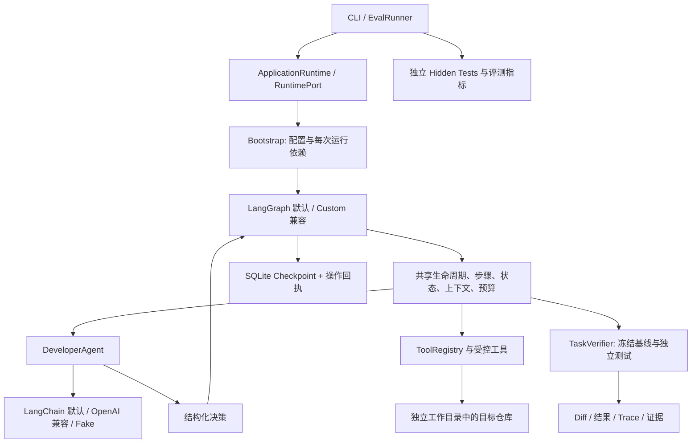

# 第一阶段：项目分析与面试价值评估

## 1. 项目定位和业务价值

DevPilot 是本地研发任务 Agent 实验平台：接收 Issue，探索代码、制定计划、修改代码、执行测试、根据反馈修复，最终产出 Diff 和运行证据。核心问题是如何把模型的不确定决策约束成可验证、可停止、可恢复的工程流程，而不只是生成代码。

仓库同时包含 ShopFlow 订单后端。它是 Agent 的目标项目和评测业务载体，不应表述为已经服务真实商家的生产电商系统。其客户、商品、订单、优惠券提供了跨 API、业务规则、持久化层的真实代码修改场景。

推荐面试定位：**AI 应用岗位以可信研发 Agent 为主线，后端岗位以执行生命周期、资源治理、恢复一致性和订单事务为主线**。没有证据支持用户规模、生产吞吐、商业收益、真实模型成功率或个人独立承担全部开发。

## 2. 当前架构和调用关系

关键区别：GraphState 是编排状态；领域状态、工具副作用、磁盘证据和模型请求账本并不是一个跨资源事务。框架提供 checkpoint，但项目仍需解决恢复时的副作用判定和预算延续。

### 研发任务主流程

1. 应用入口加载任务和配置，建立本次执行依赖、工作目录和可信基线。
2. 图从 `prepare → guard → context → decide` 推进；guard 限制资源与循环，context 汇总任务、计划和观察。
3. 模型返回 action、plan_update、finish 三类互斥决策。action 进入工具执行再观察，plan_update 更新计划后回到 guard。
4. 文件读取、搜索、补丁、测试、Git 查询通过 Registry 受控执行，结果回流为 Observation。失败信息进入下一轮上下文，而不是只盲目重试。
5. finish 只表示请求完成；`verify` 重建候选代码并运行可信测试、检查修改范围等。通过才进入 finalize，未通过可回到循环，异常进入 fail。
6. CLI 输出运行结果；评测模式额外区分 smoke 与 capability。Fake smoke 不跑隐藏验收且不计能力成功率。

### 订单业务流程

API → OrderService → Repository → SQLAlchemy Session → SQLite。创建订单先合并重复商品数量、校验客户与正整数数量，再条件扣库存、计算金额和优惠、创建订单明细；Service 统一 commit，异常 rollback。支付通过 pending→paid 条件更新；取消只允许 pending/paid→cancelled，只有真正发生迁移才回补库存，重复取消不重复加库存。

这是一套单数据库事务方案。支付是状态模拟，不含第三方支付、退款、消息队列或分布式事务。

## 3. 技术栈及作用

| 技术 | 当前作用 | 表述边界 |
| --- | --- | --- |
| Python 3.12+、asyncio | 模型调用、异步编排及子进程生命周期协调 | 单任务图是串行，不能称并行多 Agent |
| LangGraph、SQLite checkpointer | 显式状态图、持久化和恢复 | 当前默认已接入，不是未来计划 |
| LangChain / ChatOpenAI | 默认模型传输适配；旧 OpenAI 适配保留 | JSON 决策协议，不等于原生工具调用或完整 LangChain Agent |
| Pydantic、pydantic-settings | 任务/决策/状态验证、配置管理 | JSON 语法及结构正确不保证业务正确 |
| Typer、Rich、YAML | CLI 和任务输入 | 非 Web 平台、非自动 GitHub Issue 接入 |
| Git、ripgrep、pytest | 修改、检索和验证目标仓库 | 测试代码仍在本地主机执行 |
| JSONL、JSON、文件锁、原子写入 | Trace、结果、回执和本地一致性 | 非集中式可观测平台 |
| FastAPI、SQLAlchemy、SQLite | ShopFlow API 与订单持久化 | 不推导生产数据库容量 |
| uv、wheel、GitHub Actions | 锁定依赖、发行包和确定性检查 | CI 文件存在不等于远端工作流已全部成功 |

## 4. 核心实现清单与技术价值

以下编号对应证据索引，可沿源码符号和测试继续阅读。

| 优先级 / 实现 | 解决的问题与机制 | 价值层级与面试价值 | 局限和替代思路 |
| --- | --- | --- | --- |
| P0 可信验证与评测 E1 | 冻结测试/配置，物化候选代码，独立运行可见测试；隐藏测试用于能力验收；smoke 不冒充能力分数 | 深入设计：把生成、验证和指标口径分开，适合 AI 工程主线 | 测试通过不证明全部自然语言需求；coverage_for 对多数条件标记 uncovered；未来可显式绑定验收检查 |
| P0 恢复与副作用回执 E2 | prepared/completed 回执、参数与工作区摘要、结果摘要；已完成匹配则复用，不确定则拒绝自动重放 | 深入设计：理解 checkpoint 与外部副作用之间的崩溃窗口 | 保守停机牺牲自动恢复率；不是 exactly-once；远程副作用需要服务端幂等键等独立协议 |
| P0 预算与生命周期 E3 | 全任务截止时间、累计验证时间、模型请求核算；恢复保留已消耗预算 | 深入设计：把停止条件落实到异步调用和资源生命周期 | 时间和输出限制不等于 CPU/内存硬隔离；多 worker 容量需另测 |
| P1 双运行时共享业务 E4 | ApplicationRuntime 统一入口，编排与 shared steps/lifecycle 分离，manifest 恢复原引擎 | 有复杂度的架构实践：避免迁移框架时重写业务语义 | 两套适配增加兼容负担；不能声称所有层完全无框架耦合 |
| P1 受控文件修改 E5 | 路径解析、链接拒绝、写保护；Git 权威目标清单、check 后 apply、异常还原 | 有复杂度的工程实践：针对实际文件副作用建立边界 | 异常回滚不覆盖进程被强杀的全部窗口；本地可信环境，不是恶意代码安全沙箱 |
| P1 上下文与修复反馈 E6 | 按阶段指令、观察压缩、失败反馈、字符预算裁剪 | 有复杂度的 AI 实践：有限上下文下保持任务和修复信息 | 字符数非精确 token；摘要可能损失证据；未实现向量 RAG/长期记忆 |
| P1 订单事务与条件更新 E7 | Service 提交，Repository flush；库存条件 UPDATE，状态 CAS，取消一次回补 | 后端重点：原子条件判断、事务范围、幂等副作用 | SQLite 并发写能力有限；重复支付拒绝不等于请求级幂等；没有下单幂等键 |
| P2 JSON 模型适配 E8 | 禁用 SDK 自动重试、JSON object 输出、Pydantic 决策校验、请求记录 | 常规集成加工程约束：值得作为预算主线的支撑 | 不是模型训练成果；解析兜底的括号扫描未处理字符串中的括号，值得补边界测试 |
| P2 CRUD、分页和关系预加载 E7 | API 分层、分页边界、selectinload(Order.items) | 常规实现：用于解释基本功 | 不能包装为复杂微服务或数据库全面调优 |

### 最值得展开的三个机制

**可信完成**：模型输出 finish 不直接设置成功。Verifier 以冻结基线建立候选副本，再使用独立测试结果判断。这样降低了 Agent 改坏测试却自报成功的风险。但验收条件中没有绑定检查的部分仍未被证明；“可信证据”与“需求完全满足”必须分开。

**恢复一致性**：工具已经写文件、checkpoint 尚未记录观察时，重新执行节点可能重复副作用。OperationJournal 将执行前意图和执行后结果分别持久化；恢复时核验操作参数、结果和当前工作区。若只存在 prepared，则即使工作区看起来没变也拒绝重放，因为无法证明外部副作用没有发生。它解决的是明确恢复边界，而不是消灭所有不确定性。

**订单原子性**：旧实现库存与订单分别提交，可能留下部分成功。当前库存更新把“剩余库存非负”放进 UPDATE 条件，并由 Service 将扣库存、订单和明细置于同一事务；取消先通过状态条件更新争取唯一执行资格，再回补库存。无需先引入 Redis 锁，但仍需讨论数据库锁等待和事务失败处理。

## 5. 已确认的演进和工程决策

| 历史依据 | 背景问题 → 方案和当前结果 | 可讲经验 / 待确认 |
| --- | --- | --- |
| `34e6e7e`，已查看 Repository diff | 库存读改写并自行 commit、订单也独立 commit → 条件 UPDATE、flush、Service 统一事务；新增订单完整性测试 | 事务边界应跟业务不变量一致；是否由本人发现和主导需确认 |
| `41c4ea5`，已查看提交变更清单及当前源码 | 自研循环向框架编排迁移 → shared 服务、显式图、恢复 manifest、回执和兼容入口 | 框架迁移需要保持业务契约；不能把提交清单当作全部设计动机证据 |
| `41b027b`、`05d26dc`、`f7ba445`，本轮仅检查日志标题 | 历史记录包含验证/上下文预算、Unicode 恢复、保留运行证据和测试生命周期修复 | 可作为第三阶段候选；尚未逐个阅读 diff，不据此编造故障现场与根因 |
| performance-decision.md，文档记录 | 本地串行工作负载接受持久化成本，并保留回退 | 文档报告十组配对测量，执行中位数 Custom 65.697s、Graph 84.887s；不是提速。未本次复测，不外推真实模型或生产 p95 |

## 6. 功能边界、限制与风险

- 当前具备单 Agent 研发闭环、默认框架运行时、受控工具、独立验证、恢复证据、基准任务及本地 Trace。
- 未见可支撑多租户生产部署、分布式任务调度、RAG、长期知识库、多 Agent 协作或真实支付集成的实现证据。Langfuse 在当前验收文档中明确延期。
- README 的“尚未接入 LangGraph”已过期；“git apply → patch → difflib 三级后备”也与当前 ApplyPatch 不符：现在使用 Git 的多组参数检查和应用，并保存原文件作异常回滚。
- `network_access=false` 不能被解释为操作系统网络隔离；真实模型本身使用远端 API。受控工具不提供任意 shell，也不能阻止被执行 Python 测试使用宿主能力。
- ShopFlow 金额计算仍使用浮点数；可建议 Decimal/最小货币单位，但不要声称已经改好。没有观察到生产压测和外部支付一致性证明。
- 已有验收文档报告 Windows 全量回归 634 passed / 2 skips、ShopFlow 67 passed、确定性基准 8/8。这是历史记录，不是本轮结果，不是模型任务成功率。Linux 在该验收范围内未验证，尽管 CI 配置有 Linux 矩阵。

## 7. 推荐学习顺序

1. 先走通 E4 的一次任务调用链，明确状态、决策、工具、证据各自职责。
2. 深入 E1 可信完成与评测口径，回答“为什么相信 Agent 完成了任务”。
3. 深入 E2 恢复窗口，手画副作用和持久化的时间线。
4. 深入 E3 全任务预算及取消清理，回答“卡住、超时、重启后会怎样”。
5. 深入 E7 订单事务，准备后端面试中最直观的并发例子。
6. 深入 E5 文件边界与补丁，再学习 E6/E8 上下文和模型协议。

面向纯后端岗位可将 E7 提前到第 2；面向 AI 应用岗位保持上述顺序。不要先背框架 API，再反推项目用了哪些能力。
