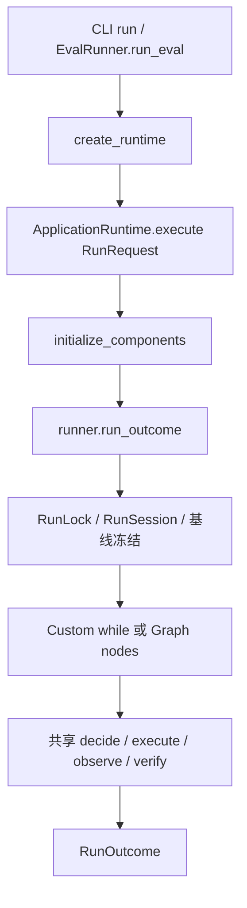

# E4：双运行时与共享业务

## 设计目标与位置

CLI 和评测都需要执行任务，但不应读取 runner 内部属性来拼结果。框架迁移也不应复制修复、预算和验证规则。当前通过应用适配器稳定入口，通过共享生命周期和步骤复用规则；引擎只决定如何推进这些步骤。以下“降低耦合”是从实现推导的收益，不代表已经确认作者当时的全部动机。

## 入口与数据流

源码位置以文件加符号定位，精确行号与链接见 [源码索引](source-index.md)。

1. `application/factory.py:create_runtime` 返回 `ApplicationRuntime`，而不是直接将具体 Graph runner 暴露给 CLI。
2. `runtime/contracts.py:RunRequest` 输入任务、ordinary/evaluation 用途、工作区来源和冻结策略；`RunOutcome` 返回结果、路径、证据、统计、预算、状态和最终 diff。`RuntimePort(Protocol)` 只要求异步 execute/resume。这里是结构化接口约束，不是运行时自动依赖注入容器。frozen dataclass 阻止字段重新赋值，但不让内部 dict 深度不可变。
3. `ApplicationRuntime.execute` 每次 `_build(request)`，再调用 runner.run_outcome。新的 Registry、守卫、Agent、Verifier 和缓存减少不同任务之间的可变状态污染；同一个旧 runner 仍由 `_executing` 防重入，不能把它当作并发服务单例。
4. `bootstrap.initialize_components` 先应用 request.policy 和 workspace_start，再选择 Fake/LangChain/OpenAI、注册八工具、构建普通或 benchmark workspace，注入容量、秘密脱敏、ContextBuilder、StateManager、LoopGuard、Trace、Verifier 和具体 runner。Fake 使用脚本化响应，测试的是真实工具闭环而非模型推理能力。
5. `RuntimeLifecycle.run/_run` 在运行锁下建立 RunSession 和 RunBudget，重置运行期指标/缓存，建立或恢复工作目录，绑定 trusted snapshot，写 manifest，然后进入子类 `_execute_loop`。`_outcome` 将结果转换成应用契约。

## 编排层如何共享业务

Custom 的 `_execute_loop` 显式 while：剩余时间与容量检查→构造上下文→decide_step→finish 验证或 action 执行/观察→计划反馈→重置单轮尝试并 checkpoint。Graph 的 `graph.py:build_graph` 使用同样的业务步骤，但拆成 prepare、guard、context、decide、apply_plan、execute_tool、observe、verify、fail、finalize 节点。

图中的 decision_route 只允许一个决策分支。verify 不通过回 guard；fail/finalize 的持久化异常向外传播，避免失败节点重新路由到自己。GraphBubbleUp 不转换成普通业务失败。图是串行节点链，async 函数不意味着节点自动并发。

`shared/steps.py` 持有具体规则；`shared/services.py` 分别包裹决策、工具和验收执行。`DeveloperAgent.decide(context)` 只返回 AgentDecision，并维护模型请求记录；不直接写文件。`observe_step` 把 ToolResult 交给 StateManager：创建 Observation、增加步数、记录修改文件和 TestRun，再更新修复状态。下一轮 ContextBuilder 将这些事实发给模型。这是观察驱动闭环，工具不是模型内部的神秘动作。

Graph runner 的 capture 包装器将 snapshot.domain 反序列化为 DevPilotState，在节点结束时输出新的 domain/accounting/recovery/trace_sequence；客户端、Registry、锁等运行期依赖留在闭包外，不序列化到 GraphState。该实现仍有共享可变 runner 字段，因此“框架解耦”不等于纯函数架构。

## 状态、manifest 与 checkpoint

领域 phase 是理解/探索/计划/实现/验证/完成/失败；图节点是调度位置，两者不是同一状态机。StateManager 校验一般 phase 迁移，但 reject_verification 会明确回 implementing。

manifest 描述恢复时该用哪个引擎、模型后端和依赖身份；checkpoint 描述已经走到哪里；回执描述外部操作是否已完成。ApplicationRuntime.resume 优先按 manifest 选引擎，无 manifest 的旧 checkpoint 才回落 custom/openai。不可简单用当前默认值恢复旧任务。

## 异常、权衡和改进

| 场景 | 当前行为与限制 |
| --- | --- |
| 配置/依赖身份变化 | 恢复校验拒绝，避免不同语义继续旧状态 |
| 工具普通失败 | Observation 回流；预算/持久化失败可能终止运行 |
| 验收成功但持久化失败 | Graph 不将其当作成功完成；终态发布另有保护 |
| 两引擎业务一致性 | `test_graph_business_contracts.py` 替换 runner 构建边界复用规划、修复断言；不是所有恢复语义相同的证明 |

自研循环依赖少、控制直接；图引擎提供显式拓扑和持久化调度，但增加序列化/存储成本。当前保留双实现有迁移回退价值，也有双倍兼容矩阵成本。未来若移除旧引擎，应先保留 manifest 迁移策略和契约测试；这是建议，未实施。

## 面试掌握路径

- 核心知识：结构化接口、依赖生命周期、领域状态与调度状态、共享业务契约。
- 最值得展示：迁移编排引擎而保留验证和预算语义。
- 五层路径：解释入口→追踪 RunRequest/Outcome→解释 Protocol/对象状态→比较循环与图→分析并发复用 runner 和旧任务恢复。
- 追问重点：每次构建新依赖为什么必要？共享代码为何仍需契约测试？不能声称两引擎拥有完全相同的恢复能力。
