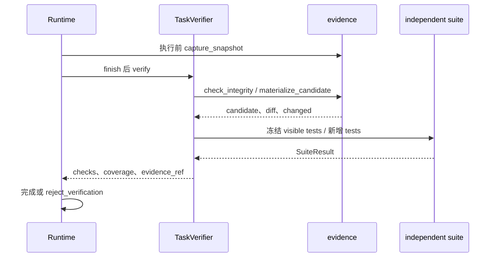

# E1：可信验证与任务评测

## 目标与依赖

LLM 的 finish 是意图，不是证明。测试和配置若可由候选代码任意改变，退出码为零也可能只是“删掉了失败测试”。本模块位于 Runtime 完成门禁与 EvalRunner 之间，依赖冻结快照、候选物化、独立测试进程和结构化证据。

## 执行流程

## 核心代码逐层分析

1. `verification/evidence.py:capture_snapshot(repo, artifacts)` 调用 inventory，对允许文件计算摘要并复制到 runs 下 trusted/baseline，manifest 保存全部 files 及 protected 子集。冻结的不只是测试：全部纳入清单的文件形成 diff 基线；保护集包括测试命名 Python 文件、tests 路径和 conftest/pytest.ini/pyproject.toml 等配置。跳过 .git/.venv/缓存/runs/workspaces 及数据库等后缀，所以它不是全磁盘镜像。
2. `validate_write` 在工具写入前阻止修改已冻结测试及测试配置；`check_integrity` 在验收时重新计算 trusted 和工作区摘要。前者是准入检查，后者是独立复核，不能只信 Agent state.modified_files。
3. `materialize_candidate` 返回 `(b, diff, changed)`：a 来自冻结 baseline，b 来自当前清单，使用 `git diff --no-index --binary ... a b`。Git 返回 1 表示有差异，不能当执行失败；0/1 都接受。文件系统并集比较纳入新增和删除，避免普通 Git diff 漏掉未跟踪文件。
4. `TaskVerifier.verify` 缺失快照立即失败；物化失败返回失败 checks。成功后覆盖 state.modified_files，检查 diff 非空、禁止文件、修改数量。复制冻结测试到独立 baseline-tests，新增测试进入 added-tests，分别执行；新增测试不能覆盖基线测试的失败。
5. `testing/suite.py:run_independent_suite` 在独立 harness 中运行 pytest，以显式 `-c`、`--confcutdir`、importlib 模式和禁用插件自动加载降低候选配置对收集的影响。PYTHONPATH 指向候选代码，因此测试对象仍是修改后的实现。返回 SuiteResult，而非只用 stdout 字符串猜测通过。
6. `shared/steps.py:verify_step` 记录 report；通过才设置 completed。失败调用 StateManager.reject_verification：增加 retry_count、设置 verification 修复源、添加失败 Observation、回 implementing；达到重试上限终止。

这些副本和进程分离保护的是可信本地仓库的验收证据，不隔离同机恶意 Python 代码访问宿主文件。

## 验证语义与指标

| 概念 | 当前用途 | 不代表什么 |
| --- | --- | --- |
| test.run | Agent 开发反馈 | 最终独立验收 |
| visible tests | 冻结测试验证候选 | 全部自然语言需求覆盖 |
| added tests | 新增测试独立执行 | 可以替代原有测试 |
| hidden tests | EvalRunner 能力验收 | 生产真实用户分布 |
| smoke | Fake 驱动闭环，hidden=NOT_EVALUATED | 真实模型成功率 |
| capability | 真实任务运行+可信 visible+hidden | 仅凭 Agent completed 即 PASS |

`evals/runner.py:run_eval` 在 hidden 未评估/错误时保持对应状态，smoke 的 task_success 为 None。不存在“没测也算成功”的合理口径。

`coverage_for` 只把包含 add tests/新增测试/新增回归测试关键词的条件映射到 required_new_tests，其余通常 uncovered。它不是语义验收规划器；而且 required_new_tests 主要检查是否新增测试文件，不证明测试针对该条件。verify.success 聚合 checks，并不要求每个 coverage 条目 verified。这是面试中必须主动说明的边界。

## 异常与权衡

| 异常 | 当前处理 |
| --- | --- |
| trusted 或受保护文件变化 | 拒绝物化，返回失败证据 |
| 测试源缺失 | SuiteResult NOT_EVALUATED，不冒充 PASS |
| 超时、输出上限、取消 | ERROR；配额异常向上抛出 |
| visible 跳过测试 | Verifier 要求 PASS 且无 skipped |
| 最终测试失败 | 结构化反馈进入修复循环，受次数和时间预算约束 |

直接在工作区验收更快，但受候选配置和可变文件影响；当前复制策略更可审查，代价是磁盘和扫描成本。摘要用于检测变化，不是对抗拥有宿主写权限者的签名认证。未来可添加显式 criterion→check 映射、独立容器和不可变证据存储；均未实现。

## 测试与面试路径

证据：`verification/test_evidence.py` 中删除基线测试仍被检测、未跟踪文件进入 diff、新增简单测试不能掩盖旧测试失败；`test_eval_truthfulness.py` 核对指标口径。

掌握四点：执行者与裁判分离、文件真实差异、测试证据语义、未覆盖需求。五层路径：说明 finish→跟踪物化与 suite→解释独立进程/内容摘要→比较复制成本与可信度→分析候选代码试图污染验收。最值得展示的是“限制成功声明的证据边界”，不是宣称能证明程序绝对正确。
