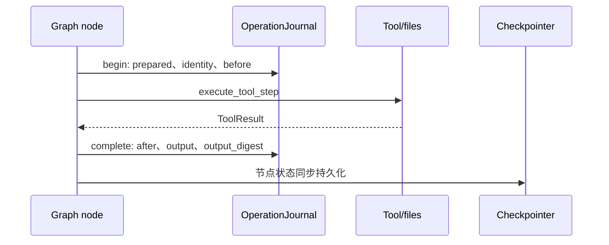

# E2：恢复与副作用一致性

## 问题与边界

图状态持久化和文件写入不在同一个事务。工具成功后、节点 checkpoint 前崩溃，恢复可能重新进入 execute_tool。直接重执行会把恢复变成重复修改。当前方案是 SQLite 图 checkpoint + 操作回执 + 内容摘要 + 单 run 文件锁，适用于可信本地串行执行，不是分布式 exactly-once。

## 流程与数据结构

`runtime/langgraph/operations.py:Receipt` 包含 version、operation_id、identity、stage、before、after、output、output_digest 和 admission。identity 是参数规范化 JSON 的 SHA-256，output_digest 保护返回结果一致性；before 记录执行前状态，begin 对已有 completed 回执实际比较的是 after 与当前摘要，不能误讲成所有阶段都验证 before。

## 逐层源码

1. `ApplicationRuntime.resume` 先用 manifest 选择原引擎。`LangGraphAgentRunner.resume` 校验目录、获得 RunLock、验证 manifest；已有 result/failure 文件拒绝再次恢复。读取 SQLite graph state 后由 `checkpoint_from_graph` 投影为共享恢复结构。
2. 比较 trusted/workspace 清单；如果 workspace 比 checkpoint 新，只在待执行节点为 execute_tool/verify 且匹配 completed 回执.after 时允许。外部任意改动不自动被接纳。
3. execute_tool 用 `decision_id + ':tool'` 作为操作 ID，把完整 decision 和 workspace/trusted 摘要交给 begin。无历史记录先写 prepared；匹配 completed 则返回保存的 ToolResult 和 duration，不调用工具。
4. begin 对参数变动、未 completed、after 不匹配、结果缺失或结果摘要不符都抛 ManualRecoveryRequired。complete 只允许从 prepared 迁移；结果写失败仍留下 prepared。
5. Graph `capture` 输出领域状态和计账投影；`ainvoke(None, thread_id=run_id, durability='sync')` 从保存状态继续。QuotaSqliteSaver 对 checkpoint/writes 施加容量准入；asyncio.Lock 保护该 saver 的准入，并不是跨机器锁。

## 崩溃窗口

| 崩溃位置 | 当前恢复决策 | 原因 |
| --- | --- | --- |
| begin 前 | 后续可正常开始 | 无已知已准入操作 |
| prepared 后，工具是否执行未知 | 工具拒绝自动重放 | 工作区不变也不能证明没有外部副作用 |
| 工具成功，completed 尚未落盘 | 人工检查 | 文件与回执非原子事务 |
| completed 后，checkpoint 前 | 参数/摘要一致可复用 | 回执保存了工具结果和后置状态 |
| checkpoint 后，observe 尚未完成 | 按图状态继续 | 不需要重新决定是否执行工具 |
| 验收完成，终态尚未发布 | 有额外终态发布路径 | 不可笼统说所有 completed 图都可重复恢复；result 文件存在则拒绝 |

## 模型与验证不是照搬工具策略

`_begin_model_request` 保存请求次数、单轮 attempt、messages 和预算原点。`_reconcile_model_requests` 验证上下文、attempt≤3、次数和预算来源后，completed 且有 decision 时复用；prepared 请求保留一次已消耗尝试并记 unknown/interrupted usage，然后可能继续下一次尝试。它不查询供应商是否实际计费，故不能说模型调用最多发生一次或未知 token 为零。

`_verify_candidate` 还保存 verification、evidence、evidence_digest 和预算；复用必须再次验证证据目录内容，并用 max 保留累计验证时间。文件没变但证据被改，也不能复用报告。

## 原理与设计权衡

checkpoint 解决可恢复控制流，journal 解决应用副作用的可判定性，锁避免同一 run 两个本地执行者交错。prepared/completed 有两阶段外观，但不是数据库两阶段提交：没有协调者能原子提交文件、模型服务和 SQLite。

原理补充：框架持久化不能自动使任意外部操作幂等，节点恢复需考虑安全重执行；本项目选择应用回执和保守拒绝，而非依赖隐式重试。[LangGraph 官方源码文档](https://github.com/langchain-ai/docs/blob/main/src/oss/langgraph/graph-api.mdx)

替代方案包括可幂等工具、远端幂等键和事务 outbox；它们分别要求操作可重复、供应商支持或数据库事务边界，不是替换一个本地文件就能实现。更强自动恢复也带来业务补偿和人工审批设计成本。

## 验证与面试路径

`test_operation_journal.py` 验证 prepared 即使工作区不变也拒绝、参数/结果变动拒绝、写失败保留不确定；`test_graph_resume.py:test_resume_tool_crash_window` 覆盖 completed 落盘与未落盘分支；`test_model_reconciliation.py` 验证未知使用量和尝试次数不重置。

核心知识：崩溃窗口、持久化原子性范围、幂等与结果复用区别、保守恢复。五层路径：说明恢复目标→追踪 begin/complete→画两个持久化资源的窗口→比较自动重试与停机→讨论真实支付工具。最值得展示的是明确“不能自动恢复”的条件，而不是无限制重试。
