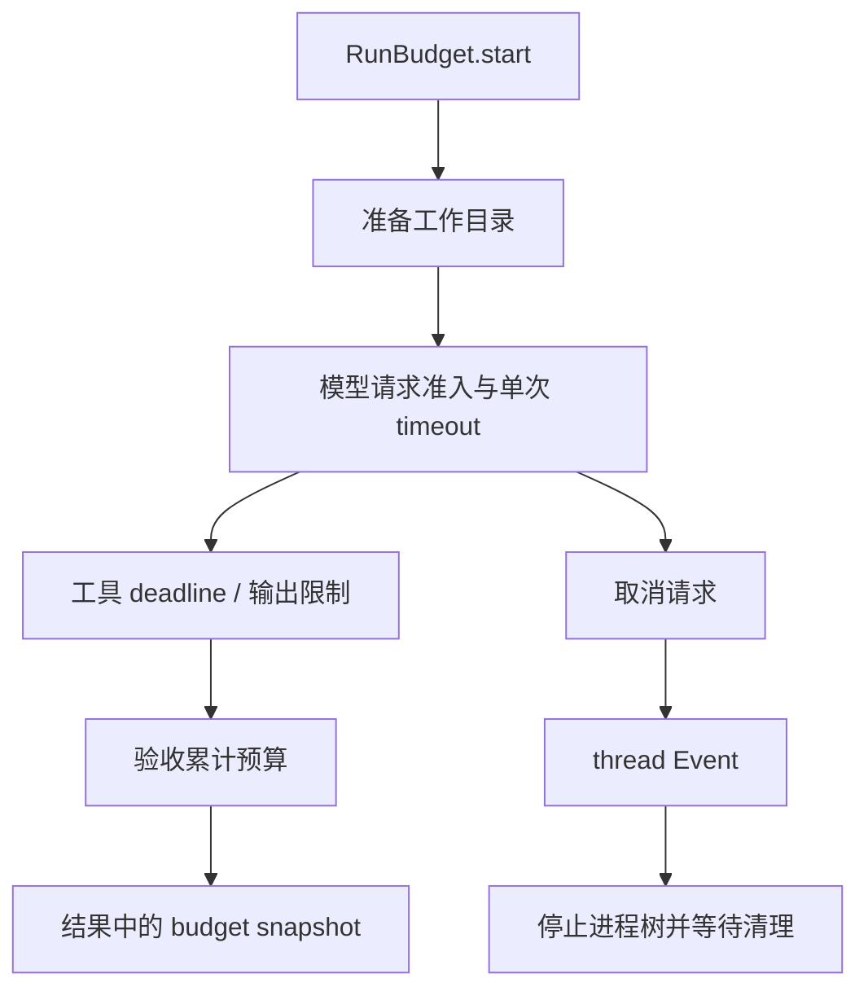

# E3：预算、取消与资源生命周期

## 目标与流程

单次调用超时不足以约束 Agent：它可以不断重试、重复验证或重启。项目将全任务时间、模型次数、验证累计时间、工具输出和文件容量一起纳入运行生命周期。



## 从入口逐层追踪

1. `runtime/budget.py:RunBudget.start(config, recovery)` 返回包含 started_at、deadline_at、单调时钟 deadline、evaluation_limit 和已用验证时间的对象。新任务用墙钟建立绝对截止时间；恢复取绝对截止时间剩余量和保存 remaining_seconds 的较小值，不能重新获得完整预算。
2. `remaining` 取单调时钟和墙钟剩余时间最小值。单调时钟适合进程内计时，墙钟用于跨进程截止时间；组合仍不是抵抗任意时钟攻击的分布式时间协议。
3. `shared/steps.py:decide_step` 请求前检查总次数并递增 request_count 和 attempts_in_turn，再持久化准入/llm_inflight；每轮至多三次尝试。异常重试也耗请求次数。SDK 自动重试禁用，避免应用只记一次而 SDK 偷偷发多次。
4. `DecisionService.decide` 使用 wait_for 包裹 Agent；`ToolExecutionService.execute` 用工具超时和 context.deadline 双检查；create_file 超时给出 manual_recovery_required，因为写入结果可能不确定。
5. `RunBudget.evaluation` 是上下文管理器：有效时间为全局剩余与累计验收剩余之较小值，在 finally 累加实际经过时间。AcceptanceService 传播这个 deadline 给 Verifier。EvalRunner 的 hidden tests 继续扣 outcome 中剩余预算，而不是开启新任务计时器。

## asyncio 取消为什么还要线程协作

项目关键代码（`processes.py:run_cancellable`，节选）：

```python
worker = asyncio.create_task(asyncio.to_thread(function, *args, cancel=cancel, **kwargs))
try:
    return await asyncio.shield(worker)
except asyncio.CancelledError:
    cancel.set()
    # 实际代码继续等待 worker，处理重复取消，再重新抛出原取消
```

原理补充：协程由事件循环在 await 处让出执行；取消向 Task 注入 CancelledError，并不强杀正在执行的线程。wait_for 会请求取消并等待处理，实际返回时间可能超过 timeout；shield 保护 worker 不因外部等待者取消而被直接取消。项目利用 Event 通知同步函数停止，并等待 worker 清理完再把取消传播给上层。[Python 3.12 asyncio 官方文档](https://docs.python.org/3.12/library/asyncio-task.html)

因此这里追求“资源清理后再返回”，不是严格在 N 秒时强行返回。若同步函数从不检查取消且永不返回，协作取消仍可能等待很久；不能把 to_thread 当作可强杀线程池。

## 子进程所有权

`run_process` 接收命令列表、cwd/env/log、timeout、output_limit 和取消 Event，返回 ProcessResult。Windows 先启动等待 stdin 的 launcher，绑定私有 Job Object 后才发送目标命令，减少目标在 Job 绑定前逃逸的窗口；Job 使用 KILL_ON_JOB_CLOSE。Unix 分支创建新 session，用 killpg 停止进程组。

stdout/stderr 各由读线程消费，共用锁和字节额度，增量 UTF-8 解码避免块边界损坏；跨块保留尾部处理秘密脱敏。监视循环检查超时、取消、输出和磁盘容量，任一触发便 stop_tree；正常父进程退出也清理其后代。finally 再确保停止、wait、join、关闭句柄；I/O 线程仍存活会报需要人工恢复，不静默遗弃。

`storage.py:CapacityReservation` 对文件容量准入做跨进程协调；`checkpointer.py` 在 SQLite 写前预留估算放大量、写后检查。这是本地配额策略，不能等同文件系统硬配额。

## 异常、权衡与扩展

| 场景 | 行为/剩余边界 |
| --- | --- |
| 模型取消或解析失败 | finally 尽力记账；未知用量保留未知 |
| 多次取消同一等待者 | 等待 worker 的循环继续处理取消，最终传播原取消 |
| 输出过量 | 保留受限日志，停止子进程，不把截断报告当完整证据 |
| Job 绑定失败 | 目标命令尚未发送，不应开始候选代码 |
| 宿主被强杀 | 普通 Python finally 不保证执行；依靠 OS 所有权与后续恢复检查 |
| 多 worker | 每 run 锁及本地准入已有，但没有集群队列、公平调度、跨机器限额或硬 CPU/内存限制 |

硬隔离需要容器/cgroup/更完整 Job 限额等额外设施；当前不具备。增加集中队列前，应先定义取消、租约丢失和重复领取的语义。

## 测试与掌握路径

`test_processes.py` 覆盖输出上限、跨块脱敏、父子进程停止、取消等待清理和 Job 绑定失败；`runtime/test_request_budget.py`、`test_model_reconciliation.py` 检查请求与恢复预算。

知识点：单次/累计预算、墙钟/单调时钟、取消传播、进程树所有权。五层路径：解释停止条件→追踪 deadline→解释 await/取消/线程→比较协作清理与硬截止→分析多 worker 超时和资源泄漏。最值得展示“超时后谁负责把工作真正停下来”。
