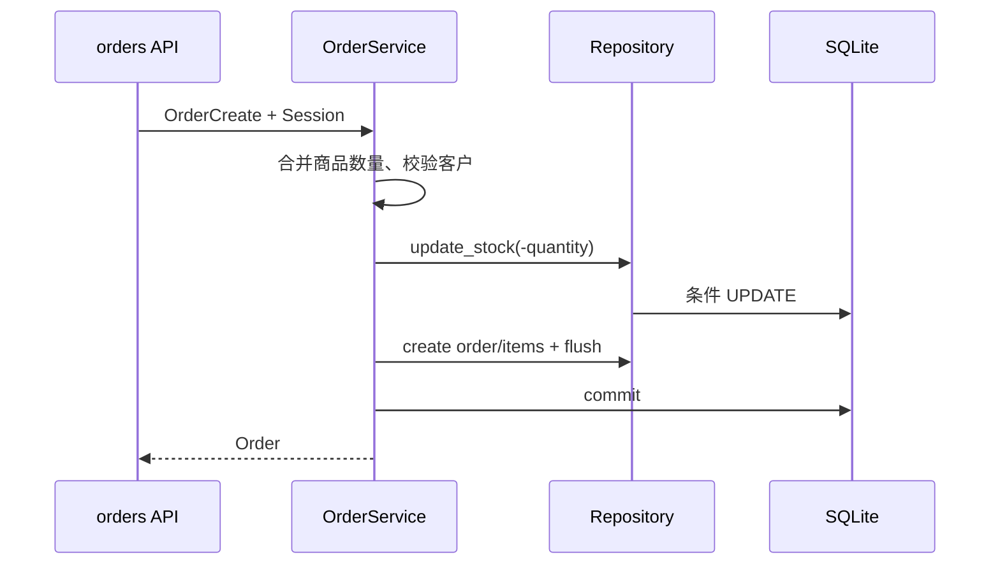

# E7：ShopFlow 订单事务与并发控制

本文只分析 `shopflow-order-service` 当前业务代码，不把 DevPilot 的 benchmark baseline、start.patch 或 reference.patch 当作当前订单服务。

## 目标与分层

创建订单需要同时满足库存非负、订单和明细完整；取消需要只回补一次。API 负责输入与 HTTP 错误，Service 负责跨实体业务事务，Repository 执行查询/更新，Session 管理事务与 ORM 对象。支付仅模拟状态，不调用真实资金系统。



## 逐层源码与状态变化

1. `app/db/database.py:get_db` 每请求创建 SessionLocal，yield 后 finally close；配置 autocommit=False、autoflush=False。close 是释放资源，不替代业务成功时的 commit。
2. `app/api/orders.py:create_order` 接收 Pydantic OrderCreate 和依赖 Session，调用 Service；业务 ValueError→400，locked/busy OperationalError→503。pay/cancel 状态冲突→409，不存在→404。字符串匹配错误原因可维护性有限，未来可改类型化领域错误。
3. `OrderService.create_order` 拒绝空 items、非正整数数量，用 product_id→quantity 字典合并重复商品；按 ID 排序遍历，防止同一商品分两行分别检查造成误判。排序统一访问顺序，但不宣称能消灭所有数据库死锁。
4. 检查客户/商品存在，保存 unit_price 快照，累计金额，调用库存条件更新。优惠券无效或后续任何步骤异常都会进入 rollback。
5. `OrderRepository.create` add Order 后 flush 获取 ID，再创建 OrderItem 并 flush；不 commit。Service 最后 commit、refresh。Repository 若提前 commit，第二件商品失败就无法回滚第一件的扣减。

关键库存表达式：

```python
update(Product).where(Product.id == product_id, Product.stock + delta >= 0)
    .values(stock=Product.stock + delta)
```

这里判断和修改由一条数据库语句执行；rowcount != 1 表示未成功匹配，Service 将其视为库存不足等失败。对比 Python 先读 stock 再写固定数值，SQL 使用数据库中的当前值计算，避免应用层读改写的丢失更新窗口。但库存语句成功后事务仍可能失败，必须与订单一起提交。

## 支付与取消

`transition_status` 使用 `WHERE id=? AND status IN expected` 更新并检查 rowcount。支付 expected=(pending,)，失败再查询以区分不存在和状态冲突。重复支付被拒绝，不是按请求键重放相同响应的接口幂等。

取消 expected=(pending, paid)，只有 changed=True 才遍历明细回补库存；已 cancelled 返回现状不再回补，shipped/completed 拒绝。状态更新和库存回补在同一事务：回补失败也 rollback，不能留下“已取消但未还库存”。这里 CAS 指条件比较并更新，不是 CPU 指令，也不是 SQLAlchemy version_id 版本锁。

## 技术原理与约束

原理补充：flush 把 ORM 待写变化发送为 SQL，仍处于事务中；commit 完成事务，rollback 撤销未提交修改。flush 不是“小提交”。Session 还维护对象身份与状态，refresh 用数据库结果刷新对象。[SQLAlchemy Session 官方文档](https://docs.sqlalchemy.org/en/20/orm/session_basics.html)

SQLite 同时只允许一个写者，条件更新保证业务条件不代表高写吞吐；锁冲突可能失败，需要应用处理。[SQLite 隔离文档](https://www.sqlite.org/isolation.html) 当前代码没有配置 WAL，不能把 WAL 优点算作已实现能力。

## 异常与替代方案

| 场景 | 当前机制/限制 |
| --- | --- |
| 多商品后半段失败 | rollback 撤销此前库存和订单写入 |
| 两请求抢最后库存 | 条件 UPDATE 竞争；可能成功一个或有锁失败，不能承诺所有请求自动重试成功 |
| 支付与取消竞争 | 数据库条件状态转换决定执行资格，无外部扣款副作用 |
| commit 成功后 refresh/响应失败 | 后续 rollback 不能撤销已提交事务；客户端重试下单仍可能重复 |
| 金额精度 | 当前 float，不是金融级金额模型 |

Redis 锁引入租约、续期和数据库间一致性成本，不能替代事务；当前单库条件 UPDATE 更直接。版本号乐观锁适合更复杂对象并发修改，悲观锁适合长链读后决策，但 SQLite 与其他数据库锁语义不同。下单幂等键+唯一约束、Decimal、生产数据库和 outbox 都是未来建议。

## 测试与面试路径

`tests/services/test_order_integrity.py` 包含重复商品合并、故障注入 rollback、取消一次回补、并发下单和支付/取消。第一阶段已执行 17 项通过，本阶段不把该结果写成新的生产压测。

掌握：事务边界、条件更新、flush/commit、状态幂等与请求幂等。五层路径：讲下单→跟到 SQL→解释原子性/锁→比较条件更新与 Redis→讨论提交成功但响应丢失。最能展示后端能力的是明确不变量和失败边界。
