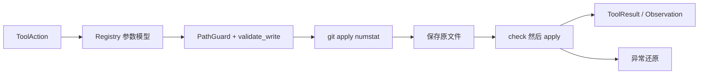

# E5：受控文件修改与补丁

## 目标和流程

模型输出的路径与补丁是不可信输入。模块需要限制可触及文件、阻止破坏测试证据、在普通应用失败时恢复原内容，并把结果变为可观察反馈。

## 逐层实现

1. `tools/registry.py:register` 建立名字→工具对象字典，并支持点号转换为下划线的别名；重复名或别名冲突拒绝。execute 查找工具、使用其 input_model 校验 arguments；未知工具和参数错误返回失败 ToolResult。
2. 执行放入 execution_scope，传递 deadline 和最大输出；结果 JSON 编码超过预算时返回失败而非截断成不合法对象。PermissionError/普通 Exception 转换为失败；ArtifactQuotaExceeded 明确重抛，CancelledError 也不属于普通 Exception。注释“never raises”不能当真实契约。
3. `PathGuard.validate_path` 组合根路径并 resolve，检查最终路径仍在根内，再逐级拒绝符号链接/junction，按 workspace-relative 名称检查禁止路径。避免使用字符串前缀误判诸如 repo-other。根本身为链接也拒绝。
4. `ApplyPatch.execute` 解析初步路径并调用 validate_write；通过 Git `apply --numstat -z -` 获取权威目标清单，再逐个验证。以 NUL 分隔减少空格路径解析问题；不能只信模型声明的 modified_files。
5. 保存每个目标原始 bytes，不存在者记录 None，并限制补丁和回滚内容总大小。依次尝试普通参数、unidiff-zero、再忽略空格变化；每种先 `--check` 成功才实际 apply。不是 README 所写 patch/difflib 后备。
6. apply 及后续查询期间捕获 BaseException，存在者写回 bytes，不存在者删除新文件，再抛原异常。成功返回实际修改文件结果，失败诊断回到 Agent。Registry 转换异常并不意味着底层写入从未发生。

## Git 与文件系统原理

工作区是磁盘文件，暂存区是准备提交的内容集合，commit 是版本快照。当前补丁目标是工作区；`git apply --check` 只验证是否能应用，不提交文件，也不锁住外部编辑者。check 与 apply 之间存在时间窗口；本地 run 锁约束项目自身执行者，不阻止用户或其他程序同时改文件。

最终验收 E1 使用文件清单与 `git diff --no-index`，不只依赖工具返回的 Git 工作区摘要。这是编辑反馈与最终证据的不同职责。

## 异常矩阵与改进边界

| 情况 | 处理/残余风险 |
| --- | --- |
| 路径越界、链接、受保护测试 | 写前拒绝；验证时再复核 |
| 补丁部分无效 | 预检查避免混合补丁部分落地；见 test_mixed_valid_invalid_patch_leaves_files_unchanged |
| CRLF 文件与 LF patch | 有测试覆盖，不应宣称会统一规范所有行尾 |
| 普通异常/协程取消 | 尝试还原；磁盘满等也可能让还原本身失败 |
| 进程被强杀 | Python 异常处理不会运行；需 E2 判断不确定副作用 |
| 并发外部替换路径 | resolve/检查不是内核原子打开；可信本地边界仍成立 |

引入 staging 副本后交换可减小部分写窗口，但多文件原子交换仍需额外设计；容器、系统权限隔离才用于执行不可信程序。现有工具白名单不是完整安全沙箱。

## 面试掌握路径

四点：参数验证、规范化路径、预检查与原子性的区别、回滚与崩溃恢复的区别。五层路径：解释允许什么工具→追踪补丁→解释路径/Git→比较工作区回滚与 staging→分析强杀、磁盘满和外部并发编辑。重点展示多层边界，而不是声称绝对安全。测试入口为 `tools/test_registry.py`、`test_path_guard.py`、`test_patch_atomicity.py`。
