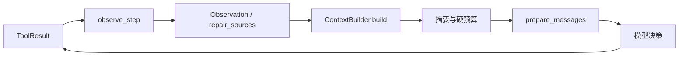

# E6：上下文与修复反馈

## 目标和位置

模型每次只看到本轮请求消息，Runtime 必须把任务、进展、错误和下一步约束重新投影到有限窗口。ContextBuilder 读取领域状态，不执行工具、不自行查询向量库；它是运行内信息选择器，不是长期记忆系统。

## 逐层源码

1. `shared/steps.py:observe_step` 对失败 test.run 补充结构化 test_failure，经 StateManager.apply_tool_result 记录 Observation。Observation 含 step_id/source/name/success/summary/data/duration，不只是拼接 stdout。add_observation 同时增加 current_step 和 total_steps，因此步数也包括计划/运行时反馈，不能直接等于工具次数。
2. StateManager.set_repair 用 repair_sources 集合维护 test 与 verification 等来源，repair_required 是集合是否非空。一次开发测试通过只清除 test 源，不应该擦掉独立验证拒绝。
3. `ContextBuilder.build(state, workspace_path)` 依次构建系统提示、工具 schemas、完整任务、状态块和阶段指令。阶段指令分别鼓励探索、计划、编辑和验证；它们是模型行为引导，不是强制先计划再编辑的安全状态机。Runtime 本身允许探索阶段使用 code 工具后进入 implementing。
4. `_build_state_content` 保留最新完整计划，优先显示最后一条 guardrail_feedback；倒序寻找最近测试失败，若遇到更新的成功测试则停止，避免旧失败覆盖新事实。verification_report 作为独立状态字段提供验收失败内容。
5. 最近默认 10 条观察显示较详细格式；旧观察每项摘要裁剪到 100 字符，并另提取 explored/modified/tests/failures。它是确定性规则摘要，没有调用另一个模型做总结。已探索文件列表不是文件内容的无损保存。
6. 超长或观察超过 20 条时 `_compress_context` 临时把近期观察数降到至少 8，再恢复原配置。最终 `_enforce_limit` 以 max_context_chars-reserved_chars 为硬限制，在深复制的状态投影中逐步移除可删观察，不删除真实历史状态。修复所需最近失败和最后 guardrail 受保护；任务/计划等固定内容仍过大时抛 ContextBudgetExceeded，不无限裁剪到假装可用。
7. 模型协议 `prepare_messages` 再加入 schema 提示并校验最终消息字符数，避免 ContextBuilder 预算没算后加提示。具体预留值的装配入口见 bootstrap，不能只看 build 返回值判断最终请求大小。

## 失败反馈的闭环

test.run 失败→结构化失败→设置 test 修复源→下轮 CURRENT TEST FAILURE；verify 失败→reject_verification 增加 retry_count、添加 Observation、保存 report→下轮 INDEPENDENT VERIFICATION FAILURE。计划空转还受 LoopGuard 的软反馈和硬停止约束。因此“自我修复”是模型接收证据后继续工具动作，不代表模型必然能修好。

## 原理、权衡和边界

字符预算易计算且跨供应商稳定，但不等同 token：中文、代码和不同 tokenizer 的比例不同。规则摘要低成本且可重复，却会丢行号细节或早期推理依据；模型可能需要重新读取文件。RAG 需要额外检索语料/索引/相关性机制，长期记忆需要跨 run 存储和更新策略，当前均未实现。

| 场景 | 当前行为/风险 |
| --- | --- |
| 旧失败后新测试通过 | 新结果优先，测试失败块不再展示旧错误 |
| 计划或任务本身超过预算 | 硬失败；不能靠删除必要需求解决 |
| 信息裁剪后再次读取 | 可能合理，也可能形成循环；由守卫和预算约束 |
| 工具内容含诱导指令 | 结构化呈现不等于消除 prompt injection；真实执行仍靠工具权限和验证限制 |

未来可按工具内容优先级保留引用、使用供应商 tokenizer、按需重新获取证据；需测试相关信息保留率，不能只追求短消息。

## 测试和知识路径

`runtime/test_context_feedback.py` 确认成功创建不被写成失败、后续通过覆盖旧失败；`test_context_compression.py` 和 `test_repair_loop.py` 为预算及修复入口。

掌握：状态到消息的投影、规则压缩、修复来源、字符与 token。五层路径：说明模型能看到什么→跟踪 Observation→解释有损摘要→比较保真与成本→分析超大任务/陈旧失败。展示重点是让反馈对应最新事实，而不是泛称“做了记忆系统”。
