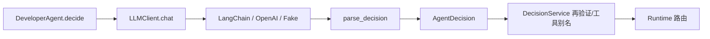

# E8：模型适配与结构化决策

## 设计目标与入口

供应商返回的是不可靠外部数据。适配层把它转换为共同 AgentDecision，让运行时只处理明确的业务分支；Fake 则替换网络，验证编排与工具契约。



## 接口与协议逐层解析

1. `llm/base.py` 定义 LLMMessage、LLMResponse、LLMRequestRecord 和 LLMClient。DeveloperAgent 输入消息列表、转换工具 schema，调用 chat(context, tools)，返回 response.decision；finally 优先保留适配器 last_request，否则保留自己的兜底记录。
2. `llm/protocol.py:prepare_messages` 将领域消息转换为 role/content dict，首条 system 追加 SCHEMA_HINT；不存在 Available tools 块才补工具描述，最后检查字符上限。工具 schema 放进提示文本不等于供应商原生 function calling。
3. `LangChainLLMClient` 使用 ChatOpenAI，显式 max_retries=0、streaming=False、use_responses_api=False，通过 extra_body 保持 max_tokens 传输约定，并 bind response_format=json_object。ainvoke 后读取 response_metadata/usage_metadata，要求 content 为字符串，再交 parse_decision；本地禁用 LangSmith tracing。
4. `parse_decision` 先去 Markdown 代码围栏，尝试 model_validate_json；失败后扫描第一个 `{` 到匹配 `}` 再验证。这里是兼容兜底，不是完整容错 JSON 解析器。
5. `domain/decision.py` 三个可空字段由 after validator 保证恰有一个非 None：

```python
if sum(x is not None for x in (self.action, self.finish, self.plan_update)) != 1:
    raise ValueError("Exactly one of action, finish or plan_update is required")
```

action 包含 tool 与自由 arguments dict；finish 含 summary 与 low/medium/high risk；plan_update 是 ImplementationPlan。外层通过不证明工具存在或参数合法，Registry 再按具体工具 input_model 验证。finish 合法也不证明任务完成，仍需 E1。
6. DecisionService 对返回决策重新验证并规范工具别名；Graph 路由再检查单分支。校验分布在不同信任边界：协议形状、工具参数、业务验收，职责不同。

## 请求账本与异常

适配器在发出请求前建立 record；响应后记录 model、token、耗时，解析前标记 parse_error，通过才 success。异常记 error_type，finally 写耗时；LangChain callback 额外保留 CancelledError，避免框架错误聚合吞掉取消。Runtime 在每次尝试的 finally 记账，Graph 另以 durable receipt 跨重启对账。

JSON object 模式仅请求 JSON 格式，不证明字段满足 Pydantic，更不保证生成的 patch 正确。Pydantic 承担解析/字段约束；本类未统一设置 extra=forbid 或 strict=True，不应声称严格拒绝所有未知字段和类型转换。

| 异常 | 当前行为/边界 |
| --- | --- |
| 非字符串响应 | ValueError，Runtime 按尝试策略处理 |
| 零分支/多分支 | Pydantic 拒绝 |
| 未知工具/参数错误 | Registry 返回失败观察 |
| 网络错误/超时 | 次数继续计入；远端是否已计费可能未知 |
| usage 缺失 | 不伪造精确 token，保留 unknown |
| 前后杂文中 JSON 字符串含花括号 | 兜底扫描不理解转义/字符串，可能截错；这是静态发现的边界，未声称本轮已复现生产 Bug |

## 权衡与优化

共同 JSON 协议方便兼容供应商与 Fake，但重复提示和自定义解析需要维护。原生工具调用或 JSON Schema 严格输出可减少形状错误，仍不能替代工具权限和业务验证；供应商兼容性需要单独测试。建议用真正 JSON decoder 的位置解析改进兜底，并加字符串括号/多对象测试；本轮不改业务代码。

SDK 重试禁用让 Runtime 明确拥有重试与预算；代价是应用承担错误分类。目前普通 Exception 可进入有限重试，不代表有完整的指数退避或错误分类策略。

## 测试和面试路径

`llm/test_langchain.py`、`test_langchain_transport.py` 覆盖协议/传输，`domain/test_models.py` 覆盖决策模型，`runtime/test_model_ledger.py`/`test_model_reconciliation.py` 覆盖请求事实。

掌握：协议适配、分层验证、重试所有权、未知计费。五层路径：说明三类决策→追踪 chat 到 Registry→解释解析与业务校验→比较通用 JSON 与原生工具调用→分析超时重试和错误 JSON。展示重点是如何约束模型输入后端，而非声称 JSON 模式保证正确。
