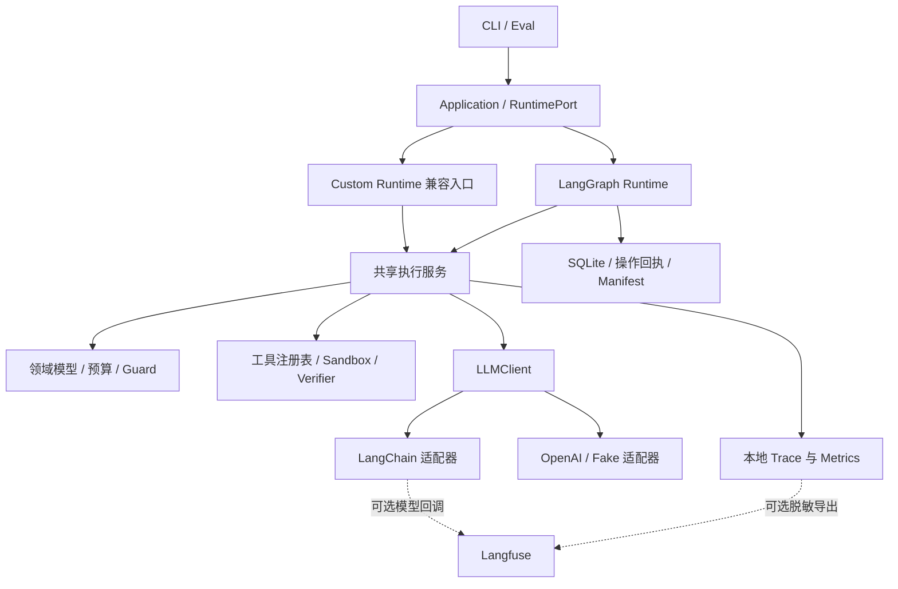

# DevPilot 完整重构开发计划

核对日期：2026-11-03。依据：当前工作区代码、已有测试日志和重构记录，而非仅依据 README。本文是开发与验收计划，不代表所有阶段已完成。本次只新增计划文档，不改动业务实现、运行默认值或正在采样的性能脚本。

范围调整（2026-11-03）：用户明确表示没有 Linux 验收环境，要求“先跳过”。因此本文后续原计划中的 Linux 实测门槛本轮豁免；继续 Windows 验收、安装包恢复、回滚与默认切换。Linux 标为未验证，不以配置存在宣称通过。

## 1. 结论与范围

采用渐进替换：LangGraph 负责流程编排与图状态持久化，LangChain 负责模型调用适配，现有领域模型、受控工具、Sandbox、预算、确定性 Verifier 和 Eval 继续承担业务约束。Langfuse 作为后续独立的可选观测模块接入。

当前已经存在可执行的 LangGraph 和 LangChain 实现，因此不应重新启动一次全量重写。当前重点是完成双运行时验证、跨平台证据、性能判断、打包与回滚，再切换默认值。

已有记录明确暂缓 Langfuse；本计划保留其完整后续工作包，P0–P5 不以 Langfuse 上线为前提。未来需要重新确认部署位置、允许上传的数据和凭证配置，不能因安装 SDK 就默认开启远端导出。

本期不扩展多 Agent、并行文件写入、RAG、向量库、分布式任务调度或人工审批 UI。后续有明确业务需要再引入。

## 2. 当前代码事实

以下路径相对项目根目录。

| 范围 | 当前实现 | 重构判断 |
| --- | --- | --- |
| 入口与依赖注入 | `devpilot/devpilot/application/{factory,bootstrap,runtime}.py`；`runtime/contracts.py` 已有 RunRequest、RunOutcome、RuntimePort | 稳定边界已建立；进一步消除具体运行时命名和类型残留 |
| 默认配置 | `settings.py` 仍为 runtime=custom、llm_backend=openai | 默认切换尚未完成，不应提前修改文档为全面迁移成功 |
| LangGraph | `runtime/langgraph/graph.py` 编译真实 StateGraph，含 prepare、guard、context、decide、apply_plan、execute_tool、observe、verify、fail、finalize | 已完成主体，重点验证分支和异常语义 |
| 共用执行逻辑 | `runtime/shared/` 提供共享生命周期、执行步骤、上下文和守卫；custom 保留编排 | 保持单份业务规则，防止两套运行时持续分叉 |
| LangChain | `llm/langchain.py` 使用 ChatOpenAI，复用 `protocol.py`、`decision_parser.py` | 保留 JSON action/plan_update/finish 协议；不同时迁移 native tool calling |
| 模型请求兼容 | 显式关闭 SDK 重试与 Responses 路径，保留 max_tokens 线协议；维护取消、usage、请求记录 | 升级依赖时重点回归；避免多层重试使预算失效 |
| 持久化 | `runtime/langgraph/checkpointer.py` 提供带容量检查的 SQLite saver；`operations.py` 提供操作回执 | 图 checkpoint 与外部副作用必须共同验证，不能把存图等同于恰好执行一次 |
| 恢复路由 | `runtime/manifest.py`、`application/runtime.py` 根据 manifest 选引擎；支持经校验的旧 custom checkpoint | 不做 custom 与 graph checkpoint 自动互转 |
| 观测 | `tracing/events.py`、`writer.py`、`identity.py` 已有本地 JSONL 和事件标识 | 本地文件继续用于审计；远端观测不参与成功判定与恢复 |
| 评估 | `evals/runner.py` 已调用应用层 RuntimePort；保留 hidden tests 和结果状态 | smoke、能力评估、执行失败必须分开统计 |
| CI | `.github/workflows/ci.yml` 已声明 Windows/Ubuntu、测试、benchmark、wheel 验证 | 配置存在不等于已获得本次改动的 Linux 执行证据 |

特别需要清理：应用适配器名为 `CustomRuntime`，实际承担两种引擎的入口；bootstrap 返回注解仍指向 CustomAgentRunner。建议后续改为中性名称及结构化协议，并保留必要兼容导出。该整理安排在当前性能采样结束后。

## 3. 已有验证及其边界

| 证据 | 已核对结果 | 不代表什么 |
| --- | --- | --- |
| `runs/p5-full-regression.txt` | 607 passed，2 skipped；两个跳过涉及 Windows symlink 支持 | 不覆盖后来新增的业务契约测试和旧 checkpoint 路由修改 |
| `runs/p5-graph-business-contracts.txt` | 16 passed，覆盖修复、规划、验证等复用契约 | 其中有直接测试共享 guard 的用例，不能把全部算成图端到端测试 |
| `runs/p5-legacy-routing-fixed.txt` | 9 passed，旧路由、manifest、入口相关 | 不代表任意历史 checkpoint 可跨版本恢复 |
| 已有安装包记录 | 候选 wheel 在源码外安装并验证两种 Fake 运行时；历史环境恢复有单独记录 | 候选包早于最新路由修复，最终必须重新构建 |
| `runs/p5-overhead-command.txt` | 本次检查已记录 4/10 配对完成 | 未完成十组；无最终性能验收结论 |

已有 remaining-gates.md 部分行仍写“旧路由未修复”“性能仅完成 lint”，与最新代码及日志不一致。最终应将其改为当前状态表，implementation-status.md 保留历史流水，避免两者共同承担“最新状态”职责。

## 4. 目标架构与职责

四项必须保持的约束：

1. LLM 的 finish 只是完成意图，必须通过现有确定性验证才能形成成功结果。
2. 工具调用始终经过原注册表、路径与文件策略、进程限制、输出限制和预算；框架工具封装不能提供旁路。
3. 图状态只保存可序列化数据。模型客户端、进程句柄、锁、连接、密钥和服务对象由运行时依赖注入。
4. 图状态是流程恢复依据，操作回执用于副作用对账，manifest 用于兼容路由，本地 trace 用于审计；Langfuse 仅用于观察和分析。

## 5. 分阶段工作包

### P0：冻结基线与验收契约（已有基础，补齐发布基线）

任务：
- 当前工作区包含大量已有改动，先区分原有硬化工作和框架迁移，生成确定源文件哈希、锁文件、配置快照、工具版本、测试结果和产物清单。
- 固化 CLI、RunRequest/RunOutcome、AgentDecision、终态、预算、恢复拒绝条件和评估状态的契约。
- 记录 supported Python/OS、依赖版本和 checkpoint schema 支持范围。
- 保存原 custom 发布包和恢复环境；历史 231 文件归档不能被描述为整个仓库完整备份。

交付：基线清单、行为差异表、兼容策略、回归用例清单。验收：每项测试和 wheel 均能关联到同一份源码与依赖；不通过放宽测试来追平新引擎。

### P1：稳定应用边界与共享业务服务（主体已实现）

任务：
- CLI 和 Eval 仅通过 RuntimePort 调用，不读取具体 runner 私有属性。
- custom 与 graph 复用同一份上下文、决策解释、工具执行、验证、预算、结果构建逻辑。
- 完成 CustomRuntime 命名、bootstrap 返回类型和兼容模块的整理，检查循环依赖。
- 配置只在应用层解析，run 使用冻结配置；禁止恢复时悄悄套用新的默认值。

交付：中性应用适配器、共享服务边界及依赖规则。验收：切换运行时只影响装配和编排，工具/Verifier 规则不变；CLI 与 Eval 均覆盖双引擎。

### P2：LangChain 模型适配（主体已实现，完成兼容验收）

任务：
- 保留 LLMClient 和现有 JSON 协议，复用提示构建与容错解析。
- 锁定并验证 base_url、模型名、温度、max_tokens、JSON 模式和 usage 映射；不假设所有 OpenAI 兼容服务行为相同。
- 只保留一层业务重试策略；每次实际请求均记账，取消和未知 usage 不能算作零消耗。
- 验证超时、429/5xx、畸形 JSON、缺少 usage、外部取消、SDK 异常包装与全局回调环境。
- 保留 Fake 优先级，以及 openai/langchain 显式选择；防止 shell 的全局追踪变量意外启用远端传输。

交付：适配器兼容表、MockTransport 契约测试、锁文件。验收：离线传输测试通过；如后续进行真实模型验证，独立列出服务商、预算和样本，不以 Fake 结果宣称真实模型能力。

### P3：LangGraph 编排与业务等价（主体已实现）

任务：
- 维持现有串行图：prepare → guard → context → decide；action → execute_tool → observe → guard；plan_update → apply_plan → guard；finish → verify → finalize 或回到 guard。
- 统一失败出口，明确哪些异常应终止、哪些允许业务重试、哪些必须向上传播取消/控制流。
- 确认步骤数、请求数、修复次数、最大运行时间与 custom 的相同语义。
- 将原规划、repair、自我修正、验证失败、重复动作和上下文限制用例纳入双引擎矩阵。
- 明确 graph recursion_limit 与业务 max_steps 的映射，覆盖小预算和边界值，避免框架提前中止。

交付：图拓扑、状态字段说明、等价性报告。验收：确定性 Fake 输入下，两引擎终态、工具序列、关键计数、验证证据和最终 diff 一致；graph 允许增加明确记录的内部 trace/checkpoint。

### P4：持久化、崩溃恢复与兼容（已有较多实现，补足系统证据）

任务：
- 保持 run_id/thread_id 对应关系、每 run 锁和 SQLite 隔离；并发恢复同一 run 必须拒绝或串行化。
- 逐一核验工具、模型请求、Verifier 的 prepared/completed 回执及预算对账。
- 对执行已发生但完成回执未落盘的未知副作用明确拒绝自动重放；不要承诺通用 exactly-once。
- 恢复保留原始截止时间、累计请求和验证开销，进程重启不能重置配额。
- 校验 schema、依赖、代码/配置身份、工作区指纹、可信验证文件与回执摘要；未知或冲突版本应给出可操作的拒绝信息。
- 旧 custom checkpoint 仅走受支持的旧路由；缺 manifest 的 graph 数据库拒绝猜测；两种 checkpoint 不互转。
- 补齐磁盘配额、损坏数据库、终态重复恢复、保存失败、关闭失败、进程强杀与依赖漂移矩阵。

交付：恢复状态表、故障注入报告、兼容矩阵、人工处理说明。验收：成功状态只在所需持久化完成后发布；崩溃恢复不隐瞒未知调用、不重复已确认的副作用、不重置预算。

### P5：发布验收、性能与默认切换（当前主要工作）

顺序：
1. 保持当前采样代码与生产源码不变，完成现有十组交替配对；不启动重复采样或并行重负载。
2. 用 summarize_runtime_overhead.py 检查完整性、配对契约、耗时和存储倍率。报告中位数、范围、每组差值及 SQLite 占比。十组不足以做稳定尾延迟推断。
3. 如开销明显，先 profile 状态序列化、checkpoint 次数、SQLite 写入和 trace 原子重写；优化之后重新采集独立样本。不可先取消必要持久化来满足速度目标。
4. 性能接受阈值尚未在记录中明确，单独形成 ADR：说明可接受的绝对耗时、倍率和磁盘预算及其业务理由。采样脚本成功不等于性能通过。
5. 完成 P1–P4 的剩余整理，冻结候选源码；运行包含新测试的完整回归、ShopFlow 测试及八个 benchmark 的验证。
6. 使用真实 Windows/Ubuntu 执行结果验收。确认 CI 中 check_wheel.py 的离线安装依赖缓存充分；空缓存环境需要显式允许锁定依赖下载，禁止依赖开发机偶然缓存。
7. 重建 wheel，在源码目录外的新环境验证 CLI、资源、custom/graph、旧恢复和显式回退；保存构建哈希与测试证据。
8. 默认切换作为独立、可回退的变更：runtime=langgraph、llm_backend=langchain。同步 CLI help、README、示例与配置说明，重跑最终默认入口、全量回归及安装包验收。
9. 显式 custom/OpenAI 回退保留至少一个发布周期；已有 run 始终根据 manifest 选择原引擎。切换新任务默认值不迁移在途任务。

交付：发布候选、完整验收报告、性能 ADR、操作指南、回滚演练。验收：最终测试与最终 wheel 对应同一源码；Linux 证据缺失或性能判断未完成时继续保持现有默认值。

### P6：Langfuse 可选观测（后续独立阶段）

任务分解：
- 定义 Observer/TraceSink 接口、NoOp 实现和 Langfuse 实现；保留本地 TraceWriter。依赖作为可选 extra，未启用时不要求凭证，也不发出请求。
- 统一 run_id、业务 trace、node、step、request_id、operation_id、attempt、release 和 runtime 标签；恢复时关联原 run，同时区分新的进程会话和真实新请求。
- 一个业务根 trace，下挂节点/工具/验证 spans 和 LLM generations。只给模型调用安装必要 LangChain callback；避免同时套多种自动 instrumentation 导致双重计数。
- 当前 LangChainLLMClient 固定传入本地 callbacks，需要增加明确的回调注入点；继续关闭非预期的 LangSmith 导出，并通过测试验证 Langfuse 开关的独立性。
- 自定义工具不经 LangChain ToolNode，所以不能仅靠 LangChain callback 覆盖工具执行、Verifier 和预算事件；从共享执行服务或统一事件适配层补齐。
- 在数据离开进程前做字段白名单和脱敏：默认只传摘要/计数/哈希；代码正文、提示、diff、绝对路径和 hidden-test 内容按明确策略处理；密钥永不上传。
- 使用有界队列、超时、批处理和有限 flush；服务不可用不影响任务终态与恢复。导出丢失要有本地计数，不能默默吞掉且宣称完整审计。
- usage 缺失保持 unknown；金额推算注明价格来源和版本。确定性 Verifier 分数与模型评审分数分开，远端评分不回写业务完成判定。
- 选择部署模式、维护责任、保留周期、访问权限和删除策略；若自托管，单独按所选版本验证基础设施要求。

交付：可选 SDK 适配、开关配置、脱敏测试、观测关联测试、故障降级测试和部署说明。验收：关闭时零远端请求；开启时每个模型调用只记一次；恢复不重复计算旧调用；导出故障与关闭 SDK 后仍可完整运行。

### P7：观测驱动的质量迭代（增强阶段）

在 P6 稳定后，再接入 prompt 版本和数据集实验。保存本地可用的提示版本与哈希，离线运行和恢复不能强依赖远端 prompt 服务。运行 benchmark 时关联代码、锁文件、提示、模型参数和结果。以任务成功率、hidden-test 通过率、修复成本、未知用量比例和耗时分析改进，不以 trace 数量作为质量指标。

## 6. 必须覆盖的测试矩阵

| 层级 | 组合/场景 | 通过标准 |
| --- | --- | --- |
| 应用入口 | run / resume / eval；显式参数与默认配置 | 正确装配；manifest 优先；不依赖源码目录 |
| 引擎与模型 | custom、langgraph × Fake；两引擎 × OpenAI/LangChain 的模拟传输 | 分别验证业务契约和传输契约，不把 Fake 当真实模型验证 |
| 业务闭环 | 正常完成、计划更新、测试失败修复、验证拒绝、重复动作 | 终态、关键计数、diff 与证据满足原契约 |
| 预算与取消 | 请求上限、总时间、工具超时、取消、unknown usage | 无隐藏重试、预算重置或错误成功 |
| 进程恢复 | 模型/工具/Verifier 前后、checkpoint 保存窗口、终态发布前后 | 已知回执复用；未知副作用停止；计费不遗漏 |
| 兼容与存储 | 旧 custom、缺失 manifest、版本漂移、文件篡改、配额/磁盘异常 | 按矩阵恢复或明确拒绝；不转换未知状态 |
| 平台与包 | Windows / Ubuntu；干净环境安装 wheel | 全套必要检查与资源完整性通过 |
| 可观测性 | Langfuse off/on、网络异常、队列满、敏感字段、恢复 | 不影响业务正确性；无意外外传与重复计数 |

## 7. 开发排期与交付拆分

以下为一名熟悉现有代码的开发者的工程量估算，不是固定承诺；不含获取 CI/部署资源及长时间真实模型实验的等待。

| 工作包 | 剩余估算 | 主要交付 |
| --- | --- | --- |
| P0/P1 收口 | 1–2 人日 | 源码证据清单、中性接口、契约说明 |
| P2/P3 补验 | 1–3 人日 | 模型/业务矩阵、边界缺口修复 |
| P4 恢复验收 | 2–4 人日 | 兼容与故障报告、恢复操作指引 |
| P5 发布 | 3–5 人日 | 性能判断、跨平台回归、最终 wheel、回滚演练 |
| P6 Langfuse | 4–7 人日 | 可选接入、脱敏、降级、部署验证 |
| P7 质量增强 | 2–4 人日 | 数据集/提示版本与对照实验 |

P0–P5 剩余约 7–14 人日；P6/P7 另计约 6–11 人日。若恢复或性能验收暴露架构问题需重新估算，不用日历截止日期替代通过条件。

建议按审查边界拆分变更：基线与契约 → 应用边界 → 模型适配 → 图编排 → 持久化恢复 → 验收与发布 → 默认切换 → 可选 Langfuse。当前已有混合改动先梳理来源，不覆盖用户已有修改，不把所有内容一次提交为“引入框架”。

## 8. 发布与回滚规则

- 新任务回滚：显式选择 custom/OpenAI 或回退默认配置。
- 既有任务恢复：沿用 manifest 声明的 runtime/provider；不能给 graph run 强行指定 custom。
- 版本回滚：保留上一版本 wheel、锁文件、运行配置和对应恢复环境；复制保留 run 工件后再演练，旧版本不读写新 schema。
- 暂停切换条件：有未解释的业务结果差异、预算丢失、重复副作用、不可恢复终态、Linux 未验证或性能成本未接受。
- 结束兼容期前，确认没有仍需旧引擎恢复的活跃任务，并明确历史工件只读/恢复支持策略。

## 9. 最近执行顺序

1. 先完成已启动的十组性能采样，保留原始数据，记录当时的源码版本。
2. 更新 remaining-gates.md，使其与最新路由和业务测试事实一致。
3. 补齐 P1 命名/类型、剩余双引擎与恢复缺口；完成性能取舍。
4. 固定源码，取得 Windows/Ubuntu 完整回归与最终安装包证据。
5. 独立切换默认值并复验，交付回滚指南。
6. 再开始 Langfuse 工作包，先选数据策略与部署方式，再启用远端导出。

## 10. 官方资料

- LangGraph persistence：<https://docs.langchain.com/oss/python/langgraph/persistence>，用于核对 checkpointer 与 thread 状态的职责；本项目本地运行使用 SQLite，不据此宣称满足分布式服务部署。
- Langfuse LangChain 集成：<https://langfuse.com/integrations/frameworks/langchain>，用于核对 CallbackHandler 集成路径；按实际选定 SDK/锁文件实现，避免照抄过时示例。
- Langfuse masking：<https://langfuse.com/docs/observability/features/masking>，用于核对导出前脱敏能力；还需覆盖现有自定义事件字段与独立工具链路。
