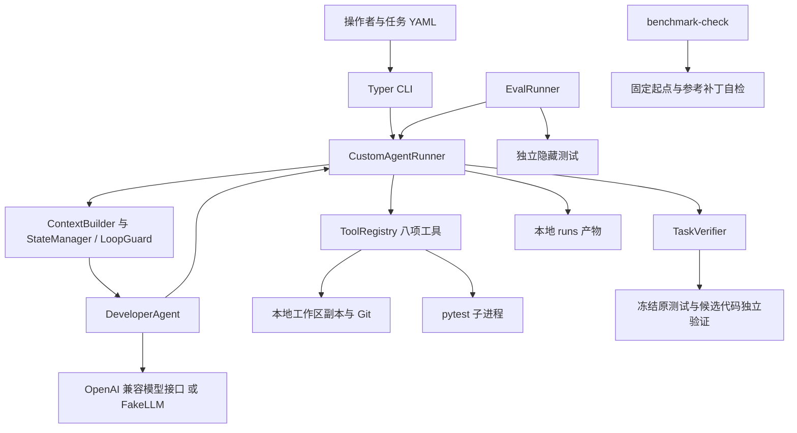

# 项目开发现状与完整架构分析报告

> 审计日期：2026-10-16（Asia/Shanghai）。工作区：`G:\program\CodingDev`。代码基线：`4a8a7780bc08cf18a4dfec3c0b91f3a15e39eae9`，审计开始时 `git status --short` 无输出。本文以当前有效代码和本次执行结果为依据，不沿用历史文档的完成结论。
>
> 审计范围：DevPilot CLI、模型适配、运行器、状态与护栏、八项工具、工作区、独立验收、评估与基准、追踪、ShopFlow API/Service/Repository/模型/Schema、现有测试、开发脚本和 CI。未调用真实模型，未启动公网服务，未操作实际业务数据库。仅新增报告与本地审计产物；未修改业务代码。

## 阅读结论与证据口径

**当前项目是一个可在本地运行、具备确定性测试与评估基础设施的 AI 编程代理原型。主产品是 DevPilot；ShopFlow 是随仓库提供的订单服务样例和能力评估靶场。不能把它解释成已经具备生产能力的电商系统，也不能把参考补丁自检或 FakeLLM 冒烟测试解释为真实模型开发成功。**

现有代码已将“任务输入—隔离副本—代码工具—测试反馈—修复—独立验收—结果归档”串接起来。重要不足是：真实模型能力证据缺失、空决策可能绕过循环预算、搜索可绕过禁止文件读取规则、测试进程没有操作系统隔离、运行不可断点恢复。ShopFlow 另有已复现的数量、库存与事务缺陷。

本文的四种功能状态：

| 状态 | 本文含义 |
|---|---|
| 已实现且验证可用 | 相关实现已追踪，且本次执行的本地测试或定向复现提供证据；仅限对应场景 |
| 已实现但未充分验证 | 有有效调用链，但真实模型、真实部署、并发或长期运行证据不足 |
| 部分实现 | 有入口或部分处理，但业务闭环、异常处理或验证缺失 |
| 尚未实现 | 在本次检查的有效入口、模块和依赖中未找到实现；不等于原计划必须包含此功能 |

问题分为“已确认问题”“潜在风险”“待验证事项”。严重程度：P1 为上线或扩展使用前应解决的安全、预算、数据一致性问题；P2 为影响可靠性和正确性的明显缺口；P3 为可维护性、信息质量问题。严重程度与使用方式有关：ShopFlow 的电商上线风险不应被误认为 DevPilot 本地演示必须完成的产品需求。

代码引用采用仓库相对路径及函数名，关键缺陷额外给出审计时行号；这些路径都相对于本报告开头的工作区。`runs/audit-20261016/` 是本次证据目录，默认被 Git 忽略，交接时应另行保存。

## 1. 项目概述与业务目标

### 1.1 实际业务定位

DevPilot 面向开发者或评估人员，接收包含需求、验收标准、限制条件的 YAML 开发任务，调用 OpenAI 兼容接口做决策，在目标代码库副本内完成搜索、阅读、修改、运行 pytest 和自我纠错，再由独立验收器决定是否完成。证据是 `devpilot/devpilot/cli.py::load_issue/initialize_components/run`、`agents/developer.py::DeveloperAgent.decide` 与 `runtime/custom/runner.py::CustomAgentRunner.run`。

它试图降低人工定位代码、编写补丁、重复测试和整理运行证据的成本。此业务价值是由实际调用链推导的定位，不是对商业收益或企业适用性的验证。当前使用者必须会准备任务文件、配置模型和 Python 解释器，并人工检查最终差异。

ShopFlow 提供客户、商品、优惠券、订单和订单状态转换的 FastAPI 示例。主代理在文件副本上读写和运行测试，不通过 ShopFlow HTTP API 驱动编程，也不要求先启动 Uvicorn。证据：`cli.py::initialize_components`、`workspace/sandbox.py::create`、`evals/benchmark.py::prepare_task`。

### 1.2 当前能力与业务预期的区别

| 业务诉求 | 当前代码能力 | 尚需人工或外部保障 |
|---|---|---|
| 从需求完成代码变更 | 本地 YAML → 模型决策 → 八项工具 → diff | 需求质量、模型服务、依赖环境、代码评审 |
| 判断任务完成 | 冻结原测试/配置，独立执行可见测试；按特定关键词要求新增测试 | 任意自然语言验收标准并未逐条自动证明 |
| 衡量模型能力 | 八项固定缺陷起点、隐藏测试、smoke/capability 区分 | 真实模型多任务实跑与统计证据 |
| 安全执行生成代码 | 路径校验、原测试保护、子进程超时、环境清理 | 宿主系统隔离、网络限制、资源与密钥治理 |
| 交付业务代码 | 保留工作区、diff、JSON 和日志，可人工查看 | 未实现自动提交到原仓库、建 PR、合并和部署 |

### 1.3 非本项目现有实现

当前仓库没有业务前端、DevPilot Web API、账户系统、向量数据库、消息队列或定时调度集成。FastAPI 自动接口文档属于 ShopFlow 的接口说明界面，不是业务前端。

## 2. 核心业务场景及完整业务流程

### 2.1 普通开发任务

1. 操作者执行 `devpilot run <issue.yaml>`。`load_issue` 要求 `id/title/description/acceptance_criteria`，记录输入文件路径，约束和 metadata 为可选内容。
2. `Settings` 合并显式参数、环境变量、dotenv 和默认值；`initialize_components` 注册八项工具，建立状态管理器、上下文、护栏、模型客户端、工作区和验收器。
3. 运行器生成 `run_<8位UUID片段>`，创建独立代码副本与新的 Git 基线。普通复制排除 `.git/__pycache__/.venv/*.db`，不是完整的秘密文件白名单。
4. `capture_snapshot` 在工作区之外的运行产物目录保存文件哈希、原始文件和受保护文件列表，冻结测试证据。
5. `ContextBuilder.build` 将系统规则、ShopFlow 固定说明、工具 Schema、任务、计划、近期观察和阶段提示组装为上下文。`DeveloperAgent.decide` 请求模型返回 JSON 决策。
6. action 经注册表校验参数后执行；结果变成 `Observation`，累计步数、修改文件和指标；阅读缓存随修改失效。plan_update 更新计划并推进计数。运行器依工具使用启发式推进阶段。
7. `test.run` 启动目标 Python 的 pytest，保存完整输出及 JUnit；失败解析器生成结构化失败供后续修复。失败增加累计重试数；成功清除 `repair_required`。
8. finish 是完成申请。验收器检查受保护文件、实际文件差异、禁改文件与修改数量，再将候选代码、冻结原测试及新增测试放入独立测试目录执行。
9. 验收通过才进入 completed；拒绝则反馈原因、增加重试并继续修复；预算或异常触发 failed。最终保存状态、结果、请求统计等产物。
10. 操作者使用 `inspect/diff` 审阅结果，再决定是否把变更应用到实际项目。没有自动发布步骤。

依据：`cli.py::run`；`runtime/custom/runner.py::run/_maybe_advance_phase/_save_artifacts`；`verification/verifier.py::verify`；`verification/evidence.py::capture_snapshot/materialize_candidate`。

### 2.2 异常、状态与人工介入

| 触发条件 | 实际处理 | 边界 |
|---|---|---|
| YAML 缺字段/格式错误 | `load_issue` 抛错，尚未进入运行器 | 不产生完整运行结果；不是交互式补全 |
| 模型调用或响应解析异常 | 每次决策最多尝试三次，记录请求，再将异常交给运行失败处理 | 无指数退避；没有独立的总请求/费用预算 |
| 工具未知、参数不合法、执行报错 | `ToolRegistry.execute` 返回失败结果，进入上下文 | 工具失败通常允许继续，不等于任务即时失败 |
| 测试失败 | 增加 retry_count，设置修复标记，达到阈值失败 | 测试和验收拒绝共用状态重试计数；不是每个阶段重置 |
| 完成申请被拒绝 | 添加 verifier 观察，尝试回到 implementing | 普通 run 没有额外隐藏业务测试 |
| 修改文件过多、重复调用、补丁失败超限 | LoopGuard 抛出异常，保存失败结果 | 多数检查在工具执行后，已发生修改不会自动回滚 |
| 进程中断/主机重启 | 无恢复命令，状态主要在结尾保存 | 需要人工重新发起；trace 不等于可恢复检查点 |

状态集合为 understanding、exploring、planning、implementing、verifying、completed、failed。`state_manager.py::_ALLOWED_TRANSITIONS` 限制合法转换；`runner.py::_maybe_advance_phase` 根据 repo/code/test 工具或步数切换。它不是严格要求每个阶段都执行一次的业务审批流，例如探索后可直接实现，finish 可提前申请但仍需验收。completed/failed 是终态。

普通运行对任意语言、构建系统的适配有限：实际测试工具固定 pytest，默认提示包含 ShopFlow 路径与架构。`--base-repo` 可换代码目录，但并不自动更换这些策略。不得将“可指定任意仓库”写成“已支持任意工程”。

### 2.3 FakeLLM 冒烟

`cli.py::create_fake_client` 使用预制决策，在内置 calculator fixture 上按“搜索—阅读—故意错误补丁—测试失败—修复—新增测试—测试—完成”执行。`run --fake` 会选用内置 fixture；`eval --fake` 明确记录 `evaluation_mode=smoke`，不执行隐藏能力测试，`task_success` 为 null。

这验证编排、工具和修复链条，不验证模型理解需求、生成计划或编写补丁的能力。即使带 DEV-001 等任务 ID，fake 跑的仍是内置 fixture，不能当作对应 ShopFlow 需求已经自动完成。

### 2.4 能力评估与基准自检

`EvalRunner.run_eval` 加载任务；对内置非 fake 任务替换为 `BenchmarkWorkspace`。`prepare_task` 仅复制 manifest 列出的基线文件，核对哈希，应用该任务的 start.patch 并建立任务起点。模型运行后执行独立隐藏测试，并综合 agent 状态与可见证据输出 PASS/FAIL/NOT_EVALUATED/ERROR。缺隐藏测试、空测试、执行错误不会伪装为成功；`run_all` 按文件顺序串行执行。

`benchmark-check` 完全不使用模型：先在缺陷起点证明隐藏断言失败，再应用人工参考补丁，证明隐藏测试和可见回归测试通过。它证明数据集可检出预设缺陷、参考答案可用，不证明代理能够自主求解。

| 内置任务 | 任务定义 | 与当前 ShopFlow 默认代码的关系 |
|---|---|---|
| DEV-001 | 订单状态过滤 | 默认列表无状态参数；能力评估从专用起点开始 |
| DEV-002 | 禁止不合法取消 | 默认取消只显式拒绝 shipped/completed；有独立起点/参考修复 |
| DEV-003 | 分页边界 | 默认直接透传 skip/limit，缺边界校验 |
| DEV-004 | 百分比优惠计算 | 默认公式已用 `/100`；基准主动注入不同起点，不能称默认仍有相同公式错误 |
| DEV-005 | 订单详情 N+1 优化 | 默认 `selectinload(Order.items)`；基准用独立起点和查询数断言 |
| DEV-006 | 客户邮箱标准化 | 默认客户读取直接返回现值；没有通用标准化流程 |
| DEV-007 | 防重复支付 | 默认已拒绝非 pending 的串行支付；不等于具有并发支付幂等机制 |
| DEV-008 | 订单审计字段 | 默认仅有 created_at，无完整任务要求的审计字段 |

依据：`evals/issues/DEV-001.yaml` 至 `DEV-008.yaml`；`evals/benchmark/manifest.json`；对应 start/reference.patch；`evals/runner.py::run_eval`。**任务文件和参考补丁是评估资源，不是默认产品已启用的功能。**

### 2.5 ShopFlow 订单业务

客户和商品通过 seed 或直接数据库准备，HTTP 端只有读取入口。创建订单先验证客户存在，再逐行验证商品存在和库存是否足够，按当时商品价格计算总金额；若提供优惠码，直接查询 Coupon 并计算折扣；创建 pending 订单和明细后逐项扣库存。订单详情用 ORM eager load 取明细，列表提供 offset/limit。

支付仅检查 pending 并改为 paid，没有支付渠道、支付回调或资金交易。取消显式拒绝 shipped/completed，其余状态直接写 cancelled；没有库存返还或退款。没有 shipped/completed 状态推进 API，没有物流、收货、退货、结算。因而业务闭环到“订单数据创建与有限状态模拟”为止。


上述图特意显示提交边界：当前实现并不是订单与库存同一事务，具体后果见第 9 节。

## 3. 技术栈与系统整体架构

### 3.1 技术清单

以下版本来自本地各项目虚拟环境的 `importlib.metadata.version`，不是在线查询或对未来版本兼容性的保证。两个项目的 `pyproject.toml` 要求 Python >=3.12，当前执行环境为 Python 3.12.13，均有 `uv.lock`。

| 层次 | 实际技术 | 版本/说明 |
|---|---|---|
| 主交互 | Typer + Rich | 0.27.1 / 15.0.0；CLI，无业务 Web 前端 |
| 模型接入 | openai Python SDK | 3.5.0；AsyncOpenAI + Chat Completions JSON object |
| 配置与数据模型 | Pydantic / pydantic-settings / PyYAML | 2.13.4 / 2.15.0 / 6.0.3 |
| 编排 | 自定义 asyncio Python runtime | 当前未依赖 LangGraph、Celery、Redis 或外部 Agent 框架 |
| 文件及变更 | pathlib、shutil、Git、可选 patch、Python 模糊补丁 | 工作区副本、本地 Git 基线、文件哈希 |
| 搜索 | ripgrep 优先，Python fallback | 两条分支语义存在差异，见风险节 |
| 服务样例 | FastAPI / Uvicorn | 0.141.1 / 0.52.4 |
| ORM 与数据库 | SQLAlchemy / SQLite | 2.0.52；文件库 `sqlite:///./shopflow.db` |
| 测试 | pytest / pytest-asyncio / httpx | 9.1.1 / 1.4.0 / 0.28.1；ASGI 内存请求 |
| 静态检查 | Ruff | 0.16.4 |
| 打包与 CI | Hatchling、uv、GitHub Actions | wheel；Ubuntu/Windows matrix；仅有检查与产物上传 |
| 产物存储 | 本地文件系统 | JSON、JSONL、diff、日志、JUnit XML；无对象存储 |

默认模型字符串为 `gpt-4o`，可配置 model/base_url/api_key。源码仅说明采用 OpenAI 兼容协议，并没有对 DeepSeek、Azure 或本地推理服务逐一实测的证据。未发现向量检索、RAG、图像或其他模型流程。依据：`settings.py`、`llm/config.py`、`llm/openai.py::chat`。

### 3.2 调用架构



ShopFlow 是独立的 `HTTP → API → OrderService → Repository → SQLAlchemy → SQLite` 样例；客户/商品读取直接到 Repository，优惠校验直接查询 Coupon 后调用 pricing_service，并非每个接口都严格经过 Service 和 Repository。不要照搬提示中“严格分层”来描述所有真实路径。

### 3.3 部署形态的实际边界

本地有两个独立 `.venv` 和锁文件。DevPilot 可指定 `test_python`，从而使代理环境与目标项目依赖分离。运行产物与默认基线路径相对调用者 cwd 解析：默认 `../shopflow-order-service` 适合从 `devpilot/` 调用，在仓库根目录直接用默认值可能找错位置。

当前未发现 Dockerfile、Compose、Kubernetes、服务守护、反向代理、生产数据库配置、迁移工具或持续部署工作流。存在本地环境和历史运行文件不证明服务器正在运行；本次未登录服务器或查询线上进程。

## 4. 项目目录结构与核心模块职责

| 路径 | 职责与当前有效性 |
|---|---|
| `devpilot/pyproject.toml`、`uv.lock` | CLI 发行包依赖、脚本入口和构建配置 |
| `devpilot/devpilot/cli.py` | run/inspect/diff/eval/benchmark-check；统一初始化 |
| `devpilot/devpilot/domain/` | task、plan、decision、state、result 的 Pydantic 模型 |
| `devpilot/devpilot/agents/developer.py` | 请求模型决策和记录调用信息 |
| `devpilot/devpilot/llm/` | 兼容接口、FakeLLM、配置、提示及工具 Schema |
| `devpilot/devpilot/runtime/custom/` | 实际启用的 runner、状态、上下文、循环护栏 |
| `devpilot/devpilot/tools/` | 工具协议、注册、PathGuard、repo/code/test/git 工具 |
| `devpilot/devpilot/workspace/` | 工作区复制、初始化 Git、产物保存、可选销毁 |
| `devpilot/devpilot/verification/` | 冻结测试、文件完整性、候选差异、最终验收 |
| `devpilot/devpilot/tracing/` | JSONL 事件和调用、Token、重试等指标 |
| `devpilot/devpilot/evals/` | 能力评估、自检、任务和隐藏测试等打包资源 |
| `devpilot/devpilot/fixtures/smoke/` | calculator 固定冒烟样例，不是 ShopFlow 业务 |
| `devpilot/tests/` | 工具、状态、循环、CLI、验收、防伪成功、基准等测试 |
| `shopflow-order-service/app/` | FastAPI 订单样例；api/services/repositories/models/schemas/db |
| `shopflow-order-service/tests/` | 内存数据库和 ASGI 请求测试 |
| `scripts/` | 基准资源生成、基准检查、wheel 包外安装检查 |
| `.github/workflows/ci.yml` | 双平台冻结依赖、lint、pytest、基准和 wheel 检查 |
| `dev.ps1`、`Makefile` | 开发检查快捷入口；PowerShell 使用 `--frozen`，Makefile 未强制冻结 |
| `runs/`、`devpilot/runs/`、`devpilot/workspaces/` | 本地产物与副本，不是另一套服务；默认 Git 忽略 |
| `docs/`、根设计文档和 README | 说明资料；不作为实现完成的替代证据 |

部分代码存在但不是当前主要执行分支：`TaskVerifier._check_visible_tests/_check_diff_non_empty` 和 `EvalRunner._check_visible_tests` 是旧辅助方法，当前主路径用独立 suite 与文件快照；`evals/metrics.py::collect_metrics` 与 EvalRunner 内收集逻辑重复；`domain/state.py::test_runs` 定义了字段，但运行器没有维护它。不能因这些定义存在就宣称相应功能已接入。

`scripts/build_benchmark.py` 是资源生成维护工具，本次未执行，避免重生成数据集或改写基准。

## 5. 系统运行机制与数据流转

### 5.1 API、Worker、队列和并发

DevPilot 没有常驻 API 或 Worker 服务。一次 CLI 启动一个 runner，按“一个模型决策—一个工具—一个观察”串行循环；`asyncio` 用于模型 I/O、子进程和部分线程工作，不代表多任务并行。EvalRunner.run_all 逐个 await。没有消息队列、租约、任务锁、定时扫描或调度恢复。

一次 runner 的 metrics、guard、cache、verifier 结果保存在实例内。多进程可各自建立副本，但没有统一容量控制；同一实例并发调用 run 会共享并重置这些可变对象，**不应作为已支持的并发使用方式**。本次未做多实例压力验证。

ShopFlow 的同步路由依赖 FastAPI 的运行机制处理请求，数据库 Session 按请求创建和关闭；无应用级订单/库存锁、幂等键或原子条件更新。

### 5.2 运行预算和重试

默认参数：max_steps=30、max_test_retries=3、max_modified_files=10、max_patch_failures=3、test_timeout_seconds=120。`Settings` 和 `RuntimeConfig` 做正数/非负检查。

LoopGuard 对六次连续相同工具调用、计划空转、修改文件数和累计补丁失败做限制。测试失败和验收拒绝均会用到 retry_count。默认三次失败意味着第三次触及阈值时终止，不应理解为失败后额外无限尝试。模型调用异常的三次重试与测试重试是两套机制。

步数主要由工具观察、计划更新和验收失败观察推动，并不等于全部 LLM 请求数。空决策这一分支存在预算缺陷，见问题 D-01；因此默认 max_steps 不是现阶段完整的费用控制承诺。

### 5.3 工作区与信任边界

`SandboxWorkspace.create` 复制文件并重新 init/commit，不继承原库历史，也不写回原库。普通模式发现 symlink 只是警告，copytree 默认解引用复制；后续 inventory 拒绝剩余 symlink/junction，但无法据此保证复制前绝无引入外部文件内容。基准模式较严格：manifest 白名单与哈希保护基线输入。

原测试、测试配置及 tests 目录中的原文件被保护，新增测试允许写入。最终 `materialize_candidate` 以文件内容哈希核对变更，包含未追踪新增和删除，生成 Git no-index diff，避免只信任工具自报修改列表。

独立测试使用显式 pytest 配置、`--confcutdir`、importlib 模式、禁用插件自动发现与环境白名单，在候选代码目录之外运行。它防止常见测试配置污染，**不能阻止导入的 Python 候选代码访问宿主文件、网络或自行创建进程**。源码 `verification/evidence.py` 与 `evals/benchmark.py::run_independent_suite` 也明确指出此限制。

### 5.4 产物及可追踪性

| 产物 | 产生位置/时机 | 实际用途 |
|---|---|---|
| `workspace-metadata.json` | 创建工作区 | 路径、时间；基准还记录数据集起点 |
| `trusted/manifest.json`、`trusted/baseline/` | 首个模型动作前 | 冻结原文件与测试证据 |
| `trace.jsonl` | 持续追加 | 阶段、请求、工具调用、验收及护栏事件 |
| `tests/*.log`、对应 XML | 每次 test.run | 完整 pytest 输出和结构化结果 |
| `verification-*/` | 每次独立验收 | 原始与候选树、测试 harness、报告 |
| `final.diff` | 验收器生成；eval 有回退导出 | 审阅差异；普通运行若从未进入验收，不保证存在 |
| `state.json/result.json/llm-requests.json` | 运行结束/捕获失败 | 终态、观察、指标、请求元信息 |
| `eval_result.json` | 能力评估/评估错误 | 模式、结论、可见/隐藏结果、原因 |

trace 的 tool_call 保存参数摘要（实际为 arguments 的字符串，可能包含完整代码），tool_result 只写成功/摘要，完整结果通常留在 state 观察中。因此有追踪证据，不代表可以仅靠 trace 重放每个工具响应或恢复执行。

Token 总量在任何请求缺少 usage 时记录 null，同时保留 known_tokens 和未知请求数；这比默认为零更诚实。EvalResult 的 `token_cost/regression_rate` 只有定义，当前 run_eval 不填充，不能据此输出真实金额或回归率。

### 5.5 数据模型

DevPilot 的 task/state/result 没有数据库表，使用 Pydantic + 本地 JSON。未提供任务列表服务、多人共享存储、租户隔离或结果查询 API。

ShopFlow 五张核心表：

| 表 | 主要字段 | 关系与限制 |
|---|---|---|
| customers | id、name、email | 一对多 orders；无邮箱唯一/标准化约束 |
| products | id、name、price(Float)、stock(Integer) | order_items 引用；无 stock>=0 检查约束 |
| orders | id、customer_id、status(String)、total_amount(Float)、created_at | 客户外键；明细 delete-orphan；无状态枚举检查 |
| order_items | id、order_id、product_id、quantity、unit_price | 订单和商品外键；不限制数量正数或重复商品 |
| coupons | id、code(unique)、discount_type、discount_value(Float) | 无 Order 外键关联；下单只保存折扣后总额 |

订单没有保存优惠券 ID、原金额、折扣金额、支付凭证或完整状态事件，不足以追溯折扣和资金处理。金额均为浮点数，未采用明确的定点金额策略。数据库连接未启用显式 SQLite foreign_keys PRAGMA；ORM 外键声明不等于已验证数据库层强制执行。证据：`app/db/database.py`、`app/models/`。

## 6. 已实现功能清单及实际可用状态

### 6.1 DevPilot

| 功能 | 入口/核心实现 | 当前状态与验证边界 |
|---|---|---|
| YAML 任务解析 | `cli.py::load_issue` | 已实现且有现有测试；类型质量并非完整业务校验 |
| CLI 主流程与配置 | `run/initialize_components`、`settings.py` | 已实现；真实模型连通性未验证 |
| 搜索/列表/阅读 | tools/repo 下三个工具 | 已实现且有测试；目录搜索禁止文件缺陷已复现 |
| 代码补丁 | `tools/code/apply_patch.py::execute` | 已实现；Git/patch/Python 多级回退；模糊和部分应用风险未消除 |
| 新建文件 | `CreateFile.execute` | 已实现；独占创建并 git add；上下文显示有缺陷 |
| pytest 执行 | `RunTests.execute` | 已实现且有本地测试；参数白名单、超时、JUnit；固定 Python 测试栈 |
| Git status/diff | `tools/git/` | 已实现；供查看工作区变化，无自动业务提交/推送 |
| 自修复与循环护栏 | `runner.py/loop_guard.py` | 部分实现；主分支贯通，但空决策和工具别名存在缺口 |
| 计划及状态管理 | `state_manager.py`、domain/plan.py | 已实现；计划不是事务或严格审批；无恢复入口 |
| 冻结测试/独立验收 | `verification/evidence.py/verifier.py` | 已实现且有现有防篡改测试；不等于任意验收标准已证明 |
| 历史查看 | `cli.py::inspect/diff` | 已实现；从本地产物读取，无分页 UI 或权限层 |
| 运行追踪与指标 | tracing、runner | 已实现；费用、回归率与完整重放未接通 |
| 固定冒烟 | `create_fake_client` | 已实现且用于本地测试；不计算能力成功率 |
| 八任务能力评估 | `EvalRunner.run_eval/run_all` | 已实现但真实模型未充分验证 |
| 八任务基准自检 | `validate_benchmark` | 已实现；本次独立执行结果见第 8 节 |
| wheel 资源打包/包外校验 | pyproject、`scripts/check_wheel.py` | 有 CI 检查定义；本次未重建安装新 wheel |
| Web 前端、任务 API、调度 Worker | 无有效入口 | 尚未实现 |
| PR/合并/部署自动交付 | 无注册工具或调用链 | 尚未实现 |

八项注册工具精确为：`repo.list_files`、`repo.search_code`、`repo.read_file`、`code.apply_patch`、`code.create_file`、`test.run`、`git.diff`、`git.status`。没有通用 shell、依赖安装、浏览器或代码提交工具；但 pytest 本身可以执行 Python，不能据此宣称完全没有宿主执行能力。

### 6.2 ShopFlow HTTP 接口

所有自定义业务接口位于 `shopflow-order-service/app/api/`，main.py 挂载全部 router；未发现路由依赖身份认证。除 health 外业务路由均使用 DB Session。

| 接口 | 实际实现 | 当前可用状态/缺口 |
|---|---|---|
| `GET /health` | 返回固定 status=ok | 已实现；不探测数据库或外部服务 |
| `GET /customers/{id}` | CustomerRepository.get_by_id | 已实现且本地测试覆盖；缺失 404；公开返回邮箱 |
| `GET /products` | ProductRepository.get_all | 已实现且测试覆盖；无分页/搜索 |
| `GET /products/{id}` | 按 ID 查询 | 已实现且测试覆盖；缺失 404 |
| `POST /orders` | OrderService.create_order | 部分实现；正常创建已测，输入与事务缺陷已复现；ValueError→400 |
| `GET /orders` | get_orders→get_all | 已实现基础列表；无状态/客户筛选、总数、排序或分页边界限制 |
| `GET /orders/{id}` | get_order→selectinload(items) | 已实现且测试覆盖；缺失 404；无用户归属校验 |
| `POST /orders/{id}/pay` | pending→paid | 已实现状态模拟；非 pending 409，缺失 404；无真实支付 |
| `POST /orders/{id}/cancel` | 非 shipped/completed→cancelled | 部分实现；重复取消仍成功、无回库存/退款 |
| `POST /coupons/validate` | 查 Coupon→apply_coupon | 已实现基础折扣试算；不存在返回 valid=false；无有效期、配额等规则 |

没有客户/商品/优惠券管理写接口，没有登录、购物车、支付网关、发货或退款。数据初始化脚本不是后台管理系统。没有“前端已完成、后端未接入”的现象可审计，因为项目不存在业务前端；主要未闭合部分发生在 CLI 的验收/恢复边界和订单业务内部。

## 7. 主要业务链路与功能完成程度

不使用完成百分比。以下分别判断代码、运行、测试和上线四个层次，避免用测试通过替代上线结论。

| 业务链路 | 代码完成 | 功能可运行 | 测试证据 | 上线条件 |
|---|---|---|---|---|
| 本地任务→工作区→工具→独立验收→产物 | 主链已接通 | 固定输入和 FakeLLM 可运行 | 单元/集成测试覆盖，见本次结果 | 仍需决策预算、安全隔离、恢复与操作规范 |
| 真实模型理解→生成补丁→满足任务 | 有模型接口和编排 | 未进行本次真实服务调用 | 未发现本地 capability eval_result 成功证据 | 不能确认自主开发能力与成本稳定性 |
| 固定缺陷→隐藏断言失败→参考修复→回归通过 | 实现完整自检链 | 本次执行自检 | 以本次 summary.json 为准 | 仅是数据集质量门禁 |
| 失败测试→修复→再次验收 | 有反馈、重试和保护 | 预制决策可覆盖 | 现有 repair/self-correction 测试 | 上下文旧失败和别名漏洞需处理 |
| 中断→恢复任务 | 有终态 JSON，无恢复流程 | 不可断点续跑 | 无对应恢复入口证据 | 尚未实现 |
| 审阅 diff→PR→合并→部署 | 仅到 diff/工作区 | 后半段人工完成 | 无自动交付执行链 | 尚未实现，需明确产品边界 |
| ShopFlow 下单→扣库存→支付→取消 | 正常路径可执行 | 内存测试可运行 | 50 项原测试通过，补充复现暴露缺陷 | 不具备真实交易和库存一致性条件 |
| ShopFlow 下单→支付→发货→完成/退款 | 只覆盖部分状态 | 无后续接口 | 无完整业务闭环证据 | 尚未形成完整电商业务 |

当前最合理的开发状态描述是：**DevPilot 处于具备本地演示与确定性工程验证基础的原型阶段；真实模型能力、宿主安全边界及长期运行机制仍待完成。ShopFlow 是功能有限且包含真实缺陷的评估样例。**

## 8. 外部系统集成、部署与本次验证

### 8.1 外部依赖与配置

| 对象 | 接入方式 | 已确认事实 / 待验证 |
|---|---|---|
| 模型服务 | AsyncOpenAI，model/api_key/base_url | 源码有效；未访问实际 endpoint，未读取或披露现有 `.env` 值 |
| Git | 系统子进程 | 工作区建立、补丁、diff、基准准备；本次本地测试会创建临时仓库 |
| patch / rg | 可选系统可执行文件 | patch 有回退，rg 无则 Python 搜索；行为并不完全等价 |
| Python 目标解释器 | `--test-python` 或 `DEVPILOT_TEST_PYTHON` | 必须装目标项目与 pytest 依赖；不是工作区内自动装依赖 |
| SQLite | SQLAlchemy 文件库 | 正常服务相对 cwd 的 shopflow.db；本次仅内存库 |
| GitHub Actions | ci.yml | 配置 Ubuntu/Windows 检查；本次不代表远端 CI 已成功或部署已完成 |

本地运行建议显式指定基线、解释器和产物路径，避免 cwd 隐式影响。此处是对现有 CLI 的操作说明，不表示本次执行了真实模型命令：

```powershell
# 从仓库的 devpilot 目录调用；真实模型调用需要操作者另行配置并授权。
.venv/Scripts/python.exe -m devpilot.cli --help
# ShopFlow 的服务入口是 app.main:app；运行服务会创建文件数据库，本次未启动。
```

### 8.2 本次执行的方法与安全边界

本次直接使用各项目已存在 `.venv/Scripts/python.exe`，未执行 uv sync、依赖升级、种子脚本或真实 eval，避免网络安装和外部模型费用。pytest 使用本地临时文件/仓库、FakeLLM 和 SQLite 内存测试；定向复现仅在进程内替换函数，退出后不保留业务代码修改。

执行项目：

| 检查 | 命令/方式 | 本次结果与证据 |
|---|---|---|
| DevPilot 原测试全集 | 在 devpilot 下 `python -m pytest -q --junitxml=../runs/audit-20261016/devpilot.xml` | **440 passed、1 skipped、1 xfailed、1 warning，356.51 秒** |
| ShopFlow 原测试全集 | 在 shopflow-order-service 下同样执行 pytest，输出 shopflow.xml | **50 passed，1.03 秒** |
| DevPilot Ruff | `.venv/Scripts/python.exe -m ruff check .` | **All checks passed** |
| ShopFlow Ruff | 同上，各自项目目录执行 | **All checks passed** |
| 八项 benchmark-check | DevPilot CLI，显式 base-repo/test-python/output | **v1.1 数据集，8/8 自检通过**；八个 negative 均 FAIL，positive/visible 均 PASS；不调用模型 |
| 订单边界与故障注入 | SQLite 内存 + 真实 Service/Repository/Schema | 已复现；`shopflow-boundaries.json` |
| 代理搜索/上下文/空决策 | 临时无敏感标记文件 + 真实工具/模型/guard | 已复现；`devpilot-boundaries.json` |
| 包外 wheel、性能门禁、线上联调 | 未执行 | 不能引用已有构建文件作为本次通过结果 |

本次定向证据位于 `runs/audit-20261016/`：两份 JUnit、两份边界复现 JSON、benchmark/summary.json 及各任务输出。复现脚本通过 PowerShell here-string 直接交给 Python 执行，没有加入项目测试或改写实现。

测试例外必须随结果一起解释：

- `tests.tools.test_path_guard.TestPathGuardRejection::test_symlink_outside_rejected` 因当前平台无法创建测试 symlink 而跳过。不能称本次已验证 symlink 逃逸防护；junction 及普通复制解引用也需要单独确认。
- `tests.test_framework_independence.TestEvalRunnerIndependence::test_eval_runner_no_custom_runtime` 为预期失败：EvalRunner 仍导入具体 CustomAgentRunner，说明评估层与具体运行时的框架解耦尚未完成。预期失败不是功能通过。
- 唯一 warning 为 pytest 尝试收集 Pydantic `TestRun` 类，因含构造器而跳过该类；本次没有因此出现断言失败。它不代表同名业务字段已维护。

基准自检的可复现命令（从 `G:\program\CodingDev\devpilot` 执行，复跑时应换一个全新输出目录，因为各任务候选目录不能预先存在）：

```powershell
.venv/Scripts/python.exe -m devpilot.cli benchmark-check `
  --base-repo G:/program/CodingDev/shopflow-order-service `
  --test-python G:/program/CodingDev/shopflow-order-service/.venv/Scripts/python.exe `
  --output G:/program/CodingDev/runs/audit-20261016/benchmark
```

本次原测试共 490 项断言测试通过，另有上述 2 项例外；基准还独立执行了各任务的负向、正向和可见套件。测试数量不等于业务覆盖率，未运行覆盖率工具，未作代码覆盖率或完成百分比声明。

### 8.3 既有产物可支持什么

对 `runs/` 和 `devpilot/runs/` 内 `eval_result.json` 的只读扫描发现一份 `smoke/PASS` 记录（`devpilot/runs/run_7edcea5e/eval_result.json`），未发现 capability 模式的 eval_result。其他历史日志/运行记录即使存在，也不能代替完整且可追溯的能力评估。本结论仅覆盖本地当前可见产物，不断言外部平台从未测试过。

CI 配置包含冻结依赖安装、两项目 lint/pytest、八项基准、wheel 构建及源码外安装检查，提供跨平台工程保障的设计；本次没有查询 GitHub Actions 运行状态，也未复跑 wheel 安装。DEV-005 的 hardware latency gate 需 `--performance`，默认自检仅执行非性能测试，不能宣称已验证 500ms 指标。

## 9. 当前存在的问题、缺陷及潜在风险

### 9.1 已确认的 DevPilot 问题

| ID / 严重度 | 具体表现和影响 | 代码与复现依据 |
|---|---|---|
| D-01 / P1 | **空决策可绕过步数预算。** AgentDecision 接受 `{}`；runner 既不执行工具也不更新计划，total_steps 不增；guard 仅对 plan_update 增加无动作计数。模型持续返回空对象时循环可继续请求，放大费用和运行时间。多分支 action+finish 也被接受，实际优先 finish，违背提示“恰一项”。 | `domain/decision.py::AgentDecision`；`runner.py::run`；`loop_guard.py::check_plan_update_loop`。本次真实模型类接受空和多分支对象；100 次空决策 guard 调用后 no_action_count 仍为 0。未运行无限模型循环。 |
| D-02 / P1 | **目录搜索绕过禁止文件策略。** 只校验搜索根目录，没有逐文件校验匹配来源，目录下 id_rsa 可被搜索返回并进入模型上下文。即使 read_file 禁止该文件，也不能阻止搜索泄露。 | `tools/repo/search_code.py:54` execute、`:82` _run_rg、`:125` _python_search；PathGuard 只应用到 inp.path。本次临时 id_rsa 内放无害标记，目录搜索成功返回标记；见 devpilot-boundaries.json。未接触真实密钥。 |
| D-03 / P2 | **成功新建文件被模型上下文描述为失败。** CreateFile 的 data 没有 success 字段，ContextBuilder 却读 data.success，显示 `[failed: None]`。可能诱发模型重复创建或错误修复。 | `tools/code/create_file.py::execute`；`runtime/custom/context.py:376`；本次按真实返回结构复现。外层 Observation.success 正确，影响的是内容提示，不是文件实际未创建。 |
| D-04 / P2 | **修复成功后仍提示“当前测试失败”。** 反向遍历只筛选失败 test.run，不在遇到最新成功记录时停止，因此 repair_required=false 仍渲染旧失败。 | `runtime/custom/context.py:158` 起 `_build_state_content`；本次构造先失败后成功观察，仍产生 CURRENT TEST FAILURE。 |
| D-05 / P2 | **工具别名执行与治理不一致。** 注册表接受 `test_run` 等下划线别名，但失败解析、重试递增、成功清除修复标记等仅匹配 `test.run`；补丁失败护栏也仅匹配点号。别名可执行却绕过专门统计与限制。 | `tools/registry.py::get`；`runner.py:438/482/511`；`loop_guard.py::inspect`。静态调用分支已确认；未声称已做完整别名自修复集成复现。 |
| D-06 / P2 | **任意验收标准未转为确定性检查。** verifier 的 checks 是文件完整性、差异、数量、测试和少量新增测试关键词；没有通用 acceptance_criteria 逐条判定。与任务无关的小补丁若通过原测试，不能据“completed”断定业务需求满足。 | `verification/verifier.py::verify`，尤其 `:163` 的关键词匹配；普通 run 不执行隐藏测试。此为代码能力边界，不是断言本次某个实际交付已经错误通过。 |
| D-07 / P2 | **断点恢复与中间状态持久化缺失。** state/result 主要在结束时写出；没有 resume 命令。强制终止后可能仅留下 trace、文件和未完成元数据。 | `runner.py::_save_artifacts`；`cli.py` 全部命令；`StateManager.deserialize` 仅有反序列化能力，不是恢复调度。 |
| D-08 / P3 | **部分可观测性定义未接通。** ContextBuilder 支持 context_compacted 事件，但 initialize_components 未给它传 trace_writer；test_runs 未更新，EvalResult.token_cost/regression_rate 未填写。 | `cli.py::initialize_components`；`context.py::_compress_context`；`domain/state.py`；`evals/runner.py::run_eval`。不能据字段和测试文件名宣称完整追踪/费用分析已实现。 |
| D-09 / P2 | **评估层仍耦合具体运行时。** EvalRunner 直接导入 CLI 初始化函数和 CustomAgentRunner，替换运行框架需要改动评估实现；尚未达到完全可插拔运行时。 | `evals/runner.py` 顶部导入与 `_init_components`；本次 `test_eval_runner_no_custom_runtime` 为已知耦合的 xfail。此问题不阻断当前自定义 runtime 本地运行。 |

### 9.2 已确认的 ShopFlow 问题

| ID / 严重度 | 具体表现、影响范围 | 代码与复现依据 |
|---|---|---|
| S-01 / P1 | **数量和明细缺少业务约束。** quantity=-2 被接受，总额=-20、库存从 10 变 12；空 items 也生成零金额订单。影响订单金额和库存，API 使用同一 Schema 和 Service。 | `app/schemas/order.py:12/19`；`OrderService.create_order:33`。本次真实 Pydantic+Service+内存库复现。 |
| S-02 / P1 | **同商品重复行可超卖。** 两行商品 1 各买 6 件，校验时都看到库存 10，提交后逐行扣减为 -2；单请求即可触发，不必依赖并发。 | `OrderService.create_order:33/66`；`ProductRepository.update_stock`；本次 total=120、stock=-2。 |
| S-03 / P1 | **下单与扣库存非原子。** OrderRepository.create 已 commit 后才扣库存，ProductRepository.update_stock 每行又 commit。中途失败会留下订单而库存未扣或部分扣减。 | `repositories/order_repository.py:31`、`product_repository.py:27`；服务先创建后循环。进程内模拟 update_stock 抛错并 rollback 后，数据库仍有 1 张订单、库存仍为 10。 |
| S-04 / P2 | **取消不回库存/不退款，且重复取消仍成功。** 购买 2 件后取消两次，状态 cancelled、库存仍 8。若其业务含义是释放订单占用，当前闭环缺失；paid 取消也只是改字符串。 | `OrderService.cancel_order:101`，只拒绝 shipped/completed；本次 cancel_twice 复现。退款需求对 mock 是未实现边界，对真实交易是阻断项。 |
| S-05 / P1（公网业务使用） | **API 无认证和对象归属权限。** 知道订单 ID 即可读详情、支付状态模拟和取消，客户接口公开邮箱。当前作为本地 mock 可解释，但不能直接公网化。 | `app/main.py` 路由挂载及 `app/api/*.py`：依赖仅有 get_db，没有鉴权/用户上下文。未对任何实际服务器发起越权请求。 |
| S-06 / P2 | **分页参数无限制且无稳定排序。** skip/limit 直接 offset/limit，负值及超大值没有业务拒绝；列表缺排序/总数/状态过滤。 | `api/orders.py::get_orders`、`OrderService.get_orders`、`OrderRepository.get_all`。具体负值查询结果与 SQLite 行为相关，未捏造 HTTP 复现结果。 |
| S-07 / P2 | **seed 清理不包含订单和明细。** 先删 Coupon/Product/Customer，遗留 orders/order_items；重跑可能出现残留关联、ID 复用或约束错误。 | `app/db/seed.py::seed`，删除三类实体后提交。未运行 seed，避免破坏文件数据库；结果属于已确认不完整清理及其潜在后果。 |

### 9.3 潜在风险（有代码依据，未证明在实际部署发生）

| ID / 级别 | 风险与适用条件 | 依据/所需验证 |
|---|---|---|
| R-01 / P1 | 生成/目标 Python 代码与宿主同权限执行，可访问网络和文件。`Settings.network_access=false` 只是定义；未发现消费者实现防火墙或沙箱策略，提示“Network access is disabled”并非强制事实。 | `settings.py:37`；`tools/test/run_tests.py::execute` 继承环境；`benchmark.py::run_independent_suite` 清理环境但未限制系统调用。未运行攻击代码或网络探测。 |
| R-02 / P1 | 普通工作区复制可能带入秘密文件或 symlink 外部内容，且 trusted 快照会另存一份。追踪和观察可能持有代码、路径、测试输出，无统一脱敏和访问控制。 | `sandbox.py::_IGNORE_PATTERNS/create`；`evidence.py::capture_snapshot`；`runner.py` trace 参数和 state 保存。现有 `.env` 只确认存在，未读取值，未断言密钥已经泄露。 |
| R-03 / P2 | 补丁不保证原子或每个 hunk 都应用。外部 patch 可部分生效后返回失败；Python fallback 逐文件/逐 hunk 模糊替换，只要有修改就可能返回成功，未完成部分未形成独立失败证据。 | `tools/code/apply_patch.py::execute/_python_apply`。应验证多文件/多 hunk 混合成功与失败、重名相似文本；本次未在真实仓库试补丁。 |
| R-04 / P2 | pytest 超时仅 kill 直接进程，独立 suite 也仅依 subprocess timeout；测试自身创建的子孙进程可能遗留。stdout/stderr 全量缓存，也可能消耗内存。 | `run_tests.py::_kill_and_wait`；`benchmark.py::run_independent_suite`。需进程树与大量输出压力验证。 |
| R-05 / P2 | 工作区、trusted、每次验收候选和 harness 可持续占磁盘。destroy 有实现但主 run/eval 未调用，没有轮转/配额/保留策略。 | `sandbox.py::destroy`；`verifier.py::verify`；`evidence.py::materialize_candidate`。需长期批量运行与磁盘预算。 |
| R-06 / P2 | 状态写出非事务/非原子，保存或 trace I/O 出错可能影响终态交付；开头部分 trace 在 run 的 try 之外，异常处理里的保存也可能再次失败。 | `runner.py::run/_save_artifacts`；`sandbox.py::save_artifact`；`tracing/writer.py::write`。需磁盘满/权限/中断故障注入。 |
| R-07 / P2 | 搜索语义跨环境不同：rg 默认按正则，Python fallback 用子串；fallback 对单文件根使用 os.walk 也不能等同 rg 单文件搜索；rg 错误码和 stderr 被忽略，错误可能被写成成功的空结果。 | `search_code.py::_run_rg/_python_search`。需正则符号、错误表达式、文件路径和 rg 缺失矩阵测试。 |
| R-08 / P2 | 上下文 30000 字符是软阈值，压缩仅减少近期观察，不严格限制任务、旧观察摘要和工具说明；说明还在 OpenAIClient 再追加一份。长任务可超模型窗口、增加成本。 | `context.py::build/_compress_context`；`llm/openai.py::chat`；`cli.py` 未配置模型 token 预算器。 |
| R-09 / P1（真实交易） | 两个并发请求可同时通过库存/支付状态读取检查，缺少数据库条件更新、版本号和幂等键；金额 Float、优惠值无限制、状态 String 无检查约束也影响资金与状态正确性。 | `OrderService.create_order/pay_order`；两个 Repository；models 和 pricing_service。串行重复支付被拒绝不等于并发安全；本次未做并发压测。 |
| R-10 / P2 | 默认系统提示固定 ShopFlow 架构，工具能力限制为 Python/pytest；换仓库不自动适配。提示禁止重新阅读也与代码被修改后重新取证有冲突，可能影响模型修复表现。 | `llm/prompts.py::REPOSITORY_INSTRUCTIONS/SYSTEM_PROMPT`；`RunTests`；`--base-repo` 入口。需跨工程真实模型评测。 |

### 9.4 待验证事项

1. 模型 endpoint、密钥有效性、所配模型对 JSON object/max_tokens/temperature 的兼容性、限流、延迟、拒绝响应和成本。代码支持配置不等于服务实测通过。
2. 八个内置任务的真实 capability 多轮评估；应保存模型标识、配置脱敏快照、输入版本、完整验收证据与失败原因。当前本地没有可支持能力成功率的运行集合。
3. 独立验收对目标项目特殊 pytest 插件、非 Python 构建工具、包导入、文件夹结构和自定义 fixture 的适配；当前测试主要围绕现有 fixture/ShopFlow。
4. Windows/Linux 当前远端 CI 成功状态、新构建 wheel 包外使用情况、fresh clone 与离线环境可复现性。本次本地既有环境通过不能替代这些结论。
5. DEV-005 性能模式、并发、多小时运行、磁盘消耗、异常中断与子进程清理。
6. 若 ShopFlow 真要独立对外：认证、租户/对象权限、事务一致性、支付/退款、库存恢复、迁移备份、监控告警、故障恢复与压测均需重新验收。

## 10. 项目整体开发状态总结

已经完成且能在代码中追踪的部分是：CLI 任务入口、模型适配抽象、单代理自定义循环、八项代码工具、复制式工作区、测试失败结构化反馈、冻结原测试、独立最终验收、JSON/JSONL/diff 产物、八任务基准与隐藏评估、两套项目测试和双平台 CI 配置。这已超出只有目录或提示词的概念草稿。

尚未证明的是：真实模型在八项任务上的自主完成能力、不同模型与不同工程的泛化、生产隔离和长期稳定性。已确认的空决策预算漏洞、目录搜索越过敏感文件策略、上下文错误与恢复缺口说明，它还不适合直接承接无人值守的高权限生产编程任务。

ShopFlow 可作为本地样例和评估载体运行，正常 API 测试通过；但其订单/库存事务与边界有可重复的数据错误，支付只是状态模拟，取消未补偿，没有发货/完成等后续接口。把它当成真实电商后台部署会超出现有代码能力。

项目交接应交付三类内容：源代码及锁文件、可复现的确定性验证证据、明确标注模型/环境/任务版本的真实能力评估。当前第一类已存在，第二类有实现与本次执行证据，第三类仍需补齐。上线结论必须按 DevPilot 工具与 ShopFlow 样例分别做出，不应混为一个主观完成率。

## 11. 后续待完成事项与建议优先级

| 优先级 | 待办 | 完成判据 |
|---|---|---|
| P1 | 决策恰一分支校验；空/非法决策统一消耗预算；增加模型请求数/总时长/费用限制 | 空对象、多分支、连续格式错误均能有界退出，保存明确原因；不会无限请求 |
| P1 | 搜索逐文件 PathGuard 与统一秘密文件策略；普通复制白名单/排除策略；产物访问和脱敏 | read/search/list/copy/snapshot 边界一致；无害禁止文件标记不会进入模型上下文 |
| P1 | 明确宿主执行威胁模型，采用容器/独立低权限执行环境、网络和资源限制 | 有可验证的文件/网络/进程隔离，配置与实际行为一致 |
| P1（ShopFlow 对外前） | 数量/空单约束、合并重复商品、订单库存同一事务、并发条件扣减 | 负数量/空单拒绝；重复商品不超卖；中途故障完全回滚；并发库存不为负 |
| P1（ShopFlow 对外前） | 身份认证、对象权限和真实支付/退款边界 | 无权用户不能读取/更改他人订单；支付与退款可追溯且幂等 |
| P2 | 修复新建文件误报、旧失败残留、工具别名归一化 | 上下文与最新观察一致；别名执行和护栏统计完全相同 |
| P2 | 补丁原子性和每 hunk 成功检查；补丁失败后的状态核对 | 部分失败不报告整体成功，失败不留下未知变更 |
| P2 | 断点保存、恢复和失败产物兜底；运行目录保留/清理与容量治理 | 中断后可定位并恢复或明确重跑；磁盘满不会丢失全部诊断 |
| P2 | 补充真实能力评估并明确普通 run 验收边界 | capability 与 smoke 分开，有有效分母、失败类型和任务版本，不报虚假成功率 |
| P2 | 统一搜索语义、模型上下文预算、仓库提示策略 | rg 有无时结果一致；长上下文有可测上限；换仓库不沿用错误指引 |
| P2（按产品范围） | 取消库存补偿、状态白名单、分页、优惠和金额审计；修复 seed | 重复取消幂等，非法状态拒绝，金额策略明确；seed 可安全重复或明确限制 |
| P3 | 清理未接通指标/旧辅助方法，接入压缩事件，规范部署与交接说明 | 字段语义、有效调用链、运行说明和实际产物一致 |

这些是基于审计证据给出的后续建议，**本次没有实施上述业务代码修复或架构重构**。是否扩展 Web UI、队列、多用户服务和自动 PR 应先明确产品范围，不应仅因它们尚不存在就机械加入开发清单。

## 附录：关键证据索引

| 结论对象 | 首要代码/测试证据 |
|---|---|
| 当前真实启动入口 | `devpilot/pyproject.toml [project.scripts]`；`devpilot/devpilot/cli.py`；`shopflow-order-service/app/main.py` |
| 编排与阶段 | `runtime/custom/runner.py`、`state_manager.py`、`loop_guard.py`；`tests/runtime/` |
| 模型请求 | `llm/openai.py`、`agents/developer.py`、`tests/agents/test_developer_agent.py` |
| 文件与代码安全 | `tools/path_guard.py`、`tools/repo/search_code.py`、`tools/code/`；`tests/tools/` |
| 独立验收 | `verification/verifier.py/evidence.py`；`tests/verification/`、`test_eval_truthfulness.py`、`test_hidden_test_isolation.py` |
| 能力与冒烟区分 | `evals/runner.py`、`cli.py::create_fake_client`；`test_eval_runner.py`、`test_benchmark.py` |
| 基准版本/参考答案 | `evals/benchmark.py`、`evals/benchmark/manifest.json`、八项 start/reference.patch |
| 状态、轨迹及指标 | `domain/state.py/result.py`、`tracing/`；`tests/tracing/`、`test_trace_replay.py` |
| ShopFlow 正常路径 | `app/api/`、`app/services/`、`app/repositories/`；`tests/api/services/repositories` |
| 本次缺陷复现 | `runs/audit-20261016/shopflow-boundaries.json`、`devpilot-boundaries.json` |
| 本次回归及数据集自检 | `runs/audit-20261016/devpilot.xml`、`shopflow.xml`、`benchmark/summary.json` |
| 开发与 CI | `dev.ps1`、`Makefile`、`.github/workflows/ci.yml`、`scripts/check_benchmark.py/check_wheel.py` |

附录中 `runtime/llm/tools/...` 的短路径均位于 `devpilot/devpilot/`，DevPilot 测试位于 `devpilot/tests/`。报告描述的是审计时当前工作区；后续修改代码后，应重新核对行号、复跑验证并更新问题状态。
