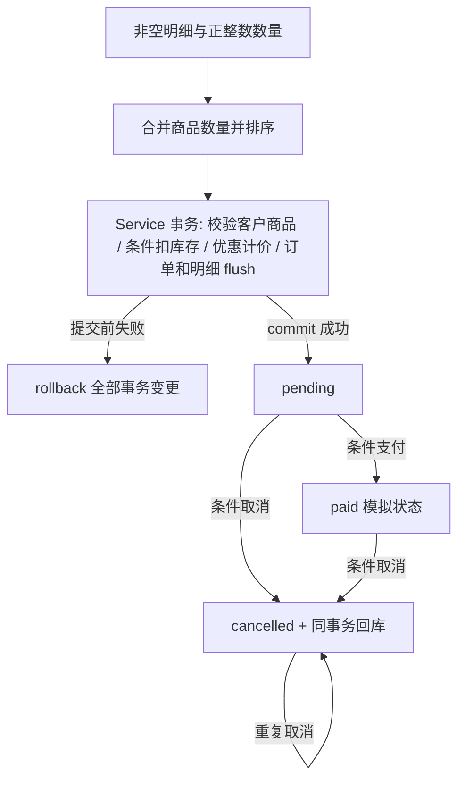
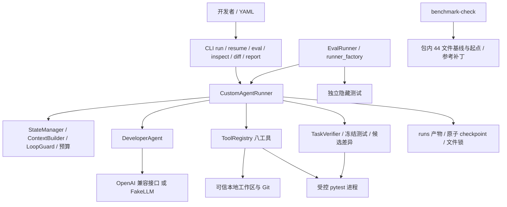

# 项目开发现状与完整架构分析报告

> 最新同步日期：**2026-10-17（Asia/Shanghai）**。工作区：`G:/program/CodingDev`。本文描述当前代码状态，替代正文中已过时的缺陷与能力结论。
>
> 同步开始时 HEAD：`2341ca172109f544cb35bb5adf9abdc39df46cbc`。最近业务源码提交：`05d26dccc5ccc01b4647f56a9e03957e822b7934`；已核对该提交到 HEAD 的 `devpilot/`、`shopflow-order-service/`、`scripts/`、`.github/` 无差异，可复用该源码版本的已完成验证证据。
>
> 原始审计日期：2026-10-16，原基线：`4a8a7780bc08cf18a4dfec3c0b91f3a15e39eae9`。原报告原文另存于[历史审计快照](历史审计/项目开发现状与完整架构分析报告_2026-10-16.md)，用于追溯当时的问题；历史复现不再代表当前代码仍有相同缺陷。
>
> 本次仅同步文档、核对代码/已有测试产物/本地依赖版本/远程分支，不修改业务代码，不重新调用真实模型、不运行实际业务 seed、不启动公网服务。测试数字引用 2026-10-17 已完成的本地门禁，不伪称本次文档更新重新跑过完整测试。

## 阅读结论与证据口径

**DevPilot 当前是预算受控、具备文件访问策略、独立验收、保守断点恢复及运行证据的可信本地编程代理。ShopFlow 是订单服务样例和评估对象，其已知输入、库存、事务与状态竞争缺陷已整改并有回归证据。项目具备本地开发和确定性验证基线，仍不能据此宣称安全执行任意不可信代码、真实模型能力已验证或可以直接承接公网交易。**

相对原审计，已经实装并验证的主要变化是：

- 决策恰一分支校验；请求数、单次模型调用和整体执行时间三层限制；工具别名统一治理。
- 敏感路径共享策略、搜索读取前过滤、普通复制排除已知凭据、链接拒绝、子进程环境白名单及已知配置密钥脱敏。
- 将 v1.1 的 44 个基线文件随包固定；持续开发的 ShopFlow 与内置评估输入解耦。
- 订单正整数/非空校验、重复行合并、条件库存更新、Service 统一事务、支付条件状态转换、取消回库且只执行一次。
- 原子检查点、同运行进程锁、保留预算的受限 resume、失败产物兜底、测试进程树清理、输出上限和产物容量准入。
- 最新本地门禁：DevPilot **502 passed、2 skipped、1 warning**；ShopFlow **67 passed**；两项目 Ruff、八任务基准、FakeLLM 冒烟和 wheel 包外检查均通过。

“已实现且验证可用”只覆盖对应测试/场景；“已实现但未充分验证”表示有效调用链存在，仍缺真实模型、跨平台或长期运行证据；“部分实现”表示仅有受限闭环；“尚未实现”表示当前有效入口未接入。以下区分代码完成、可运行、测试通过和上线条件，不给主观完成百分比。

代码路径相对仓库根目录；DevPilot 的短路径以 `devpilot/devpilot/` 为前缀。最新机器证据见 [validation-summary.json](../runs/p2-20261017/validation-summary.json)，P1/P2 改动分别见 [P1 交付记录](P1整改与可信本地版本交付记录.md)、[P2 交付记录](P2异常恢复与运行稳定性整改记录.md)。runs 证据默认不进入 Git，交接时需要另外保留。

## 1. 项目概述与业务目标

### 1.1 实际定位及使用者

DevPilot 面向能够准备任务、依赖环境并审阅代码的开发者/评估人员，接收 YAML 需求、验收标准与约束，在目标仓库副本中搜索、阅读、修改并运行 pytest，通过测试反馈驱动修复，最后输出可审阅的差异和运行产物。业务价值是减少重复定位、补丁和测试编排工作；未验证商业收益或无人值守自主交付能力。

ShopFlow 提供客户、商品、优惠券、订单和有限状态转换的 FastAPI 样例。代理直接操作代码副本，不通过 ShopFlow HTTP API 编程，不要求先启动 Uvicorn。当前支持的真实工程路径仍主要是 Python/pytest；指定其他仓库不等于自动支持其他语言或构建系统。

依据：`cli.py::load_issue/initialize_components/run`、`agents/developer.py::decide`、`runtime/custom/runner.py::run/_run`、`shopflow-order-service/app/main.py`。

### 1.2 预期与当前能力

| 业务诉求 | 已有能力 | 人工/外部依赖与边界 |
|---|---|---|
| 从需求得到代码变更 | YAML→模型决策→八项工具→独立验收→diff | 任务质量、模型服务、依赖安装与最终代码评审 |
| 验证任务完成 | 原测试/配置冻结、实际文件哈希差异、可见及新增测试独立执行 | 自然语言验收标准未被通用地逐条转成确定性断言 |
| 比较模型能力 | 八任务起点、隐藏测试、明确 smoke/capability 结果 | 尚缺真实模型多任务实跑数据；参考补丁自检不能替代 |
| 控制执行成本 | 请求上限、超时、总截止时间、已知 Token 统计 | 没有货币费用硬上限，usage 缺失时不估价 |
| 中断继续 | 普通任务在 ready/模型调用边界可恢复 | 中途工具/验收、已结束任务和 eval 不自动恢复 |
| 交付及运维 | 工作区、日志、JSON、差异、容量报告 | PR、合并、部署和人工归档仍由操作者承担 |

### 1.3 产品边界

无业务前端、DevPilot Web API、账户系统、RAG/向量库、消息队列、常驻 Worker、定时任务、云文件存储或自动 PR/部署工具。FastAPI 自带接口文档是 ShopFlow API 说明，不是业务管理前端。当前“可信本地”是一种使用约束；环境清理与进程回收不构成系统级沙箱。

## 2. 核心业务场景及完整业务流程

### 2.1 普通开发任务

1. `devpilot run <issue.yaml>` 调用 `load_issue`，校验 `id/title/description/acceptance_criteria` 并记录输入来源；约束与 metadata 可选。
2. `Settings` 合并显式值、环境变量、dotenv 与默认值，组合模型客户端、工具、状态、护栏、工作区、验收器和追踪器。含路径分隔符的目标解释器配置按调用目录解析为绝对路径。
3. 分配新的 run_id；使用独占目录创建避免复用历史运行记录，持有 OS 文件锁。普通工作区复制允许文件，跳过凭据/生成目录/数据库等，并初始化独立 Git 基线；不改原仓库。
4. 在 `runs/<run_id>/trusted` 冻结原文件、哈希和测试配置。同步准备单独记录 preparation_ms，随后开始执行截止时间。
5. 原子写检查点；`ContextBuilder` 组装任务、规则、工具、计划和观察。每次模型尝试预占请求预算，失败/解析错误/超时也计入，返回值必须恰为 action、finish、plan_update 之一。
6. action 先归一工具别名，再校验参数和路径；执行前写 tool_inflight 检查点，结果进入 Observation、工具步数、重试与指标。计划更新也是独立决策，不能与 action/finish 同时返回。
7. `test.run` 在目标解释器中运行 pytest，输出流式写入有限日志；失败生成结构化反馈，累计测试重试；最新成功测试清除旧失败提示和修复标志。
8. finish 是完成申请：写 verifier_inflight，核对冻结测试/配置、实际变更、禁改路径与修改数量，再独立运行可见测试及新增测试。普通 run 没有隐藏业务测试。
9. 验收通过进入 completed；拒绝则反馈并修复，受重试/请求/时间/容量门槛约束；错误进入 failed。终态分别保存检查点、状态、请求统计、结果；写盘失败尽力保存脱敏诊断兜底。
10. 操作者通过 `inspect/diff` 审阅已有变更并决定是否应用回原项目。没有自动业务提交、PR、发布或服务器部署步骤。

依据：`cli.py::run`；`runtime/custom/runner.py::_run/_checkpoint/_save_artifacts`；`verification/verifier.py::verify`；`verification/evidence.py::capture_snapshot/materialize_candidate`。

### 2.2 状态、异常与恢复分支

业务阶段为 understanding、exploring、planning、implementing、verifying、completed、failed。`StateManager` 限制合法状态转换，runner 根据工具使用/步数启发式推进；可以跳过部分阶段，不是逐阶段人工审批。completed/failed 为终态。

| 触发条件 | 当前处理 | 需要理解的边界 |
|---|---|---|
| YAML 缺字段或格式不合法 | 入口报错 | 运行器尚未启动，不保证有完整 run 产物 |
| 空对象/多分支/解析错误/接口失败 | 拒绝决策，每轮最多三次尝试，均消耗总请求预算 | SDK 自动重试关闭，由运行时统计；无指数退避或金额预算 |
| 未知工具/参数/执行失败 | 注册表产生失败观察，模型可修复 | 不一定立即终止任务，仍受专门护栏限制 |
| 测试失败/验收拒绝 | 累加 retry_count；达到门槛终止 | 二者共用状态重试计数，不在恢复后归零 |
| 请求、截止时间、容量或循环护栏耗尽 | 停止继续调度，输出失败与可选终止原因 | 已发生的正常代码修改不会因任务失败统一撤销 |
| 输出超限或测试超时/取消 | 保留部分日志，测试为 ERROR，等待自有进程清理 | 不以已有 XML 或退出片段宣称通过 |
| ready/llm_inflight 中断 | `resume` 核对源代码、配置、工作区和冻结证据后继续 | 原预算、护栏和重试延续，停机时间计入截止时间 |
| tool_inflight/verifier_inflight 中断 | 明确拒绝自动恢复 | 不确定副作用不得重放；人工审阅后另建任务 |
| 已有终态、eval、旧版无 checkpoint、证据漂移 | 拒绝 resume | 旧结果仍可 inspect；不提供跨版本检查点迁移 |
| 状态或产物写出失败 | 阻止新的外部动作；分别写终态，失败时尝试临时目录记录 | 所有存储不可写时只能报告失败，无法保证落盘 |

恢复协议 `runtime/custom/recovery.py::Checkpoint` 保存原任务/观察、请求数、单轮尝试次数、指标、LoopGuard 历史、deadline、工作区与 trusted 哈希及运行时指纹。运行指纹不保存密钥/完整环境；模型地址和配置只参与摘要。中断模型请求可能已计费，usage 不明时保持 unknown，不重复推算。内核文件锁阻止同一运行被两个进程同时执行，并在进程死亡后释放。

检查点是可信宿主账本，不能抵抗同权限恶意代码篡改它或系统时钟；全量哈希也增加大仓库磁盘 I/O。代码、模型参数/地址、解释器或证据改变时拒绝恢复；密钥本身不参与配置指纹。恢复读取明确采用 UTF-8，已有关闭默认 UTF-8 模式的中文回归。

### 2.3 FakeLLM 与能力评估

`create_fake_client` 在内置 calculator fixture 上执行“搜索→阅读→错误补丁→测试失败→修复→新增测试→测试通过→独立验收”。`run --fake` 使用该 fixture；`eval --fake` 标为 smoke、不执行隐藏能力测试、task_success 不计为能力成功。任务 ID/标题不改变 fake 实际操作的样例。

内置非 fake eval 使用包内 v1.1 基线快照：`evals/benchmark/baseline/` 恰含 manifest 指定的 **44 个原始文件**。`prepare_task` 严格校验哈希、应用专用起点补丁、建立新 Git 起点，模型运行后执行独立隐藏测试。当前开发中的 ShopFlow 改动不会刷新或污染这些输入。显式 `--base-repo` 仍严格校验，不匹配直接失败；普通 run/自定义任务使用目标工作区。

`EvalRunner.run_all` 串行执行任务。结果区分 PASS/FAIL/NOT_EVALUATED/ERROR；缺少/占位隐藏测试、执行异常、缺可信可见证据不会计为成功。`benchmark-check` 完全不调用模型，只证明“缺陷起点失败、参考补丁修复通过、可见回归通过”。

| 固定任务 | 当前 ShopFlow 应用代码 | 固定评估的意义 |
|---|---|---|
| DEV-001 状态过滤 | 列表尚无状态筛选 | 使用独立任务起点，不把任务资源视为产品功能 |
| DEV-002 非法取消 | 已有 pending/paid 白名单、取消幂等和库存回补 | 原 v1.1 起点/参考补丁不因应用修复被刷新 |
| DEV-003 分页边界 | API 与 Service 校验，按 ID 排序 | 继续评估原缺陷起点 |
| DEV-004 百分比优惠 | 使用百分值除以 100 的公式 | 不等于当前应用还存在该公式缺陷 |
| DEV-005 详情 N+1 | 已有 selectinload(items) | 查询数/可选性能断言针对固定起点 |
| DEV-006 邮箱标准化 | 没有通用标准化流程 | 参考答案未自动合并到样例应用 |
| DEV-007 防重复支付 | pending→paid 数据库条件更新，重复冲突 | 当前状态竞争已修复，基准仍保持原输入 |
| DEV-008 订单审计字段 | 仅有 created_at，没有完整状态审计字段 | 仍是评估题，不是已启用审计功能 |

依据：`evals/runner.py::run_eval`、`evals/benchmark.py::packaged_baseline/prepare_task/validate_benchmark`、manifest 及八项任务/起点/参考补丁。

### 2.4 ShopFlow 业务及事务边界

客户、商品和优惠券由开发者准备数据或显式运行 seed；HTTP 侧没有完整管理写接口。创建订单的真实顺序为：

1. Schema 拒绝零/负数、非整数/布尔数量和空明细；Service 再次防御内部调用绕过。
2. 合并同商品重复行的数量，验证客户存在；按 product_id 固定顺序取商品、按现价计价。
3. 每项库存通过数据库条件 UPDATE 扣减，只有 `stock + delta >= 0` 且影响一行才成功；不是先读 stock 再无条件写回。
4. 如有优惠码，查询优惠券并计算折后总额；不存在的优惠码抛错，当前事务内扣减回滚。
5. Repository 创建 pending 订单和合并后的明细，只 flush；Service 统一 commit。提交前任一校验、库存或写明细环节失败会 rollback，不遗留部分订单/扣减。
6. 支付通过 pending→paid 条件更新；并发至多一个成功，重复支付 409。它仍仅模拟状态，没有资金/回调/支付网关。
7. 取消仅允许 pending/paid→cancelled；首次取消和按明细回库在同一事务提交；重复取消返回当前结果、不重复回补。shipped/completed/未知状态拒绝，paid 取消也没有真实退款。



业务闭环到“原子下单与库存变更、支付状态模拟、取消释放库存”。没有发货、签收完成、退货、结算、真实支付或退款。Service 在 commit 后仍有 refresh/读取/HTTP 响应窗口，不能承诺提交后的响应异常可撤销已提交订单；缺少业务幂等键的剩余影响见第 9 节。

依据：`app/schemas/order.py`、`app/services/order_service.py`、`app/repositories/order_repository.py::create/transition_status`、`app/repositories/product_repository.py::update_stock`（均在 ShopFlow 项目内）。

## 3. 技术栈与系统整体架构

### 3.1 实际技术栈

两个项目声明 Python >=3.12，本地均为 Python 3.12.13，各有 `.venv` 和 `uv.lock`。下表版本本次通过各自环境的 `importlib.metadata.version` 只读核对；不是对远端环境或将来安装版本的保证。

| 层次 | 技术与当前版本 | 实际用途 |
|---|---|---|
| CLI | Typer 0.27.1、Rich 15.0.0 | 任务入口、进度、结果和报告 |
| 模型接入 | openai SDK 3.5.0 | AsyncOpenAI / Chat Completions JSON object；可配 model/base_url |
| 数据/配置 | Pydantic 2.13.4、pydantic-settings 2.15.0、PyYAML 6.0.3 | 决策、状态、任务、配置与 API Schema |
| 编排 | asyncio + 自定义 runtime | 单任务决策循环、异步等待、受控线程工作 |
| 文件与差异 | pathlib/shutil/Git/SHA-256、原子文件替换、OS 文件锁 | 副本、证据、补丁和恢复；不再调用外部 patch 或 Python 模糊补丁回退 |
| 搜索 | 可选 ripgrep、Python fallback | 先枚举允许文件；均采用区分大小写的字面量搜索 |
| 测试进程 | subprocess / POSIX 进程组 / Windows Job Object | 自有进程生命周期、输出和超时治理；非权限隔离 |
| 样例服务 | FastAPI 0.141.1、Uvicorn 0.52.4 | ShopFlow HTTP API |
| ORM/数据库 | SQLAlchemy 2.0.52、SQLite 文件库 | 订单等五表；Service 统一事务、库存/状态条件更新 |
| 验证 | pytest 9.1.1、pytest-asyncio 1.4.0；ShopFlow httpx 0.28.1 | 单元、集成、ASGI、临时文件数据库并发测试 |
| 静态检查/交付 | Ruff 0.16.4、Hatchling、uv、GitHub Actions | wheel 与双平台检查矩阵 |
| 存储 | 本地 JSON/JSONL/diff/log/JUnit/目录 | 无 OSS/S3、任务数据库、Redis 或消息中间件 |

默认模型名 `gpt-4o` 是配置默认值，不是已验证效果或用户当前服务配置；其他 OpenAI 兼容服务未逐个实测。缺 usage 保持未知，不估算费用。轮子安装脚本使用离线缓存解析发行包依赖，不等于在包外环境完整复跑了锁文件环境的全部 pytest。

### 3.2 调用关系



评估层通过 `runtime/base.py::AgentRunner` Protocol 与 runner_factory 组合运行时，默认组件工厂延迟导入。原“导入 eval 就加载具体 CustomAgentRunner”的 xfail 已移除并通过；这不等于已实现另一种运行框架。ShopFlow 独立链路为 HTTP→API→OrderService→Repository→SQLAlchemy→SQLite；客户/商品读取和优惠试算有直接 Repository/模型路径，不能一概称严格分层。

## 4. 项目目录结构与核心模块职责

| 路径 | 当前职责 |
|---|---|
| `devpilot/devpilot/cli.py` | run、resume、inspect、diff、eval、benchmark-check、workspace-report；组件组合 |
| `devpilot/devpilot/domain/` | 任务、计划、恰一决策、状态、结果及预算/诊断字段 |
| `devpilot/devpilot/agents/`、`llm/` | 请求模型、兼容接口、FakeLLM、提示和请求记录 |
| `devpilot/devpilot/runtime/base.py` | RuntimeConfig 与评估调用协议 |
| `devpilot/devpilot/runtime/custom/` | 实际 runner、状态、上下文、护栏、recovery 协议 |
| `devpilot/devpilot/security.py` | 禁止路径、允许文件枚举、环境白名单、已知密钥脱敏 |
| `devpilot/devpilot/storage.py`、`processes.py` | 原子写、文件锁、物理容量计数；流式进程输出与清理 |
| `devpilot/devpilot/tools/` | 工具注册/别名归一、路径/写入边界、repo/code/test/git 工具 |
| `devpilot/devpilot/workspace/` | 普通副本、Git 基线、容量检查和产物保存；删除方法有解析后边界保护 |
| `devpilot/devpilot/verification/` | 原文件/测试快照、真实差异、候选副本与独立最终验收 |
| `devpilot/devpilot/evals/` | 任务、隐藏测试、固定 baseline/start/reference 资源和结果判定 |
| `devpilot/devpilot/tracing/` | JSONL、请求/Token/工具/重试指标；压缩事件已接通 |
| `devpilot/devpilot/fixtures/smoke/` | calculator 固定冒烟对象，不是八任务能力题的答案 |
| `devpilot/tests/` | 预算、文件、恢复、进程、工具、验收、评估和架构依赖回归 |
| `shopflow-order-service/app/` | API/services/repositories/models/schemas/db |
| `shopflow-order-service/tests/` | 常规内存测试及临时文件 SQLite 多 Session 故障/并发回归 |
| `scripts/check_benchmark.py`、`scripts/check_wheel.py` | 数据集门禁、源码目录外安装与 CLI/资源/进程/锁检查 |
| `.github/workflows/ci.yml` | Ubuntu/Windows：冻结依赖、lint、pytest、八任务、wheel 与产物上传 |
| `dev.ps1`、`Makefile` | 本地开发快捷入口；具体命令和冻结方式以脚本为准 |
| `docs/`、`runs/`、`devpilot/workspaces/` | 说明/历史审计；本地证据和副本；后两类默认 Git 忽略 |

`TaskVerifier._check_visible_tests/_check_diff_non_empty` 等旧辅助方法仍存在，当前主路径采用冻结文件与 independent suite。`state.test_runs` 已由 `StateManager.apply_tool_result` 维护；评估共用 `collect_metrics`，不得再写成字段完全未接通。`scripts/build_benchmark.py` 仍是资源维护工具，本次未运行它或刷新 manifest。

## 5. 系统运行机制与数据流转

### 5.1 并发、队列与运行锁

DevPilot 没有常驻服务/Worker/定时队列；一次 CLI 在一个模型决策和一个工具之间串行调度，eval all 串行运行任务。asyncio/线程工作不是多 Agent 或任务队列。每个 run 的 OS 文件锁阻止同一任务同时恢复；不同 run 没有共享调度器、全局原子资源租约或硬配额。

runner 的指标、护栏、缓存和 deadline 是实例可变状态；不要把同一实例并发 run/resume 当作已支持的多任务 API。ShopFlow Session 按请求创建关闭；库存及状态由数据库条件 UPDATE 竞争，未引入 Redis/应用进程锁或请求幂等键。

### 5.2 预算和容量配置

所有环境变量使用 `DEVPILOT_` 前缀。下面是默认值，不代表当前私有 dotenv 中的实际值；本报告不读取或披露秘密配置。

| 配置后缀 | 默认 | 约束含义 |
|---|---|---|
| MAX_STEPS | 30 | 保留原工具/观察步数口径，不替代模型请求数 |
| MAX_LLM_REQUESTS | 90 | 所有请求尝试与重试累计上限；恢复不归零 |
| LLM_TIMEOUT_SECONDS | 120 秒 | 单次模型等待上限，受剩余总时间约束 |
| MAX_RUN_SECONDS | 1800 秒 | 同步准备完成后的执行预算；停机耗时也计入恢复预算 |
| MAX_TEST_RETRIES | 3 | 测试失败与验收拒绝的累计重试门槛 |
| MAX_MODIFIED_FILES / MAX_PATCH_FAILURES | 10 / 3 | 变更范围与补丁失败护栏 |
| TEST_TIMEOUT_SECONDS | 120 秒 | 单次 pytest 上限，同样不得超过剩余执行时间 |
| MAX_TEST_OUTPUT_BYTES | 2097152 | 每次测试输出上限 2 MiB，另有固定超限标记 |
| WORKSPACE_MAX_BYTES / WORKSPACE_TOTAL_MAX_BYTES | 256 MiB / 2 GiB | 允许文件的逻辑容量；不包含全部 Git/缓存/产物 |
| RUN_ARTIFACTS_MAX_BYTES / RUNS_TOTAL_MAX_BYTES | 512 MiB / 4 GiB | 单 run 与 runs 根目录的物理文件容量准入 |

工具/验收 await 使用剩余截止时间，返回后再次核对；测试取消等待清理，不能假定后台线程已自动停止。同步扫描、Git、复制和磁盘调用不能被异步超时强制抢占，清理也有额外有限等待，不承诺宿主全部代码在截止瞬间退出。非有限时间值不能用来禁用预算。

容量检查覆盖准备、循环、测试、验收及隐藏测试，并对副本和输出估算预留；超过门槛记录 artifact_quota、停止继续调度。诊断 JSON 豁免拒写，保留解释失败的机会。它不是文件系统硬配额：不同 run 可并发增长，任意宿主代码、XML/临时文件和估算偏差仍可能超额。standalone benchmark-check 输出不冒充 agent run 配额。

### 5.3 文件与进程信任边界

`security.forbidden` 统一规范分隔符和小写匹配，覆盖 `.git/.ssh/.aws`、含 `.env/id_rsa/id_ed25519` 的组件和 `.pem/.key/.p12/.pfx`；列表/阅读/搜索/写入/复制/快照路径共同约束。搜索先枚举允许文件再读，rg 使用 fixed-strings，执行错误返回失败；Python 分支对文本做子串搜索，单文件和常见字面量已有矩阵回归，不泛化到任意二进制/编码等价。

普通复制与 inventory 对遍历范围内链接拒绝，不复制凭据目录；被忽略的生成/敏感目录不进入复制。PathGuard 解析后要求仍在工作区，检查链接与禁止规则。冻结快照在候选之外；新增测试允许写，原测试/配置保护。差异由真实文件哈希和 Git no-index 导出，不只信任工具自报修改列表；不为脱敏伪造快照哈希或 diff。

子测试进程采用环境白名单，移除模型/云凭据与 Python hooks，仅保留解释器所需系统变量等。已知配置密钥对展示、日志和 JSON 进行脱敏，不保证识别任意未知秘密；本地运行目录没有多用户权限服务。

`processes.run_process` 流式合并 stdout/stderr，同时限制读取和写出字节，避免非法 UTF-8 替换或脱敏膨胀绕过上限。POSIX 使用新进程会话/组；Windows 在私有 Job 中先绑定可信启动器再运行候选，绑定失败不启动候选。超时/取消/输出超限及父进程正常结束均清理自有后代。**这些治理没有限制候选代码的宿主文件/网络权限，执行模式仍为 trusted_local，R-01 仍开放。** `network_access` 配置不构成强制网络隔离。

补丁当前只用 Git：解析真实目标、完整 --check、一次应用；支持零上下文及空白差异兼容，异常时恢复已记录目标内容；删除外部 patch/Python 模糊回退。不承诺断电/硬盘故障下的跨文件事务或与任意外部写入并发时的原子性。

### 5.4 产物、指标和保留

| 产物 | 当前时机/作用 |
|---|---|
| workspace-metadata.json | 副本来源、路径、时间；基准带数据集起点 |
| trusted/manifest.json 与 baseline | 首个模型动作前冻结原始文件及保护列表 |
| checkpoint.json / state.json | 调度边界原子保存；检查点为恢复权威账本，state 保持 inspect 兼容 |
| .run.lock | 内核文件锁；文件存在不等于仍被进程持有 |
| trace.jsonl | 阶段、请求、工具、压缩、验收和护栏事件；不是完整响应重放日志 |
| tests/*.log 与 XML | 每次测试有限输出和结构化结果，超限/超时为 ERROR |
| verification-* / hidden | 验收候选、冻结/新增/隐藏测试 harness 和结果 |
| final.diff | 验收生成，eval 有回退；未进入验收的普通失败运行不保证有最终 diff |
| result.json / llm-requests.json | 终态、预算、可选 termination_reason、请求记录、指标和 artifact_errors |
| eval_result.json | smoke/capability、判定、原因和可见/隐藏证据 |
| 系统临时目录 recovery_file | 常规写盘失败时尽力保存的脱敏诊断；不是可 resume 检查点 |

未知 Token 使总 token_usage/tokens 保持 null，同时保存 known_tokens 和请求数；没有可靠的 token_cost 货币换算或 regression_rate 统计，相关空字段不能当真实成本/回归率。context_compacted 已接追踪器、test_runs 已更新、eval Token 指标已转接。

`workspace-report --retention-days 7` 只读列出逻辑/物理字节、runs 用量和已结束旧任务的人工归档候选。默认保留全部工作区和证据，不自动调用 destroy，不删除历史产物；destroy 自身有解析后目标边界保护。

### 5.5 核心数据库表与关系

DevPilot 使用 Pydantic/JSON，无任务数据库。ShopFlow 使用 `sqlite:///./shopflow.db`，文件位置相对服务 cwd；启动 lifespan 执行 create_all，没有生产迁移管理。

| 表 | 主要字段与关系 | 当前限制 |
|---|---|---|
| customers | id/name/email，一对多 orders | 无邮箱唯一性/通用标准化与账户鉴权 |
| products | id/name/price(Float)/stock(Integer) | Service 路径条件扣库存；无数据库 stock>=0 CHECK |
| orders | customer_id/status(String)/total_amount(Float)/created_at | 无数据库状态枚举 CHECK、请求幂等键或支付凭证 |
| order_items | order_id/product_id/quantity/unit_price | Service 合并同商品且验证正数量；DB 未加正数/重复组合约束 |
| coupons | code 唯一、类型/折扣值(Float) | 订单未关联优惠券记录；无期限、配额等完整优惠规则 |

Order.items 为 delete-orphan 关系、详情 selectinload；模型外键声明不代替数据库强约束验证，未见连接显式启用 SQLite foreign_keys PRAGMA。订单未保存原额/折扣额/优惠券 ID 或完整状态事件，金额仍为 Float。直接手工 DB 写入不受 API/Service 防御等同保护。

## 6. 已实现功能清单及实际可用状态

### 6.1 DevPilot 功能

| 功能 | 代码依据 | 当前可用状态 |
|---|---|---|
| YAML、统一配置与 CLI | cli.py、settings.py | 已实现且测试；配置不等于模型 endpoint 已连通 |
| 列表/阅读/搜索 | tools/repo、security.py | 已实现且文本/路径/rg-Python/凭据矩阵验证 |
| 新建与 Git 补丁 | tools/code | 已实现且回归；新建反馈和多 hunk 失败路径已修复 |
| 八工具注册与别名 | tools/registry.py::canonical_name | 已实现且别名失败重试/观察验证 |
| 预算与循环护栏 | domain/decision.py、runtime/custom/runner.py、loop_guard.py | 已实现且空/多分支/超时/请求数/重试/终态验证 |
| pytest 流程与进程治理 | tools/test/run_tests.py、processes.py | 已实现且 Windows 子进程/输出/取消回归；Linux 远端待核实 |
| 失败反馈与自修复 | context.py、state_manager.py、runner.py | 固定决策闭环验证；真实模型修复能力未测 |
| 冻结证据与独立验收 | verification | 已实现且防篡改/真值测试；非任意自然语言需求证明器 |
| 原子中间状态与 resume | recovery.py、runner.py::resume | 已实现且限定边界验证；不支持工具/eval/跨版本自动恢复 |
| 产物诊断兜底、只读容量报告 | storage.py、sandbox.py、cli.py | 已实现且故障/容量回归；软准入、人工归档 |
| 指标/框架调用边界 | tracing、runtime/base.py、evals/metrics.py、runner_factory | 接线已实装且测试；未提供第二种 runtime/真实费用统计 |
| 44 文件固定基线与八任务自检 | evals/benchmark | 已实现、8/8 确定性自检通过 |
| 模型能力评估入口 | evals/runner.py | 已实现；真实 capability 结果仍待获取 |
| wheel 发行与包外检查 | pyproject.toml、scripts/check_wheel.py | 已构建并包外离线验证 CLI/资源/进程/锁，非发行环境全量业务测试 |
| Web UI、任务 API、MCP/Skills、常驻调度 | 无已接入主路径 | 尚未实现，另行定义范围 |
| 自动提交/PR/合并/部署 | 无对应注册工具 | 尚未实现；本会话人工授权 Git 操作不属于代理产品功能 |

注册工具精确为 `repo.list_files`、`repo.search_code`、`repo.read_file`、`code.apply_patch`、`code.create_file`、`test.run`、`git.diff`、`git.status`。没有通用 shell/依赖安装/浏览器工具；pytest 能执行 Python，因此不能据工具列表宣称无法访问宿主。

### 6.2 ShopFlow HTTP 接口

| 接口 | 当前真实行为 | 边界与状态码 |
|---|---|---|
| GET /health | 固定 status=ok | 不探测数据库或外部系统 |
| GET /customers/{id} | 按 ID 读取客户 | 不存在 404；无鉴权，含邮箱 |
| GET /products、GET /products/{id} | 商品列表/详情 | 详情不存在 404；列表无分页/搜索 |
| POST /orders | 校验/合并/计价/条件扣库/订单与明细同事务 | 201；非法数量/空单 422；不存在客户/商品/优惠码或库存不足 400 |
| GET /orders | skip>=0、1<=limit<=100，按 ID 排序 | 非法分页 422；无状态/客户筛选、总数 |
| GET /orders/{id} | 详情与 selectinload 明细 | 不存在 404；无用户归属权限 |
| POST /orders/{id}/pay | 数据库 pending→paid 条件更新 | 成功返回订单；重复/非法状态 409，不存在 404；无真实支付 |
| POST /orders/{id}/cancel | pending/paid→cancelled，状态与回库同事务 | 重复返回当前结果；非法状态 409，不存在 404；无真实退款 |
| POST /coupons/validate | 按码查询、折扣试算 | 不存在 valid=false；无期限/额度/使用次数管理 |

订单创建、详情、支付、取消路由将 locked/busy 类 OperationalError 映射为明确 503，不做应用层无限重试；不是所有数据库错误或所有列表路由的统一 503 机制。SQLite 连接自己的锁等待仍受其配置/默认行为约束。

没有前端入口悬空问题可陈述，因为没有业务前端；缺口主要在通用验收/生产隔离及完整交易链。seed 现在按明细→订单→优惠券/商品/客户清理后重建，临时库验证可重跑；它会删除开发数据，不是保留生产数据的迁移工具。本次未对实际 shopflow.db 执行 seed。

## 7. 主要业务链路与功能完成程度

| 链路 | 代码状态 | 可运行/测试证据 | 上线或扩展边界 |
|---|---|---|---|
| 本地任务→副本→工具→独立验收→产物 | 已贯通，预算与诊断已补齐 | FakeLLM 完整闭环、502 项通过 | 可信本地使用；任意不可信代码仍缺系统隔离 |
| 失败→修复→再验收 | 已贯通，旧失败/别名反馈已修复 | 冒烟与 self-correction 回归 | 无真实模型自主修复成功率 |
| 普通任务中断→恢复 | ready/模型边界实现，原预算继承 | 漂移拒绝、锁、重试、中文/非默认 UTF-8 测试 | 中途副作用只拒绝，不自动补偿/重放 |
| 固定缺陷→失败→参考修复→回归 | 固定 v1.1、44 文件随包 | 8/8 自检通过 | 证明数据集，不证明 Agent 求解能力或性能指标 |
| 真实模型→八任务能力评估 | 入口及判定可用 | 未执行真实模型验收集合 | 需有预算、多任务/多轮、明确分母与错误分类 |
| diff→PR→合并→部署 | 产品只做到 diff/证据 | 后续为人操作；GitHub 分支同步已人工授权完成 | 无自动交付工具链 |
| ShopFlow 下单→库存→支付/取消状态 | 输入/事务/竞争与回库已修复 | 67 项通过；临时文件 SQLite 独立连接并发、故障回滚 | 只为本地样例，不含鉴权、真实资金及幂等下单 |
| 订单→发货→收货→结算/退款 | 仅前段状态 | 后续无接口或完整验证 | 尚未形成生产电商闭环 |

目前应描述为“可信本地、确定性工程门禁可复现的编程代理与一致性得到验证的订单样例”。不能继续按原报告写“空决策可无限循环、已知搜索泄露、订单负库存缺陷尚未修复、无 resume”；也不能将整改完成推导为生产级安全或真实模型能力已达标。

## 8. 外部系统集成、部署与验证现状

### 8.1 依赖与部署

模型服务是唯一已接入的模型外部接口；Git 与 rg 是本机命令，目标 Python 需预装 pytest 和项目依赖。外部 SAP、邮件、OSS、真实支付网关均未接入当前业务主路径。无 Docker/Compose/Kubernetes、生产数据库迁移、认证网关或持续部署定义；CI 是检查流程，不是部署证据。

两个项目依赖隔离；默认普通 base_repo 为 `../shopflow-order-service`，相对调用 cwd，建议明确解释器与输出目录。内置 eval/benchmark-check 已改用包内基线，不依赖当前 cwd 下持续开发的 ShopFlow。服务入口 `app.main:app` 启动会 create_all 并使用文件库，本次未启动服务。

### 8.2 GitHub 与交付状态

报告同步时通过 `git ls-remote` 核实 `origin=https://github.com/feizhanbo/CodingDev.git`：

| 远程分支 | 同步开始时提交 | 状态 |
|---|---|---|
| main | `2341ca1` | 已包含本轮 P1/P2 代码和整改记录 |
| selt-runtime | `2341ca1` | 与 main 指向相同已提交代码 |
| codex/devpilot-eval-hardening | 无分支引用 | 已按用户要求删除；历史提交已包含在 main |

本地开发分支仍为 `codex/p1-trusted-local`。这些是操作者授权的仓库管理操作，不能作为 DevPilot 已实现自动推送/合并的证据。本报告自身更新不等于已上传 GitHub；远程所指为正文更新前已核验的代码基线。

GitHub Actions on push/pull_request/workflow_dispatch 配置 Ubuntu/Windows、冻结依赖、两项目 Ruff/pytest、八任务基准、wheel 和包外检查。已推送可能触发工作流，但本次没有查询其运行结果，不能把之前“未推送”的阶段记录照搬为当前事实，也不能宣称远程 CI 已通过。

### 8.3 最新已完成验证证据

验证日期 2026-10-17，源码 `05d26dc`，平台 Windows/Python 3.12.13。下表来自现存报告及本会话完成的执行结果；本次更新核对原始 XML/JSON、基准哈希和源码差异，不重复执行完整门禁。

| 验证组 | 真实结果 | 证据/限制 |
|---|---|---|
| DevPilot 完整 pytest | **502 passed、2 skipped、1 warning**；504 个收集项，752.95 秒 | `runs/p2-20261017/devpilot-final.xml`；不是定向结果拼接 |
| ShopFlow 完整 pytest | **67 passed** | `runs/p2-20261017/shopflow-full.xml` |
| 两项目 Ruff | 均退出 0 | P2 汇总及实际工具结果 |
| 固定 v1.1 八任务自检 | **8/8 PASS**；每项 negative FAIL、positive PASS、visible PASS | `runs/p2-20261017/benchmark-final/summary.json` |
| FakeLLM CLI 冒烟 | completed；7 工具步骤、8 请求；测试先失败后成功 | `runs/p2-20261017/smoke-runs/run_ab3fe742/result.json`、trace；非 capability |
| 恢复与安全回归 | 含请求/重试继承、证据漂移、互斥、非 UTF-8 模式中文恢复、禁止文件、合成密钥、进程心跳/输出限制 | 已包含完整 pytest；symlink 例外见下文 |
| 订单故障与并发 | 首项扣减后失败、明细 flush 后失败、提交前故障回滚；并发下单/支付/重复取消 | `shopflow-order-service/tests/services/test_order_integrity.py`；临时文件 SQLite、独立 Session；非共享单连接替代 |
| wheel 离线构建与包外验证 | 均退出 0 | `scripts/check_wheel.py`：独立临时环境、CLI/44 文件/八资源/实际进程与锁；未跑包外完整 pytest |
| 真实模型/服务器/性能门禁 | **未验证** | 不以自检、SDK 配置或现有构建文件代替 |

wheel SHA-256：`e8d5c5e68843567e81b3454a8211c173d5e6b3db1fd016d7744ef8804fb4de64`。机器汇总为 `runs/p2-20261017/validation-summary.json`。已停止的旧预检不计为通过。测试数量不等于覆盖率；未运行覆盖率统计。

两个 skip 是 `test_workspace_rejects_symlink_before_copy` 与 `TestPathGuardRejection.test_symlink_outside_rejected`，均因本地 Windows 创建链接条件不可用，保留原理由；通用链接/进程组回归的 Linux 实际执行需远端 CI 核验。新增 Windows Job 专属测试本地已通过。旧框架独立性 xfail 已移除并通过；唯一 warning 是 Pydantic `TestRun` 被 pytest 尝试收集，非功能断言失败。DEV-005 默认未开启 `--performance`，不得宣称满足 500ms 性能门槛。

### 8.4 操作与复现入口

从 devpilot 目录执行，使用自己的配置与新输出目录；真实模型命令需有明确预算和服务授权。下面列出不同入口：help、inspect、workspace-report、benchmark-check 不调用模型，resume 会调用原模型继续任务：

```powershell
.venv/Scripts/python.exe -m devpilot.cli --help
.venv/Scripts/python.exe -m devpilot.cli inspect run_1234abcd
.venv/Scripts/python.exe -m devpilot.cli resume run_1234abcd --env-file .env
.venv/Scripts/python.exe -m devpilot.cli workspace-report --retention-days 7
.venv/Scripts/python.exe -m devpilot.cli benchmark-check `
  --test-python G:/program/CodingDev/shopflow-order-service/.venv/Scripts/python.exe `
  --output G:/program/CodingDev/runs/new-benchmark-evidence
```

resume 会调用原模型继续任务，并不属于无模型命令；要求原运行配置/解释器与代码一致，且不能直接使用临时 recovery_file。普通/内置 eval 的基线路径语义不同，勿继续用已变化的当前 ShopFlow 强行覆盖固定基准哈希。完整测试在各项目目录执行 `python -m pytest -q`、`ruff check .`；`scripts/check_wheel.py` 需要先构建 wheel，离线依赖缓存是其运行条件。

## 9. 问题整改状态、现存缺口与风险

### 9.1 原 DevPilot 问题状态

| ID / 原级别 | 最新状态 | 当前代码及证据 |
|---|---|---|
| D-01 / P1 空决策预算 | **已修复已知漏洞** | `AgentDecision.exactly_one_branch`、runner 独立请求/时间预算；`devpilot/tests/runtime/test_request_budget.py`、`test_recovery.py`；不是费用金额硬预算 |
| D-02 / P1 搜索禁止文件绕过 | **已修复内置工具路径** | security + 允许文件预枚举、rg fixed-strings、路径验证；`devpilot/tests/test_file_security.py`；不承诺识别任意未知秘密 |
| D-03 / P2 新建反馈错误 | **已修复** | context 使用 Observation.success；`devpilot/tests/runtime/test_context_feedback.py` 对应创建反馈回归 |
| D-04 / P2 旧失败残留 | **已修复** | 逆向观察遇最新成功测试即停止旧失败渲染；context 回归及 smoke |
| D-05 / P2 别名治理不一致 | **已修复** | ToolRegistry.canonical_name 在执行/统计前归一；请求预算与失败重试回归 |
| D-06 / P2 通用验收缺口 | **仍存在的能力边界** | TaskVerifier 主要验证文件/测试和少量新增测试关键词；无任意自然语言标准逐条证明 |
| D-07 / P2 无恢复/中间状态 | **限定场景已实现并验证** | checkpoint、OS 锁、ready/llm resume、漂移拒绝；工具/eval 中途不恢复是明确策略，不伪装无条件续跑 |
| D-08 / P3 指标未接线 | **主要接线已修复，部分统计未实现** | test_runs、压缩事件、Token/请求转接；token_cost/regression_rate 无可靠计算 |
| D-09 / P2 具体 runtime 导入耦合 | **已解决已知导入问题** | AgentRunner Protocol、runner_factory、延迟组合；原 xfail 转为通过，仍只有一个实际 runtime |

### 9.2 原 ShopFlow 问题状态

| ID / 原级别 | 最新状态 | 当前依据及剩余范围 |
|---|---|---|
| S-01 / P1 数量/空单 | **已修复** | StrictInt>0、items 非空、Service 防御；API 422 回归 |
| S-02 / P1 重复行超卖 | **已修复当前路径** | 合并/排序后条件扣库；重复商品与文件 SQLite 并发验证 |
| S-03 / P1 多次提交导致残留 | **已修复提交前原子性** | Service 统一 commit/rollback，Repository flush；三类故障回滚测试 |
| S-04 / P2 取消不回库 | **库存/状态部分已修复** | 白名单 CAS、回库同事务、重复取消不回补；真实资金退款仍未实现，不能混作同一关闭项 |
| S-05 / P1（公网前）认证/归属 | **保留** | routers 仅依赖 get_db；用户可猜订单 ID，没有账户权限隔离 |
| S-06 / P2 分页边界/排序 | **已修复该缺陷** | Query + Service 边界、order_by(id)；筛选/总数仍属未开发功能 |
| S-07 / P2 seed 遗留关联 | **已修复开发重跑清理** | 明细/订单先清；仅临时库二次 seed 测试；仍为破坏式开发初始化，不用于生产保留数据 |

### 9.3 风险与处理状态

| ID / 当前关注级别 | 已缓解部分 | 尚存风险、影响及依据 |
|---|---|---|
| R-01 / **P1 保留** | 清理环境、文件策略、进程回收 | Python 仍以宿主同权限运行，能主动读宿主/联网/脱离进程组；无 OS/网络隔离。`processes.py`、test tool、network_access 定义 |
| R-02 / P1（恶意代码/未知秘密场景） | 已知凭据排除、复制/快照、预过滤、已知密钥脱敏 | 未知秘密、同权限代码绕过、运行目录的多用户访问控制仍无保证；不能据合成标记测试证明任意秘密安全 |
| R-03 / 原 P2 | Git 全补丁预检/应用、错误恢复、删除模糊回退 | 已修复常见部分 hunk 失败路径；未证明断电、硬件失败或任意外部并发写入下跨文件事务 |
| R-04 / 原 P2 | 测试进程树、取消清理、输出上限 | Windows 已回归；Linux 远端待核验；主动逃离受控组、任意宿主写入不由此保证 |
| R-05 / P2 部分缓解 | 逻辑/物理统计、容量准入、只读人工归档候选 | 不是硬配额/原子跨 run 预留；XML/诊断/任意候选写入可超额；无自动保留清理，多小时压力未测 |
| R-06 / P2 部分缓解 | 原子单文件检查点/终态、trace/display 错误不丢主流程、诊断兜底 | 多文件不是事务；磁盘/临时目录都不可写无法保证产物；中途工具明确需人工审阅 |
| R-07 / 原 P2 | 文本字面量语义、单文件分支、rg 错误传播 | 已知差异已修复，未泛化证明任意二进制/编码完全一致 |
| R-08 / P2 部分缓解 | 去掉已提供工具说明的重复追加，压缩事件接线 | 约 30000 字符仍为软压缩阈值，任务等内容未有严格 Token 上限，可能超模型窗口；`context.py`、`llm/openai.py` |
| R-09 / **P1（真实交易前）** | 库存/支付 CAS、取消幂等、Service 事务及并发测试 | Float 金额、优惠值无完整边界、DB 状态/数量强约束、真实支付退款/请求幂等/完整审计未完成；models、pricing_service、OrderService |
| R-10 / P2 | 可配置仓库和解释器、eval 调用边界 | 默认提示仍含 ShopFlow，工具固定 pytest，无自动多语言/构建适配；prompts.py、RunTests，需跨工程真实模型验证 |
| R-11 / P2 潜在风险（本次核对补充） | 提交前故障有回滚测试 | `create_order` 的 commit 后还有 refresh，pay/cancel 也有提交后查询。若提交成功而响应阶段失败，rollback 不能撤销已提交数据；客户端重试下单无幂等键可能重复创建。此窗口由静态调用顺序确认，未注入提交后/网络响应故障，不当作已发生事故 |

### 9.4 待验证清单

- 模型 endpoint、各兼容实现/参数、拒绝/限流和 usage 行为；真实模型八任务及跨项目能力/成本/失败分布。当前证据不支持能力成功率。
- Ubuntu/Windows 最新远端 Actions 结果、Linux 链接/进程组执行；包外不同依赖组合和 fresh clone 全量验证。已有本地 wheel 冒烟不能替代。
- 大工作区哈希成本、多 run 共享磁盘、长时间批量执行/容量估算、磁盘满与各种宿主故障组合；当前测试不是长期压力证明。
- 数据库真正锁等待耗尽、提交后读取/HTTP 响应失败、请求重试的业务幂等；已有 503 映射用注入锁异常测试，不泛化为生产并发压测。
- DEV-005 性能模式；其他数据库引擎/隔离级别、生产迁移、备份、监控和灾备。未操作真实生产数据库。

## 10. 项目整体开发状态总结

DevPilot 的本地任务、文件工具、修复、独立验收、产物与受限恢复已形成可追溯工程闭环；已知 P1 空决策与内置敏感搜索漏洞已修复。固定评估快照与应用演进解耦，可作为后续有预算能力评测的工程基线。它目前不是安全执行任意代码的平台，也不是已经验证自主开发成功率的无人值守服务。

ShopFlow 当前正常下单、库存扣减、支付状态竞争与取消库存回补有故障/并发回归，原负数量、重复行和事务残留不能再作为现行未修缺陷陈述。但它仍是无账户鉴权、无真实资金/物流闭环、无生产数据库治理的本地样例。不得把“67 项测试通过”换写成真实交易上线准备完成。

交接应包含源代码/锁文件、固定基准资源、报告和本地原始证据；未来真实模型结果需另带模型/配置/数据集版本和有效分母。历史报告用于解释已发生的整改，当前正文与最新源码/证据用于决定下一阶段。

## 11. 后续待完成事项与建议优先级

| 优先级 | 下一步 | 验收判据 |
|---|---|---|
| **P1 / R-01** | 单独设计并实施 OS/低权限、文件挂载、网络和资源隔离 | 实测候选不能越权读宿主/联网/逃逸；可信本地模式与隔离模式明确分开 |
| **P1（若推进公网/真实交易）** | 鉴权/对象归属、定点金额、真实支付退款/审计、数据约束及迁移 | 越权拒绝、资金/状态可追溯、迁移回滚与备份可验证；当前样例范围内不虚构这些能力 |
| P2 / D-06 | 将需求映射为可执行验收，明确普通 run 的业务验证证据 | 与需求相关的增量断言；小补丁仅过旧测试不能冒充全部标准满足 |
| P2 | 有预算真实能力评估，核对远端 CI 与 Linux 链接/进程组 | 保存模型/任务版本、请求/时间、有效覆盖和错误原因；smoke/self-check 不入成功率 |
| P2 / R-05、R-06 | 长期磁盘/恢复压力、硬配额与跨 run 预留、显式保留策略 | 多实例和容量耗尽可控；归档/删除必须有明确范围与权限，不自动清旧证据 |
| P2 / R-11 | 请求幂等与提交后响应失败语义 | 注入 refresh/读取/响应故障，重试不重复下单，区分已提交与提交前失败 |
| P2 / R-08、R-10 | 模型 Token 上下文约束、提示和测试策略按仓库适配 | 长任务窗口受控，非 ShopFlow 不套错架构，不假设所有项目 pytest |
| P3 | 清理旧辅助方法/过时注释、补充部署交接与指标定义 | 主调用链/文档一致；费用与回归率数据不足保持未知 |
| 范围另定 | Web UI、MCP/Skills、队列、多用户与自动 PR | 先明确产品场景和权限；不因能力缺失就机械扩展本轮整改范围 |

预算、文件策略、事务库存、上下文别名、取消回库、分页、seed、固定基线、检查点和进程治理已经完成的部分不再列为“尚未开发”。新增动作仍以明示使用场景与证据为准，R-01 不因其他整改而降级。

## 附录 A：关键代码与验证索引

| 对象 | 首要证据 |
|---|---|
| 启动/配置/命令 | [cli.py](../devpilot/devpilot/cli.py)、[settings.py](../devpilot/devpilot/settings.py)、[RuntimeConfig](../devpilot/devpilot/runtime/base.py) |
| 编排/恢复 | [runner.py](../devpilot/devpilot/runtime/custom/runner.py)、[recovery.py](../devpilot/devpilot/runtime/custom/recovery.py)、[恢复回归](../devpilot/tests/runtime/test_recovery.py) |
| 文件/环境/产物/进程 | [security.py](../devpilot/devpilot/security.py)、[storage.py](../devpilot/devpilot/storage.py)、[processes.py](../devpilot/devpilot/processes.py)、[文件安全回归](../devpilot/tests/test_file_security.py)、[进程回归](../devpilot/tests/test_processes.py) |
| 独立验收/真实差异 | [verifier.py](../devpilot/devpilot/verification/verifier.py)、[evidence.py](../devpilot/devpilot/verification/evidence.py)、[评估真值回归](../devpilot/tests/test_eval_truthfulness.py) |
| 固定基准与能力判定 | [benchmark.py](../devpilot/devpilot/evals/benchmark.py)、[manifest](../devpilot/devpilot/evals/benchmark/manifest.json)、[EvalRunner](../devpilot/devpilot/evals/runner.py) |
| 订单事务/状态 | [OrderService](../shopflow-order-service/app/services/order_service.py)、[OrderRepository](../shopflow-order-service/app/repositories/order_repository.py)、[ProductRepository](../shopflow-order-service/app/repositories/product_repository.py)、[Schema](../shopflow-order-service/app/schemas/order.py) |
| 故障/并发/seed | [订单一致性回归](../shopflow-order-service/tests/services/test_order_integrity.py)、[seed](../shopflow-order-service/app/db/seed.py) |
| CI/打包 | [workflow](../.github/workflows/ci.yml)、[wheel 检查](../scripts/check_wheel.py)、[基准检查](../scripts/check_benchmark.py) |
| 最新已完成证据 | [汇总](../runs/p2-20261017/validation-summary.json)、[DevPilot JUnit](../runs/p2-20261017/devpilot-final.xml)、[ShopFlow JUnit](../runs/p2-20261017/shopflow-full.xml)、[八项基准](../runs/p2-20261017/benchmark-final/summary.json) |

## 附录 B：历史与本次同步范围

| 时间/提交 | 意义 |
|---|---|
| 2026-10-16 / `4a8a778` | 原审计：440 passed、1 skipped、1 xfailed；ShopFlow 50 passed；当时暴露的缺陷保留在历史快照，不与当前计数混合 |
| `7adc018`、`34e6e7e`、`dccd2ba` | P1 与关联 P2：预算/文件/固定基线；订单事务/库存/状态；删除边界保护 |
| `a0dd114` | P1 交付记录，保留当轮边界与结果 |
| `f7ba445`、`05d26dc` | P2：恢复、进程、容量及中文/ID 冲突兼容修正 |
| `2341ca1` | P2 交付记录；本次同步开始时 main/selt-runtime 已含此提交 |
| 本次文档更新 | 以当前源码和已完成证据重写现状/风险/待办，原报告逐字节保存历史快照；不修改业务代码、不重跑完整测试、不宣称新增上线能力 |

另一份历史《项目描述与实际实现差异核查》本次未修改。后续代码或部署改变时，应按新源码重新核对业务与运行边界，而不是仅追加“已完成”到旧结论后面。
