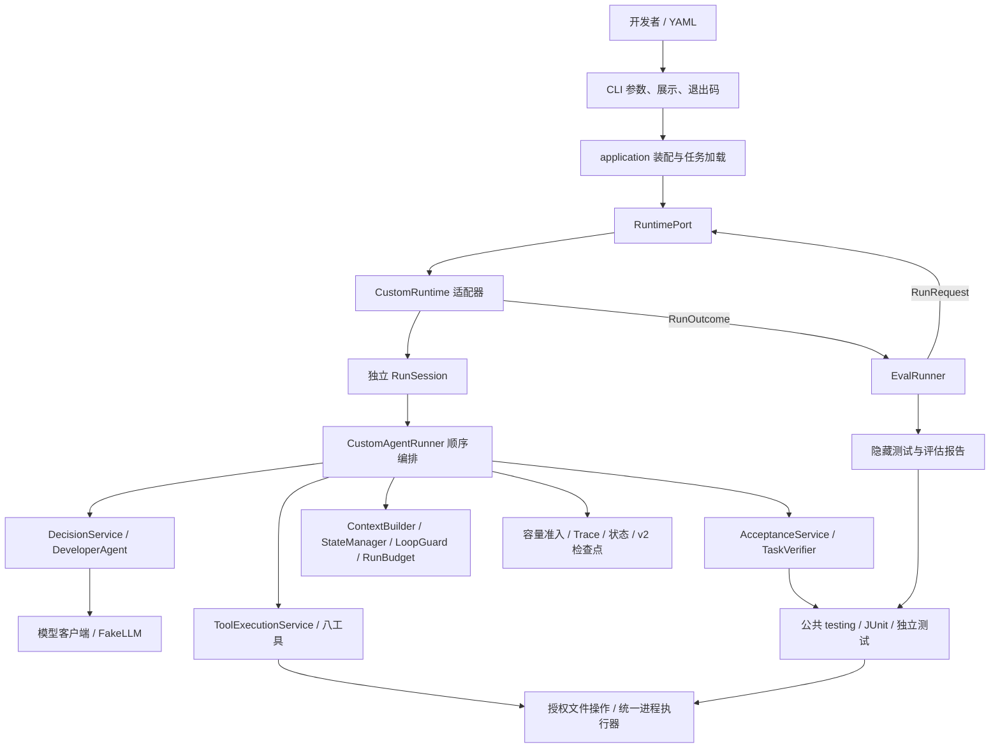
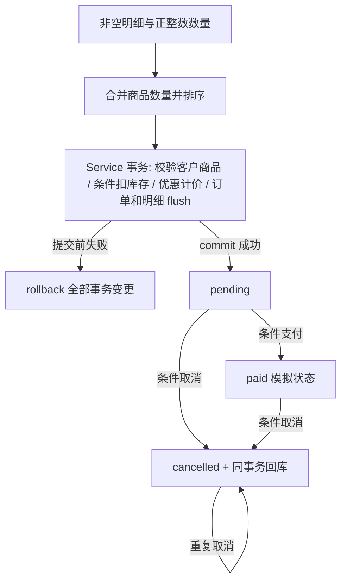

# 项目开发现状与完整架构分析报告

更新日期：2026-10-25。审查对象：CodingDev 当前工作区中的 DevPilot 与 ShopFlow；本次只更新文档，不执行开发或重新运行测试。

代码基线 HEAD：`41b027b4860354f69205ed7895de044b7f2bd39e`。P0–P2 改造仍包含工作区未提交内容，不能把 HEAD 单独当成最终实现版本。本次核对交付清单中的 130 个源码文件，SHA-256 全部一致。依赖锁、解释器、wheel 指纹见 [baseline.json](implementation-p0-p2/baseline.json) 和 [delivery-manifest.json](implementation-p0-p2/delivery-manifest.json)。

## 1. 当前完成程度与结论

**DevPilot 已具备可信本地 Python/pytest 开发任务的完整执行闭环，P0–P2 工程修复和运行边界抽取已落地；跨平台最终验收尚未闭合，LangGraph 迁移尚未开始。** ShopFlow 是可测试的订单业务样例，本轮未修改其业务，不具备生产交易系统的完整能力。

不使用缺乏统一分母的“项目完成百分比”。按代码落地、已有验证和剩余验收分别记录：

| 范围 | 代码完成程度 | 验证状态与剩余事项 |
|---|---|---|
| 本地任务、八工具、失败修复、独立验收、追踪 | 已形成完整闭环 | Fake 契约已验证；不能据此推导真实模型成功率 |
| P0 公共契约与质量基线 | 已实现 | 固定七个工具观察、八次模型请求、一次失败修复；Ruff 通过；真实模型传输阻断 |
| P1-A 读取授权与缓存 | 已实现 | 越界/敏感路径拒绝前零内容读取、缓存失效、有界读取已有回归；两项真实链接测试本机跳过 |
| P1-B 进程与全流程预算 | 已实现 | Windows 生命周期、预算与取消定向验证；Linux 路径仍待 CI |
| P1-C 容量与持久化 | 已实现协作式治理 | 配额、写失败、诊断、共享准入已有测试；不等同 OS 硬配额或长期压力验证 |
| P2 应用层、公共服务、RuntimePort、RunSession | 已实现 | 最小 RuntimePort 替身评估与 Session 隔离测试；尚无第二个真实 Runtime 实现 |
| 最终发布验收 | 尚未全部完成 | 最新全量出现的一项超时已修复并定向复测通过；修改后未再次运行完整套件，未执行远程 Linux CI |
| ShopFlow 业务样例 | 下单、库存、模拟支付、取消闭环已实现 | 已有 67 项通过；鉴权、真实资金、完整审计和幂等下单等未实现 |
| P3 框架试点 | 未开始 | 待 P0–P2 验收收尾及试点评审，不自动启动 |

六个可审查单元已整理为 [P0–P2 实施交付](implementation-p0-p2/README.md)，包括 P0、P1-A、P1-B、P1-C、P2 公共服务、P2 运行边界。它们是审查分组，不是已经提交的六个 Git 提交。本轮没有发布远程变更。

## 2. 产品定位与功能边界

DevPilot 面向开发者：从 YAML 任务和可信仓库起点建立副本，由模型决策调用受限工具，使用 pytest 反馈修复代码，最后由冻结测试与独立验收决定终态，保存差异及证据。它目前是 CLI 产品，没有常驻任务服务、Web UI、消息队列、多 Agent 调度或自动 PR/合并/部署链路。

模型层支持 OpenAI 兼容接口和 FakeLLM。当前验证使用 Fake、确定性测试及基准参考补丁，没有收费模型调用。模型协议、Prompt、原步数/修复次数和阶段规则在 P0–P2 中保持不变。任务验收继续展示 `uncovered`，没有新增严格验收模式；测试通过不能证明任意自然语言需求已被全面覆盖。

八个工具协议保持为：`repo.list_files`、`repo.search_code`、`repo.read_file`、`code.apply_patch`、`code.create_file`、`test.run`、`git.diff`、`git.status`。没有通用 shell 工具，但 pytest 可以执行 Python，因而不能把工具名单当成宿主权限隔离。

## 3. 当前整体架构



### 3.1 模块职责与依赖

以下路径均相对仓库根目录：

| 模块 | 当前职责 |
|---|---|
| `devpilot/devpilot/cli.py` | run/resume/inspect/diff/eval/benchmark-check/workspace-report；参数、显示与退出码，保留兼容导出 |
| `devpilot/devpilot/application/bootstrap.py` | 任务加载、模型与工具装配、Fake/smoke 初始化 |
| `devpilot/devpilot/application/runtime.py` | CustomRuntime；每次执行建立 runner 与服务，将内部证据转为公开结果 |
| `devpilot/devpilot/runtime/contracts.py` | RuntimePort、RunRequest、RunOutcome、WorkspaceStart、FrozenPolicy |
| `devpilot/devpilot/runtime/custom/session.py` | RunSession：计数、指标、预算、缓存、验证状态和服务依赖 |
| `devpilot/devpilot/runtime/custom/runner.py` | 自定义顺序循环与恢复编排；保留 run(task) 门面 |
| `devpilot/devpilot/runtime/custom/services.py` | 决策、工具执行、独立验收服务 |
| `devpilot/devpilot/runtime/custom/` 其他模块 | 上下文、业务状态更新、循环守卫、恢复协议 |
| `devpilot/devpilot/runtime/budget.py` | 全流程与累计验收预算、快照与恢复 |
| `devpilot/devpilot/domain/`、`agents/`、`llm/` | 任务/状态/决策模型、DeveloperAgent、模型适配与 Fake |
| `devpilot/devpilot/tools/`、`security.py` | 八工具、别名归一、授权路径、敏感文件与链接限制 |
| `devpilot/devpilot/execution.py`、`processes.py` | 执行策略上下文、取消、有界输出、进程树和线程收尾 |
| `devpilot/devpilot/storage.py`、`workspace/` | 物理容量、共享锁与预留、原子写、工作区与产物 |
| `devpilot/devpilot/testing/` | 公共 JUnit 解析与独立测试执行，不反向依赖 evals |
| `devpilot/devpilot/verification/` | 原始证据冻结、候选构建和独立验收 |
| `devpilot/devpilot/evals/` | 数据集、公开 RuntimePort 消费、隐藏测试及评估结果；保留旧公共函数兼容出口 |
| `devpilot/devpilot/tracing/` | Trace、请求/Token/工具/重试统计 |
| `shopflow-order-service/app/` | FastAPI、Service、Repository、ORM、Schema 与数据库 |
| `scripts/`、`.github/workflows/ci.yml` | 基准自检、包外安装检查、Windows/Linux CI 配置 |

### 3.2 运行接口与兼容约定

```python
class RuntimePort(Protocol):
    async def execute(self, request: RunRequest) -> RunOutcome: ...
    async def resume(self, run_id: str) -> RunOutcome: ...
```

`RunRequest` 包含任务、ordinary/evaluation 用途、可信 WorkspaceStart 和冻结执行策略。`RunOutcome` 包含原 AgentRunResult、workspace/artifacts 引用、evidence、statistics、budget、state 与 final_diff。

EvalRunner 通过请求传入工作区起点，通过结果取得证据与统计，不再读取 `runner.sandbox`、`verifier.last_results`、`metrics`、`deadline` 等内部属性。具体适配器内部可以收集这些数据，但评估调用者不依赖其存在。无上述属性的最小替身已纳入测试；接口独立性不等于第二种框架已实现。

原 `run(task) -> AgentRunResult`、CLI、任务 YAML、工具名称/参数、旧报告读取和完成/失败退出码保留。每次 CustomRuntime 执行建立独立依赖；旧 runner 实例并发执行明确拒绝，同一 run_id 仍只允许一个执行者。客户端、锁、进程句柄不进入检查点。

### 3.3 技术栈和版本依据

主体为 Python 3.12、asyncio、自定义 Runtime、Typer/Rich、Pydantic、OpenAI SDK、PyYAML、Git、可选 rg、pytest、Ruff、uv/Hatchling。ShopFlow 使用 FastAPI、SQLAlchemy 与 SQLite；没有 Redis、任务数据库或对象存储。

交付基线记录 Python 3.12.13、Pydantic 2.13.4、OpenAI SDK 3.5.0、pytest 9.1.1、Ruff 0.16.4。精确依赖以各项目 `uv.lock` 为准；本次没有升级依赖，也没有联网核对软件最新版本。上述是本地交付环境事实，不是远端运行环境保证。

## 4. 任务生命周期、状态与恢复

1. CLI 交由应用层加载任务、冻结策略并选择普通副本或 Benchmark 起点。
2. 在准备工作区之前建立全局 deadline；准备阶段包含副本、Git 初始化、身份计算和冻结证据。
3. 建立 RunSession、运行锁、状态、Trace 与检查点；模型动作之前冻结原文件、测试和保护规则。
4. 构建有界上下文，经 DecisionService 获得结构化决策并规范工具别名，请求尝试与重试统一记账。
5. ToolExecutionService 执行工具；授权、输出、时间和容量守卫贯穿文件与进程路径，观察反馈更新状态。
6. 测试失败或验收拒绝进入既有修复循环；达到请求/步数/重试/时间/容量限制则结束，不继续派发操作。
7. 模型提出完成后进入独立验收：基于可信证据构造候选，执行冻结测试及相关检查，保留 `uncovered`。
8. 保存结果、差异、统计和预算；评估用途继续执行隐藏测试，消费同一任务全流程和剩余验收额度。

恢复只允许确定的安全边界。新检查点版本为 2，预算语义为 `whole_task_v2`；旧版本可查看但拒绝新版续跑，不自动转换。恢复继承请求记账及绝对截止时间，停机时间不会返还。身份或冻结证据不匹配、损坏检查点、失败标记、工具或验收执行中的不确定状态均不能被当成可自动恢复任务。

没有完整副作用操作日志，也没有新增人工审批生命周期。无法确认写入结果时返回 `manual_recovery_required`，需要人工检查；不通过强行重跑掩盖不确定写入。

## 5. 权限、资源与持久化治理

### 5.1 读取、缓存、上下文与补丁

Runner 的授权前读文件缓存旁路已移除。ReadFile 每次先检查规范路径、敏感文件和链接，再进入读取/缓存路径；工作区根目录链接也拒绝。缓存键包含规范路径、读取范围、内容摘要及输出额度，内容分块计算摘要，避免同大小、同 mtime 修改返回旧内容。缓存为有界 LRU，不负责绕过授权。

读取采用分块处理和有界结果构造，超长单行不会先完整载入再截断；读取/搜索保留明确截断标记。搜索覆盖 rg 与 Python fallback。补丁等需要完整内容的操作超限明确失败，回滚原内容也受容量限制，不使用截断内容继续应用。

ContextBuilder 已有字符硬上限和 schema 预留，无法满足时明确失败；字符约束不是 tokenizer 精确 Token 上限。未知 usage 保持未知，不伪造 Token 或费用。

### 5.2 预算的实际语义

所有环境变量使用 `DEVPILOT_` 前缀。默认值来自当前 settings，不读取私有密钥配置。

| 配置 | 默认 | 当前约束 |
|---|---|---|
| max_run_seconds | 1800 秒 | 准备、模型、工具、独立验收、隐藏评估和恢复停机时间的完整任务截止时间 |
| preparation_timeout_seconds | 120 秒 | 准备、Git 初始化、身份与证据冻结合计上限 |
| llm_timeout_seconds | 120 秒 | 单次模型请求，另受全局限制 |
| tool_timeout_seconds | 120 秒 | 单次工具调用，另受全局限制 |
| test_timeout_seconds | 120 秒 | 单次 pytest，叠加当前工具/验收与全局剩余额度 |
| evaluation_timeout_seconds | 120 秒 | 独立验收和隐藏测试累计执行上限，重试不重置 |
| max_tool_output_bytes / max_test_output_bytes | 各 2 MiB | UTF-8 工具输出及测试输出有界，结果构造和进程输出均受限制 |
| max_context_chars | 30000 | 上下文字符上限，不等同 Token 数 |
| max_steps / max_llm_requests | 30 / 90 | 工具观察步数与所有模型请求尝试分别计数 |
| workspace_max_bytes / workspace_total_max_bytes | 256 MiB / 2 GiB | 单工作区与共享根目录物理文件计数 |
| run_artifacts_max_bytes / runs_total_max_bytes | 512 MiB / 4 GiB | 单运行与共享产物根目录物理文件计数 |
| diagnostic_reserve_bytes | 8 MiB | 单运行产物额度内部的诊断保留空间，普通产物不得占用 |

每次操作取全局、阶段、操作限制的最小剩余值。超时允许必要清理，不再派发新操作；不承诺任意宿主系统调用可在截止瞬间被抢占。

### 5.3 进程与取消

Git、rg、pytest 以及准备/验收 Git 调用接入统一进程执行器。它支持 stdin、独立 stdout/stderr、有界捕获、取消及进程树清理；Windows 使用 Job Object，POSIX 使用进程组。Windows 候选在可信启动器绑定 Job 后才启动。

取消等待自己启动的进程树和 I/O 工作线程退出；补丁在确认进程清理后回滚。写入或准备不能以“停止 await、后台继续执行”冒充取消完成。清理无法确认时明确失败。

### 5.4 容量准入与持久化

容量按物理文件计算，包含 Git、日志和生成文件，不复用模型可见文件过滤。Trace、测试日志/XML、状态、检查点、结果进入统一治理；原子替换检查旧文件与临时新文件同时存在时的峰值，而非只比较最终文件大小。

共享根目录使用跨进程 OS 锁串行准入，并写预留记录；锁竞争返回明确的 `shared_capacity_busy`。异常预留仅在持锁核对实际文件后回收，不删除既有证据。这是合作进程间的容量准入，不是任意候选程序宿主写盘的硬隔离。

普通产物不能侵占诊断保留空间，诊断自身也不无限豁免。容量耗尽后停止新操作，能保存时只写有界失败诊断；完整检查点无法写入时标记不可恢复，不保存截断却看似有效的检查点，也不把完整检查点转存到临时目录逃避额度。磁盘故障返回持久化错误，小型紧急诊断仅尽力保存。Trace 写入失败阻止继续调度，不宣称持久化成功。

### 5.5 产物与剩余安全边界

主要产物包括可信 manifest/baseline、workspace-metadata、checkpoint/state、trace.jsonl、测试 log/XML、verification/hidden 目录、final.diff、result.json、llm-requests.json、eval_result.json 以及失败时的 failure.json。检查点是恢复账本，Trace 不是完整可重放副作用日志；普通失败任务不保证存在最终 diff。

系统仍为 `trusted_local`：路径保护、环境白名单、密钥脱敏和进程树治理已实现，但不限制候选程序全部宿主文件/网络权限，`network_access` 不构成强制网络隔离。默认保留历史工作区与证据，只读容量报告给出人工归档候选，没有自动清理策略。

## 6. ShopFlow 业务现状（本轮未改动）

### 6.1 ShopFlow 业务及事务边界

客户、商品和优惠券由开发者准备数据或显式运行 seed；HTTP 侧没有完整管理写接口。创建订单的真实顺序为：

1. Schema 拒绝零/负数、非整数/布尔数量和空明细；Service 再次防御内部调用绕过。
2. 合并同商品重复行的数量，验证客户存在；按 product_id 固定顺序取商品、按现价计价。
3. 每项库存通过数据库条件 UPDATE 扣减，只有 `stock + delta >= 0` 且影响一行才成功；不是先读 stock 再无条件写回。
4. 如有优惠码，查询优惠券并计算折后总额；不存在的优惠码抛错，当前事务内扣减回滚。
5. Repository 创建 pending 订单和合并后的明细，只 flush；Service 统一 commit。提交前任一校验、库存或写明细环节失败会 rollback，不遗留部分订单/扣减。
6. 支付通过 pending→paid 条件更新；并发至多一个成功，重复支付 409。它仍仅模拟状态，没有资金/回调/支付网关。
7. 取消仅允许 pending/paid→cancelled；首次取消和按明细回库在同一事务提交；重复取消返回当前结果、不重复回补。shipped/completed/未知状态拒绝，paid 取消也没有真实退款。



业务闭环到“原子下单与库存变更、支付状态模拟、取消释放库存”。没有发货、签收完成、退货、结算、真实支付或退款。Service 在 commit 后仍有 refresh/读取/HTTP 响应窗口，不能承诺提交后的响应异常可撤销已提交订单；缺少业务幂等键的剩余影响见第 8 节。

依据：`app/schemas/order.py`、`app/services/order_service.py`、`app/repositories/order_repository.py::create/transition_status`、`app/repositories/product_repository.py::update_stock`（均在 ShopFlow 项目内）。

### 6.2 核心数据库表与关系

DevPilot 使用 Pydantic/JSON，无任务数据库。ShopFlow 使用 `sqlite:///./shopflow.db`，文件位置相对服务 cwd；启动 lifespan 执行 create_all，没有生产迁移管理。

| 表 | 主要字段与关系 | 当前限制 |
|---|---|---|
| customers | id/name/email，一对多 orders | 无邮箱唯一性/通用标准化与账户鉴权 |
| products | id/name/price(Float)/stock(Integer) | Service 路径条件扣库存；无数据库 stock>=0 CHECK |
| orders | customer_id/status(String)/total_amount(Float)/created_at | 无数据库状态枚举 CHECK、请求幂等键或支付凭证 |
| order_items | order_id/product_id/quantity/unit_price | Service 合并同商品且验证正数量；DB 未加正数/重复组合约束 |
| coupons | code 唯一、类型/折扣值(Float) | 订单未关联优惠券记录；无期限、配额等完整优惠规则 |

Order.items 为 delete-orphan 关系、详情 selectinload；模型外键声明不代替数据库强约束验证，未见连接显式启用 SQLite foreign_keys PRAGMA。订单未保存原额/折扣额/优惠券 ID 或完整状态事件，金额仍为 Float。直接手工 DB 写入不受 API/Service 防御等同保护。

### 6.3 ShopFlow HTTP 接口

| 接口 | 当前真实行为 | 边界与状态码 |
|---|---|---|
| GET /health | 固定 status=ok | 不探测数据库或外部系统 |
| GET /customers/{id} | 按 ID 读取客户 | 不存在 404；无鉴权，含邮箱 |
| GET /products、GET /products/{id} | 商品列表/详情 | 详情不存在 404；列表无分页/搜索 |
| POST /orders | 校验/合并/计价/条件扣库/订单与明细同事务 | 201；非法数量/空单 422；不存在客户/商品/优惠码或库存不足 400 |
| GET /orders | skip>=0、1<=limit<=100，按 ID 排序 | 非法分页 422；无状态/客户筛选、总数 |
| GET /orders/{id} | 详情与 selectinload 明细 | 不存在 404；无用户归属权限 |
| POST /orders/{id}/pay | 数据库 pending→paid 条件更新 | 成功返回订单；重复/非法状态 409，不存在 404；无真实支付 |
| POST /orders/{id}/cancel | pending/paid→cancelled，状态与回库同事务 | 重复返回当前结果；非法状态 409，不存在 404；无真实退款 |
| POST /coupons/validate | 按码查询、折扣试算 | 不存在 valid=false；无期限/额度/使用次数管理 |

订单创建、详情、支付、取消路由将 locked/busy 类 OperationalError 映射为明确 503，不做应用层无限重试；不是所有数据库错误或所有列表路由的统一 503 机制。SQLite 连接自己的锁等待仍受其配置/默认行为约束。

没有前端入口悬空问题可陈述，因为没有业务前端；缺口主要在通用验收/生产隔离及完整交易链。seed 现在按明细→订单→优惠券/商品/客户清理后重建，临时库验证可重跑；它会删除开发数据，不是保留生产数据的迁移工具。本次未对实际 shopflow.db 执行 seed。

## 7. 评估体系与验证证据

### 7.1 评估含义

Fake smoke 验证固定工具轨迹、修复循环和最终验收，比较排除随机 ID、时间戳与临时路径。八任务 Benchmark 使用 v1.1 包内 44 文件基线、冻结起点和参考补丁，检查题目初始缺陷及修复后的可见/隐藏测试。两者均不计为真实模型能力成功率。

ShopFlow 当前业务与冻结题库分开演进：状态筛选、邮箱通用标准化和完整审计字段仍不是现有业务能力；取消、分页、折扣、详情预加载和重复支付已有实现。不能根据题目存在就断言业务代码仍有同名缺陷，也不能因样例已修复就改写冻结基准起点。

### 7.2 已保存的本地验证

以下引用 2026-10-24 实施阶段保存的记录。本次文档更新未重新执行这些测试；数量不跨轮次相加。

| 证据 | 结果 | 适用范围 |
|---|---|---|
| [完整通过基线](implementation-p0-p2/pytest-validation.txt) | 527 通过、2 跳过 | 最后容量加固之前的完整运行 |
| [最新完整回归](implementation-p0-p2/final-tests.txt) | 528 通过、2 跳过、1 失败 | 旧模型超时测试的外层 5 秒等待在准备阶段耗尽 |
| [收尾定向回归](implementation-p0-p2/final-focused.txt) | 44 通过 | 包含请求预算、CLI 和新增边界 |
| [超时单项复测](implementation-p0-p2/final-timeout-recheck.txt) | 1 通过 | 外层等待改 30 秒；模型 10 毫秒限制与三次请求断言保留 |
| [恢复与故障标记](implementation-p0-p2/final-recovery-markers.txt) | 3 通过 | Trace 写失败、旧检查点、失败标记 |
| [最终路径权限回归](implementation-p0-p2/final-path-security.txt) | 17 通过、2 跳过 | 含根链接拒绝前零内容读取；真实链接创建权限不足导致跳过 |
| [ShopFlow](implementation-p0-p2/shopflow-tests.txt) | 67 通过 | 样例业务回归 |
| [DevPilot Ruff](implementation-p0-p2/final-ruff.txt)、[ShopFlow Ruff](implementation-p0-p2/shopflow-ruff.txt) | 均通过 | 静态检查 |
| [Benchmark 自检](implementation-p0-p2/final-benchmark.txt) | 8/8 通过 | 数据集与参考补丁自检 |
| [wheel 包外安装](implementation-p0-p2/final-wheel-install.txt) | 通过 | 安装后 CLI、评估资源与执行路径验证 |

最新全量的已知失败已定向修复和复测，没有遗留的已知测试失败；**这不等于最终修改后已有一次完整全绿记录**。当前两个真实链接测试仍跳过。CI 文件已经配置 Windows/Linux 矩阵，但本轮未推送、未触发远程 CI，本机也没有可用 Linux 发行版完成替代验证。因此不能写成“Windows/Linux CI 均通过”或“所有完成判据均已满足”。

源码版本由工作区加交付清单共同标识。最终 wheel 为 `devpilot/dist/devpilot-0.1.0-py3-none-any.whl`，指纹记录于交付清单；包外检查不等于安装环境完整复跑全部业务测试。

## 8. 已解决问题与剩余风险

| 事项 | 当前状态 | 仍需注意 |
|---|---|---|
| Runner 授权前读取与旧缓存 | 已修复 | 本地并发恶意改写不构成 OS 隔离保证 |
| 整文件/超长行读取后才截断 | 已改为分块和有界构造 | 完整内容操作超限必须失败 |
| Git/rg/pytest 生命周期分散 | 已统一执行器 | Linux 平台证据待补 |
| 准备不计总预算、恢复刷新额度 | 已落实完整任务预算 | 收尾清理可越过执行截止点 |
| 独立验收/隐藏测试预算分离 | 已以累计额度及公开快照衔接 | 后续适配器须遵守同一契约 |
| Git/日志漏计、诊断无限豁免 | 已纳入物理容量与有界诊断 | 外部任意写入没有硬磁盘隔离 |
| 共享容量非原子准入 | 已加跨进程锁与预留核对 | 采用串行准入；高并发吞吐、长期压力仍待专项验证 |
| Trace/检查点失败被当成功 | 已显式失败、保留不可恢复标记 | 磁盘完全不可写时不能保证诊断落盘 |
| CLI 装配和评估内部属性耦合 | 已抽应用层与 RuntimePort | 服务抽取不等于完成 LangGraph 迁移 |
| 工具/Verifier 反向依赖 evals | 公共 testing 已抽出 | 兼容导出仍保留，需避免新增回流 |
| 自然语言需求验收不足 | 保持既有 uncovered | 严格验收、阶段语义与 Prompt 改进另立任务 |
| 不确定副作用恢复 | 明确拒绝自动恢复 | 未实现完整操作日志、补偿或人工审批状态机 |
| 真实模型效果与费用 | 尚无本轮证据 | Fake/参考修复不能替代真实能力评估；未知 Token 不估算费用 |
| ShopFlow 提交后响应异常 | 仍有风险 | commit 后 refresh/响应失败不能撤销提交，缺幂等键时客户端重试可能重复下单 |
| ShopFlow 生产能力 | 明确未完成 | 无鉴权/对象归属、金额使用 Float、DB 约束有限、无真实支付退款及完整审计 |

## 9. 后续任务与验收顺序

1. **先闭合 P0–P2 验收。** 对最终工作区执行完整 DevPilot 回归；在可创建链接的 Linux CI 和 Windows CI 上验证进程、链接、恢复及容量路径，保存源码指纹与结果。不能用局部测试数量替代完整验证结论。
2. **完成可审查交付。** 按六个单元审查行为差异、兼容导出、预算和资源边界；需要提交/发布时再形成对应版本，保留旧证据和检查点。
3. **进入 P3 试点评审。** 在 RuntimePort 后评估 LangGraph 适配，复用公共工具、testing、验收、预算和契约。先比较同输入行为，再决定是否迁移；本次没有开始试点。
4. **单独规划能力与产品增强。** 真实模型评估需要明确预算与授权；严格验收、阶段语义、Prompt、OS/网络隔离、长期压力测试、多 Agent 和服务化均另列范围。ShopFlow 的生产改造独立于 Runtime 迁移。

回退按审查单元撤回未验证改造，保留已验证的授权修复；不删除用户工作区、历史报告和检查点，不使用旧运行器强行恢复 v2 检查点。公共接口通过兼容门面保持旧入口可用。

## 10. 文档与证据索引

- [P0–P2 交付说明及六个审查单元](implementation-p0-p2/README.md)
- [基线版本与锁文件指纹](implementation-p0-p2/baseline.json)
- [最终源码、wheel 与验证状态清单](implementation-p0-p2/delivery-manifest.json)
- [2026-10-24 架构审查验证记录](architecture-review-2026-10-24/06-validation.md)
- [本次更新前的 2026-10-17 报告快照](历史审计/项目开发现状与完整架构分析报告_2026-10-17_更新前快照.md)

本次同步以当前代码、指纹及落盘验证为准，替换了旧报告中的“准备后才开始总预算”“逻辑文件容量”“诊断无限豁免”“无共享原子准入”“评估读取 Runner 内部属性”等过时结论。ShopFlow 业务、表结构和 HTTP 接口说明沿用前次核查，明确本轮没有修改业务或重新执行业务审计。历史计数不再作为当前完整验收结论。
